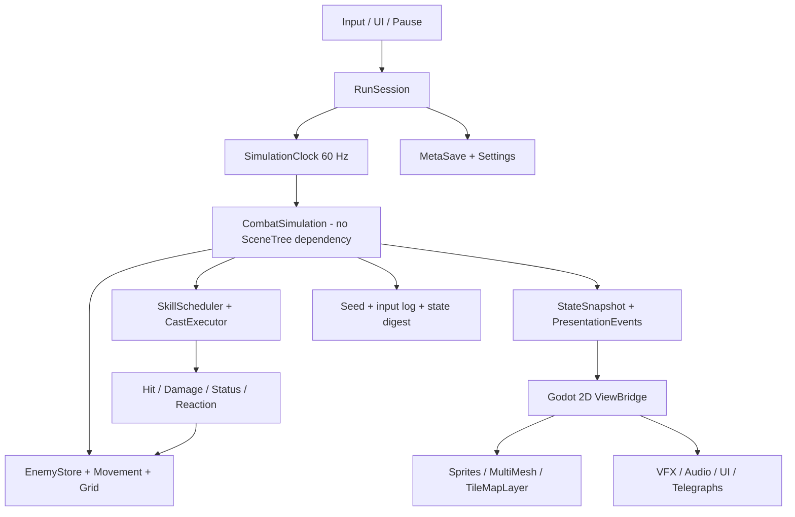
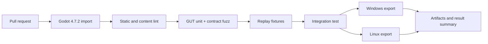
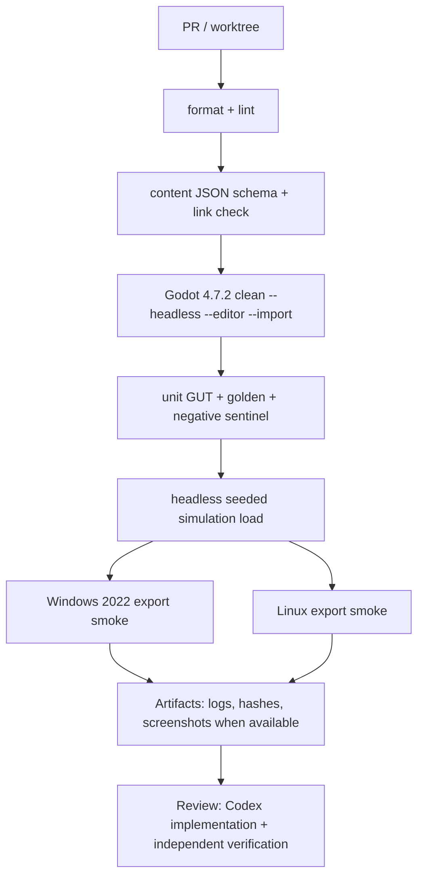
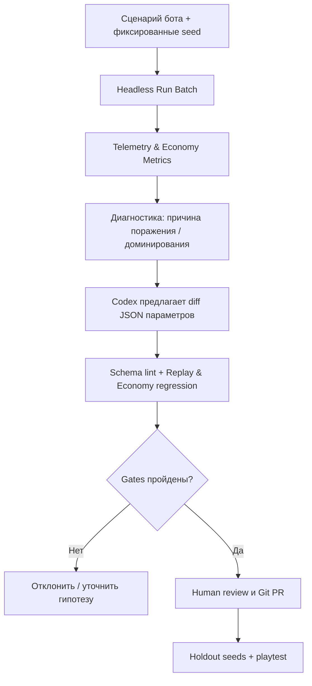

# Xianxia Survivors — архитектура v6.0: боевой движок, классы, метапрогрессия, мультиязычность, режимы и баланс

**Проверка:** 11 ноября 2026 года. **Редакция:** v6.0 (v5 + утверждённая метапрогрессия, языки, режимы, конфиги, боты и экономика). **Язык:** русский. **Статус:** design/research, не результаты реализации. **База аудита:** локальные документы `Xianxia_Survivors_Architecture_v3_RE_Godot2D_Codex_2026-11-11.md` (1238 строк) и `Xianxia_Survivors_Architecture_v4_Critical_Audit_2026-11-11.md` (1290 строк), официальные документы Godot 4.7, первичные GitHub-репозитории, пользовательские технические отчёты осени 2026. **Цель:** сделать архитектуру конкретной настолько, чтобы AI-агенты могли реализовать и проверять отдельные срезы без свободной интерпретации основных правил.

> **Непересматриваемые требования пользователя:** Godot **2D** (основная версия **4.7.2 stable**), типизированный GDScript, нативный hot path на **GDExtension C++ или Rust/gdext только после профилирования**, 2D-изометрический/three-quarter стиль, основные автоматические атаки в духе **Vampire Survivors и Soulstone Survivors**, обилие накопительных статусов/мультикастов, разработка и графика через **Codex + встроенный GPT imagegen**, ChatGPT Plus, Claude Pro/Claude Code, OpenCode Go, **NVIDIA 12 ГБ VRAM, 32 ГБ RAM**, без дополнительных платных API. Никакого возврата к сравнению Unity/Bevy/3D runtime.

**Утверждено дополнительно 11.11.2026:** общее дерево талантов секты; классовое мастерство; достижения/разблокировки; четыре архетипа (меч, гром, талисманы, тело), сначала реализация двух; несколько сценарных ботов и `PlayerCommand`; готовность к RU/EN с первого вертикального среза и к дополнительным языкам; конфигурируемые сложности, карты, mutators и экономические таблицы. Главы P–AE версии v6 являются нормативными и заменяют конфликтующие ранние рекомендации. Численные значения геймбаланса ещё не проверены.

**Степень доказанности:** «официальный API» ≠ «лучшее решение под конкретную игру»; «пост разработчика» ≠ «воспроизведённый бенчмарк»; «архитектурное предложение» ≠ «реализовано в репозитории». Всё, что требует профилирования и игры, далее помечено как *гипотеза*, *предложенный контракт*, либо *acceptance test*.


**Новые разделы v6:** P–AE описывают многоязычность, отдельные пресеты сложности и режимы, контракт конфигурации, классы, валюты, покупку/возврат талантов, независимое классовое XP, валидатор, систему бот-прогонов, расширенный reverse engineering, изменённый roadmap и принятые риски.

**Изменения v5 относительно v4.** Дополнено системным аудитом **всех 32 глав v4**, реальной семантикой повторных попаданий, event budget на уровне контента, моделями игрока/элит/боссов, критическими ограничениями Godot 2D presentation, планом Codex-анимаций, смысловыми геймдизайнерскими выборами, UI/audio/control contracts, build-specific code-first reverse engineering, dependency tiers, свойствами replay и вертикальным playable slice. Последующие главы **дополнения A–O являются нормативными уточнениями**: при расхождении с более ранними разделами v4 действуют правила v5. Они не означают, что код или игровые бенчмарки уже выполнены.

**Ключевой принцип реализации:** никакие p95/FPS, стабильность конкретного MCP, точность чужого декомпилированного кода и воспроизводимость replay при обновлении Godot не объявляются подтверждёнными без соответствующего теста и артефакта.

## Оглавление

- [00. Executive decision и ключевые исправления](#s00)
- [01. Аудит всех 27 глав v3: пропуски и последствия](#s01)
- [02. Границы игры, продуктовые критерии и недопущение scope creep](#s02)
- [03. Версии Godot и выбор 2D-рендерера](#s03)
- [04. Runtime-система и явная модель времени](#s04)
- [05. Content definitions: типы, каталог, схемы, статические проверки](#s05)
- [06. Auto-cast scheduler: полный контракт](#s06)
- [07. Damage/stat modifier pipeline и математические ограничения](#s07)
- [08. Статусы: четыре семантики стаков и планировщик DoT](#s08)
- [09. Effect/proc engine: циклы, события и безопасные цепные реакции](#s09)
- [10. Spatial query и targeting: структуры и алгоритмы](#s10)
- [11. Орда: движение, разделение, группы, спавн и волны](#s11)
- [12. Логические снаряды, попадания, ауры и зоны](#s12)
- [13. Replay, RNG, детерминизм и отладка расхождений](#s13)
- [14. Godot 2D presentation: проекция, Y-sort, MultiMesh, анимации](#s14)
- [15. VFX, телеграфы, damage numbers, UI и доступность боя](#s15)
- [16. AI asset factory: Codex GPT + локальный детерминированный QA](#s16)
- [17. Атласы, память, импорт и визуальная консистентность](#s17)
- [18. Геймдизайн культивации и спецификация первых способностей](#s18)
- [19. Баланс, массовые симуляции и экспериментальный дизайн](#s19)
- [20. Сохранения, настройки, конфигурация и диагностика](#s20)
- [21. Зависимости и инструменты: pin-матрица на 11.11.2026](#s21)
- [22. Skills, MCP и разделение труда AI-агентов](#s22)
- [23. Reverse engineering обеих игр: code/data-first, протокол доказательств](#s23)
- [24. Профилирование, CPU/GPU gates и поздний GDExtension](#s24)
- [25. Тесты, GitHub Actions, CI и реальные метрики](#s25)
- [26. Структура репозитория, ADR и контракты](#s26)
- [27. План P0—M4, сроки условные, измеримые критерии](#s27)
- [28. Непроверенные допущения и риск-регистр](#s28)
- [29. Готовые задачи для Codex/Claude/OpenCode](#s29)
- [Дополнение A. Аудит всех 32 глав v4: критические недоопределённости](#v5_audit)
- [Дополнение B. Зафиксированные решения и статус доказательств](#v5_decisions)
- [Дополнение C. Combat Semantics Contract: повторные попадания, урон, стаки](#v5_semantics)
- [Дополнение D. Экономика событий и защита от взрыва proc chains](#v5_budget)
- [Дополнение E. Игрок, враги, элиты и боссы: полный игровой цикл](#v5_enemies)
- [Дополнение F. Godot 2D: визуализация, MultiMesh, сортировка и FX](#v5_visual)
- [Дополнение G. Конвейер Codex/GPT-imagegen и QA анимации](#v5_assets)
- [Дополнение H. Xianxia gameplay, билды, культивация и баланс](#v5_design)
- [Дополнение I. Управление, UI, звук, доступность и читаемость](#v5_ux)
- [Дополнение J. Code-first RE: версии сборок, формулы, доказательства](#v5_re)
- [Дополнение K. Зависимости, CI, MCP и разделение труда AI-агентов](#v5_tools)
- [Дополнение L. Тестовая стратегия и синтетические бенчмарки](#v5_tests)
- [Дополнение M. Сохранения, диагностика, GitHub Actions](#v5_ci)
- [Дополнение N. План PR/milestone и gates приёмки](#v5_scope)
- [Дополнение O. Риск-регистр и приоритеты](#v5_risk)
- [30. Реестр первичных и пользовательских источников](#s30)
- [31. Исторический CURRENT_STATE v5](#s31)

### Утверждённая редакция v6 (приоритетнее ранних разделов)

- [P. Решения, одобренные для реализации](#v6_decision)
- [Q. Мультиязычность и локализация Godot 4.7](#v6_i18n)
- [R. Уровни сложности и Director](#v6_difficulty)
- [S. Режимы и испытания: совместимость](#v6_modes)
- [T. Конфиги, схемы, валидаторы и AI-workflow](#v6_config)
- [U. Валюты и постоянное развитие](#v6_economy)
- [V. Награды, экономика и антифарм](#v6_rewards)
- [W. Классы, мастерство и дерево талантов](#v6_classes)
- [X. Игровые боты и массовые сценарии](#v6_bots)
- [Y. UX от выбора класса до новой попытки](#v6_ux)
- [Z. Reverse engineering меты, режимов и валют](#v6_re)
- [AA. Обновлённый roadmap](#v6_roadmap)
- [AB. Задания для AI-агентов](#v6_tasks)
- [AC. Риски и ограничения](#v6_risks)
- [AD. Источники осени 2026](#v6_sources)
- [AE. CURRENT_STATE](#v6_state)


<a id="s00"></a>
## 00. Executive decision и ключевые исправления

**Рекомендация:** сохраняем *Godot 4.7.2 / 2D / typed GDScript / built-in GPT imagegen*, но перепроектируем v3 из «набора подсистем» в **две чётко разграниченные машины**: (1) **Combat Simulation** (детерминированная, самостоятельная, покрыта тестами), (2) **Presentation/Experience** (Godot nodes, рендерер, VFX, звук, интерфейс). Между ними — версионированные события и снимки состояния, а не глобальные `signal`-цепи.

**Самые дорогие ошибки v3:**

1. Нельзя обобщать «один MultiMesh = оптимальная изометрическая толпа»: индивидуальное перекрытие по Y, несколько атласов и разные кадры анимации противоречат монолитному инстансингу.
2. Нельзя ограничить «процессинг до K событий за тик» без обоснования, куда деваются оставшиеся эффекты: скрытый сброс ломает баланс, бесконтрольная очередь переносит лаг на будущие тики. Требуется формальная proc-семантика с *контрактными верхними границами* и эквивалентным coalescing там, где это допустимо.
3. Нельзя хранить каждый ядовитый стек как таймер/ноду: типы статусов должны иметь разные семантики, а `status_tick` выполнять периодический scheduler без сканирования каждого активного эффекта на каждом кадре.
4. Нельзя заявлять воспроизводимый replay, не определив порядок обхода целей, ID с поколением, стабильность RNG, версии content и процедуру проверки локальных/межплатформенных отличий.
5. Нельзя считать достаточным «3 умения + 3 статуса»: необходима *узкая вертикаль*, но со всеми фазами: gameplay input → skill readiness → projectile/area → hit → status → reaction → kill → XP → upgrade → replay → представление.
6. Нельзя рассчитывать на GPU/CPU оптимизацию из сообщений форума как на гарантию; тестировать и полный кадр с VFX, и headless чистое ядро.
7. Нельзя устанавливать сразу несколько MCP, систем оркестрации и сотни skills. Минимальный набор даёт более воспроизводимую работу и уменьшает конфликт версий и контекста.
8. Нельзя забывать настройки видимости FX, паузу на upgrade, сохранение метапрогрессии, gamepad/input, crash diagnostics и экспорт: это не «позже», а лёгкие контракты с начала, реализация по milestone.

**Главное изменение:** подход *skill definitions → combat IR → deterministic execution* вместо «каждая способность — отдельный скрипт со своими сигналами». В game design могут оставаться уникальные способности, но массовые варианты выражаются небольшим набором **типизированных примитивов**.

<a id="s01"></a>
## 01. Аудит всех 27 глав v3: пропуски и последствия

| Раздел v3 | Сильная часть | Недостаток v3 | Правка v4 | Приоритет |
|---|---|---|---|---|
| 01 Ревизия | Зафиксированы требования | Нет собственных проверочных следов | Статус фактов/гипотез и риск-регистр | P1 |
| 02 Идентичность игры | Два survivor-референса | Нет цели по контролю персонажа, билду и ясности боя | Gameplay acceptance: auto-cast без клика, читаемый dodge, различимые враги | P0 |
| 03 Источники | Публичные RE-доки | Непостоянные версии и неодинаковая надёжность | Build fingerprint и доказательства по каждой механике | P0 |
| 04 RE | Code-first | Не расписан переход «метаданные → реальный алгоритм» | Level A/B/C evidence, selected functions, runtime trace | P0 |
| 05 VS | Конкретные системы | Нет версионированного mechanic ledger | Таблица `claim → file/symbol → confidence → Godot test` | P1 |
| 06 Soulstone | Упомянуты IL2CPP и стаки | Много механик пока реконструируются по описаниям | Обязательный разбор order, caps, casting, aggregate ticks | P0 |
| 07 AI RE | Субагенты | Нет программно проверяемого формата заметок | `re_observation.schema.json`, hash binaries и доказательства | P1 |
| 08 RE artifacts | Сравнение механик | Нет базы конфликтов источников | Source confidence и discrepancy register | P1 |
| 09 Godot | Simulation/View | Не прописаны renderer, lifecycle, ownership, сборка data | Clock, state ownership, renderer decision gate | P0 |
| 10 Scheduler | Тики и мультикаст | Windup, reacquisition, interruption, cooldown migration недостаточно определены | State machine, owner lifetime, cancel/retry semantics | P0 |
| 11 Статусы | Фазы и proc flags | Нет канонического status ключа и таймерного индекса | Stack policy, source policy, tick scheduler и target handles | P0 |
| 12 Damage/replay | Основы seed | Нет численного формата и совместимости content | Разделить damage policy, replay seed + content hash | P0 |
| 13 Орда | Dense arrays + grid | Мало о steering, crowd pressure, связи grid и rendering | Density field, stagger, fixed support query + metrics | P0 |
| 14 Изометрия | Anchors и Y-sort | MultiMesh не совместим с произвольным пообъектным перекрытием | 2.5D render bands + individual foreground blockers | P0 |
| 15 GDExtension | Correct profile-first | Нет точной границы FFI, стоимости вызовов и fallback | Packed batch API, side-by-side replay, ABI pin | P1 |
| 16 Hardware | Учтены 12/32 ГБ | VRAM бюджеты и import-пайплайн неточные без измерения | RGBA/mip/atlas budgets, target resolution matrix | P1 |
| 17 GPT art | Нет платных API | Не описано восстановление попыток и версии ассетов | master reference, prompt hashes, rejected states, quality gates | P0 |
| 18 QA art | Pillow и screenshot | Нет генерации UV/атласных метаданных и alignment tests | Alpha, bbox, foot-anchor, visual scale, collision silhouettes | P0 |
| 19 Tools | Shortlist | Непроверенные совместимости и слишком широкий skill set | Pin-матрица, action-type allowlist, CI smoke | P1 |
| 20 Studio Igor | Корректно не runtime | Не очерчен адаптируемый минимум | Только style critique и milestone protocol | P2 |
| 21 AI subscriptions | Роли и worktree | Нет параллельного контракта и ownership conflicts | One writer per slice, owner, tests, evidence packet | P1 |
| 22 Xianxia | Стихийные реакции | Нет ограничений смешения, типов build, контрбаланса | Tag ontology, synergy matrix, level draft constraints | P0 |
| 23 Tests/CI | Логика/рендер отдельно | Нет fast/slow и проверок экспорта/отладки импорта | 4 gates: static, sim, render smoke, packaging | P0 |
| 24 Roadmap | Срезы | Механики привязаны к месяцам, не к испытаниям | Milestones с выходными артефактами и STOP-рекомендациями | P0 |
| 25 Prompts | Готовые агентские задания | Слишком открытые и слабые критерии запрета изменения других файлов | Exact File Scope + Definition of Done + tests + checkpoint | P1 |
| 26 Sources | Отделены утверждения | Точный HEAD внешних проектов не закреплён | Verified release/version vs living README, pin only after smoke | P1 |
| 27 Status | Отличает проект от исследования | Не указывает subsystem acceptance | Таблица фактов и следующее разрешённое действие | P0 |

**Проверяемый недостаток документа:** в v3 секция `10.1. SkillDefinition` повторена дважды; это небольшой редакторский дефект, но он указывает, что само исследование ещё нуждалось в structural QA. Ряд готовых промптов и схем всё ещё декларативен и не сопровождается исполняемыми контрактными тестами. В v4 это исправлено спецификацией тестов, а не фиктивным заявлением об их выполнении.

<a id="s02"></a>
## 02. Границы игры, продуктовые критерии и недопущение scope creep

### Наблюдаемая игровая петля

`Movement/dodge → passive skills cast automatically → hordes attacked → stacks/reactions build → XP drops → draft one upgrade → build changes automatically → elite/boss challenge → run reward → next run.`

**Необходимые ощущения:** интенсивная толпа VS, частый рост силы и триггерные комбинации Soulstone, но на экране всегда видны траектория героя, опасная зона противника и направление для ухода. Цель — не максимальное число частиц, а *читабельная мощь*.

**M0 / прототип:** одна арена, один герой, 2 обычных типа врагов + один опасный элитник, три auto-cast skills, три типа статуса, одна рецептура реакции, XP и меню из 3 улучшений, 5 минут игрового цикла; один boss/tribulation placeholder при завершении. Все изображения могут быть временными для проверки системы. Три навыка без leveling/upgrade loop **не** являются достаточным срезом survivor-like.

**M1:** 15–20 минут, 6–8 навыков, 4–6 архетипов врагов, минимум 2 ветки билда, один полный прорыв стадии культивации, сохранённая метапрогрессия; позднее M2 с контентом, VFX и балансом.

**Явное не-входит:** полноценная секта, диалоги NPC, алхимический crafting, открытый мир, мультиплеер, 8 направлений для каждой породы врагов, процедурный планетарный ландшафт. Арены могут быть процедурно собраны из chunked tiles, но *контент-системы* создаются только после того, как combat loop доказал интересность.

**Три критерия игрового теста:** игрок понимает, что атаковать вручную не нужно; выбирает между реальными синергиями, а не только процентами урона; умирает от распознаваемой ошибки/риска, а не из-за нечитабельной невидимой атаки. Для каждого нужен наблюдаемый playtest, не AI-оценка текста.

<a id="s03"></a>
## 03. Версии Godot и выбор 2D-рендерера

**Godot 4.7.2 stable** опубликован 18.08.2026, исходный commit `ed1daf0bf`; **4.8 beta3** опубликована 09.11.2026 и не должна быть production baseline сейчас. Официальная политика поддерживает 4.7, а 4.8 — испытательная ветка. [R01][R02][R03]

### Подвох, которого не было в v3: 2D renderer backend

Godot 4.7 имеет **Compatibility**, **Mobile**, **Forward+**. Для типичной 2D-игры официально рекомендуется начинать с Compatibility; но для HDR 2D, compute, отдельных видов частиц и post-effects возможны преимущества Forward+. В официальной таблице также указаны разные профили базовой и масштабируемой стоимости. **Не путать «выбор Godot 2D» с выбором драйвера/рендерера.** [R04]

| Критерий | Compatibility (GL) | Forward+ (Vulkan/D3D12) | Последствие |
|---|---|---|---|
| Простые 2D sprites/UI | Подходит, низкий базовый overhead | Подходит, более высокий стартовый overhead | Не выбирать по лозунгу «современнее» |
| HDR 2D viewport | Нет | Да | Для ярких xianxia эффек­тов полезен Forward+ |
| GPU compute | Нет | Да | Нынешний M0 не требует compute |
| 2D MSAA | Нет | Есть | Измерять на рисунках и шейдерах |
| Массовый overdraw | Ограничивается GPU и материалами | Ограничивается GPU и материалами | Не решается только переключением backend |
| Web-экспорт | Да | Нет | PC-first, web-порт сейчас не цель |

**Решение:** Godot 4.7.2 зафиксирован. Создать одинаковый `bench_vfx_horde.tscn`, включить 1000 врагов / 300 логических ударов за секунду / 1000 VFX-инстансов и сравнить *отдельно* Compatibility и Forward+ на 1080p и ультрашироком при возможности. До измерений не объявлять победителя. Для рабочего baseline можно начать Compatibility и *не использовать features Forward+*, пока не доказана необходимость, либо сразу Forward+ при желании HDR-свечения — но визуальный контракт должен учитывать зависимость. Это **единственный технологический A/B**, не смена движка.

### 4.7.2 pin

- Зафиксировать **Engine exact version** в `toolchain.lock.md` и CI. Сначала Linux GitHub-hosted headless job, Windows-2022 export job; каждый выполняет `godot --version`.
- Импорт ассетов делать отдельной командой `godot --headless --editor --path . --import`, затем тесты. Для `--export-release` нужен редактор и установленный набор export templates. [R05]
- При появлении 4.8 stable создать отдельную ветку upgrade, не открывать агентам возможность произвольного обновления движка.
- Настройки renderer, viewport, texture filter, Y-sort anchors и FX-quality хранить в `docs/ART_TECH_SPEC.md`, чтобы генерация новых ассетов не меняла визуальный контракт.

<a id="s04"></a>
## 04. Runtime-система и явная модель времени

### Правильный разрез приложения



**Предлагаемая ownership-модель:** `RunSession` владеет текущим `CombatSimulation`; внутри него `EntityStore`, `SkillStore`, `StatusStore`, `RngStreams`, `EventQueue`. `ViewBridge` только читает согласованный snapshot и события презентации. Запрещены прямые вызовы `EnemySprite.take_damage()`, `Particle2D.apply_poison()` и другая зависимость simulation от сцен.

**Clock:** один фиксированный основной timestep 60 Hz для движения героя, логики кастов и попаданий; отдельная частота пересчёта решений AI (`next_ai_tick`, например каждые 3–6 тиков), периодических эффектов и директора волн. Не плодить разные `Timer` для 1000 объектов. Реальная длительность тиковой очереди не должна зависеть от частоты рендеринга.

**Freeze:** при выборе улучшения `RunSession` переводится в состояние `UPGRADE_PAUSED`: combat-tick останавливается, не вызывается `randomize()`, UI и animations меню продолжают работать. Не менять произвольно `Engine.time_scale`, поскольку это затрагивает таймеры/частицы и создаёт нежелательные зависимости; hit-stop на важных ударах делается отдельной presentation-политикой либо строго согласованным замедлением.

**Phase list** (это договор команды, а не claim о Soulstone):

```text
0 Read input (stored with integer tick)
1 Apply prior queue of spawn/despawn and upgrade selection
2 Hero movement + enemy movement; rebuild/advance spatial grid
3 Skill readiness + target selection + windup/commit
4 Spawn/step logical projectiles, persistent areas and orbit hit shapes
5 Gather hit candidates, deduplicate and resolve damage
6 Apply/refresh statuses and schedule due ticks
7 Process due status ticks + authorized reactions in stable order
8 Resolve death, XP, drops, level-up requests
9 Commit state: snapshots, replay digest, presentation events
```

**Не смешивать 0/1 с Godot input callbacks:** callbacks только формируют команду `InputCommand`, привязанную к `tick` и порядковому номеру. Это единственный путь влияния кнопок и UI на симуляцию.

**Интерполяция:** Godot поддерживает physics interpolation, включая 2D, но packed-array enemies со своим renderer могут потребовать ручного `previous/current position` + alpha interpolation. Отдельно проверять телепортацию/respawn: без сброса interpolation появляются streak artifacts. GPU particles не обязаны интерполироваться тем же способом. [R06]

**Контракт snapshot:** `SimulationFrame{tick,run_id,player_state,enemy_visuals[],projectile_visuals[],presentation_events[]}`; список объектов может быть только интересующей камеру подвыборкой. `Snapshot` не содержит ссылок на `Node`; rendering не меняет simulation state.

<a id="s05"></a>
## 05. Content definitions: типы, каталог, схемы, статические проверки

**Главное улучшение:** `SkillDefinition` — только спецификация, не runtime-state и не `execute()` с произвольным GDScript. Движок читает типизированный каталог и исполняет строго поддерживаемые `action opcodes`.

### Минимальные определения

| Тип | Ключевые поля | Проверки при загрузке |
|---|---|---|
| `SkillDef` | ID, tags, cooldown, windup, target policy, effect program, cast cost | Несуществующие status/pattern IDs, отрицательный cooldown, некорректная targeting policy |
| `StatusDef` | stack policy, max stacks, lifetime, tick period, source attribution, snapshot policy | Конфликтующие refresh/expire rules, нулевой период |
| `EffectOp` | opcode, params, conditional tags, proc mask, target selector | Неизвестный opcode, запрещённая рекурсия, незаполненная цель |
| `EnemyDef` | HP, radius, speed, avoidance, attack program, loot, render family | Отрицательный радиус, неверные weighted values |
| `UpgradeDef` | eligibility, mutually_exclusive groups, modifications, rarity, cap | Circular dependencies, hidden precedence, недостижимые улучшения |
| `WaveDef` | time window, composition, spawn lanes, budget, elite events | Неверная кривая сложности, невозможная арена |
| `ReactionDef` | required tags/statuses, priority, consume rule, output actions | Циклы и unbounded fanout без явного лимита |

**Хранение:** редактируемые `Resource`/`.tres` удобны в Godot Inspector; экспортируемый YAML/JSON manifest может строиться для CI/аналитики, но не нужен как параллельный runtime-источник истины. *Не нужно* поддерживать две независимые базы definitions. Runtime stores используют ID/числовые индексы, а не копии `Resource` на каждого противника.

**ID:** стабильные `StringName`/строковые имена на уровне контента (`skill.spirit_sword`, `status.sword_mark`), преобразование в таблицу целочисленных ID при запуске. Числовые IDs внутри run могут меняться между версиями content — seed replay обязан хранить content hash, а не только целевые numbers.

**Ключевое упущение v3:** определения должны иметь **schema version** и миграцию `v1→v2` для сохранений метапрогрессии. При переименовании skill ID есть `aliases[]`/миграционная таблица, а не тихое исчезновение предмета.

**Content validation job**:

```text
load every resource -> collect ID registry
check referential integrity -> construct effect/reaction graph
check semantic bounds -> validate durations, proc flags, stack policies
check upgrade graph -> unreachable/cyclic upgrades
simulate all definitions on zero enemies and one dummy
emit manifests, content hash and warnings-as-errors report
```

Преимущество для AI-агентов: агент вправе добавлять новую технику в `.tres`, если использует поддерживаемые opcodes; новая фундаментальная механика требует отдельного ADR, теста и согласования изменения ядра.

<a id="s06"></a>
## 06. Auto-cast scheduler: полный контракт

**Используем две сущности:** `SkillDef` (immutable) и `SkillRuntime` (owner, rank, next_ready_tick, current_phase, cast_sequence, modifier-cache-key). На раннем этапе достаточно 4–8 умений игрока, но враги/суммоны также могут выполнять свои skills. Единый scheduler обслуживает собственные таймеры всех владельцев.

### Состояния каста

```mermaid
stateDiagram-v2
  [*] --> Ready
  Ready --> Acquiring: next_ready_tick <= tick
  Acquiring --> Windup: valid target & action allowed
  Acquiring --> Ready: no target; retry policy
  Windup --> Commit: windup elapsed
  Windup --> Cancelled: interrupted/owner dead
  Commit --> Echoes: primary cast succeeded
  Echoes --> Recovery: multicast complete
  Recovery --> Ready: cooldown elapsed
  Cancelled --> Recovery: cancel policy
```



**Нужны отдельные правила**, которые в v3 оставались подразумеваемыми:

- `No target`: не тратить cooldown до успешного commit (или строго заданная политика для field skills); повторная попытка через `retry_ticks`, но не каждый тик тысячами существ.
- `Target lost in windup`: `REACQUIRE | FIRE_AT_LAST_KNOWN | CANCEL`; не оставлять `target_id` без проверки `generation`.
- `Interrupted/Owner died`: отменить ещё не закоммиченный skill; выпущенные projectile/DoT могут продолжаться по `on_owner_death` policy.
- `Pause`: `ready_tick` не продвигается; `cast_sequence` не изменяется.
- `Cooldown changed by upgrade`: `NEXT_CAST_ONLY` для M0; альтернативы только по ADR. Нельзя пересчитывать прошедшую часть таймера без явной логики.
- `Cast animation`: презентация не блокирует игровую логику, кроме explicitly authored windup.
- `Multicast`: это *дополнительные Cast events* с собственными флагами источника; `allow_echo_multicast=false` для M0, предотвращая экспоненциальный рост.

### Набросок API без привязки к Godot Node

```gdscript
# Interface sketch, не утверждение о прошедшей компиляции.
class_name SkillScheduler
extends RefCounted

func advance(tick: int, skill_store: SkillStore, state: CombatState, out_events: Array[CombatEvent]) -> void:
    # 1. only due skill runtimes
    # 2. validate owner handle generation
    # 3. target policy with stable tie-break
    # 4. commit cast and optional echoes
    # 5. set next_ready_tick; no scene-tree callbacks
    pass
```

**Cooldown:** для прототипа `effective_ticks = max(min_ticks, ceil(base_ticks / (1 + haste)))`, `haste≥0`. При слишком высоком haste cooldown остаётся положительным; минимум является *балансным параметром конкретного skill*, а не искусственным скрытым ограничением. Проверить infinity/NaN и отрицательные значения при расчёте modifiers.

**Multicast:** модель v3 с `p_i = p0 · decay^(i−1)` остаётся **нашим предположением**, не восстановленной формулой Soulstone. Важно определить `max_echoes`, время между echo, snapshot stat policy, `proc_source_kind`, приоритет цели и суммарную стоимость каждого каста в goldens. Для CI строить распределение количества echo на `10^5` фиксированных seeded trials и проверять expected count `1 + Σp_i` в заданном допуске. Нельзя делать распределение зависимым от VFX RNG.

<a id="s07"></a>
## 07. Damage/stat modifier pipeline и математические ограничения

**Модель модификаторов должна быть самостоятельным модулем**, иначе через 20–50 skills появятся несовместимые суммы, проценты и эффекты, каждый с особой формулой.

### Контрактный порядок

```text
skill rank base -> owner snapshot -> additive per-tag buckets
  -> multiplicative modifier groups -> crit roll & crit mult
  -> target current vulnerability -> defense/resistance
  -> reaction factor, if allowed -> clamp & quantization
  -> HP delta (if allowed) -> event with provenance
```

Для каждого modifier: `id`, `stat_key`, `scope`, `source`, `stage`, `operation ADD|MULT|OVERRIDE|MIN|MAX`, `stack_rule`, `priority`. Коммутативные операции объединяются независимо от порядка добавления, приоритетные override исполняются детерминированно. Основываясь только на `Dictionary` с произвольным порядком и случайных скриптах, невозможно гарантировать одинаковую формулу.

**Числа:** M0 может использовать GDScript `float` с явным округлением *только при нанесении HP delta* (например, float внутри формулы, int HP на выходе). Альтернатива для более строго воспроизводимых боёв — целочисленная фиксированная арифметика для параметров и стака. Не принимать fixed-point как аксиому: точность и скорость сравниваются на золотых боях. Обязательные guards: finite values, no NaN, no negative crit chance, no dividing by zero, resistance clamp.

**Снимки:** projectile damage snapshot в момент Cast; дебафф на цели оценивается по текущему состоянию в момент Hit; snapshot-source для DoT на момент применения status для M0. Другой тип DoT может получать owner-current stats, но это отдельный trait. Это влияет на билд и replay и не должно решаться в UI-коде.

**Пример:** 10 base, +30% additive fire, ×1.2 `skill_specific`, ×1.5 crit, ×1.1 vulnerability = 25.74 до округления и защиты. Проверить точное правило округления через тест. Если мультикаст x3, базовая формула исполняется 3 раза, а проки от echo определены flags, а не по недокументированным побочным эффектам.

**Особый случай:** повторный hit по одной цели может накладывать статус, но не наносить урон, если on-hit immunity активна. Это требует раздельных flags `damage_allowed`, `apply_status_allowed`, `trigger_on_hit_allowed`; единое `Hit` без подтипов породит двойные DoT/OnKill.

<a id="s08"></a>
## 08. Статусы: четыре семантики стаков и планировщик DoT

**Ошибочный упрощённый статус:** `stacks = 5, duration = 10`. Он не определяет, что происходит при следующем наложении и отдельном истечении предыдущего стака. Необходима типизированная политика.

| Политика | Пример | State representation | Риск |
|---|---|---|---|
| `AGGREGATED_REFRESH` | Burning: суммарная сила + общий срок | `count, intensity, expire_tick, next_dot_tick` | Новое применение не должно создавать лишний tick |
| `INDEPENDENT_EXPIRY` | Sword Marks с отдельным сроком | Deque/buckets stack instances, count, owner | При 5000 врагах могут раздуться данные |
| `INTENSITY_AND_DURATION` | Poison: растёт intensity и refresh | fixed point intensity, expire, source attribution | Интенсивность и числа стаков нельзя путать |
| `THRESHOLD_CONSUME` | Thunder Charge → discharge | накопленный charge + trigger threshold | OnConsume не должен рекурсивно повторяться |

**Модели владельца:** `PER_TARGET_GLOBAL` (все источники смешиваются), `PER_SOURCE_ENTITY` (разделённые стаки каждого кастера), `PER_SKILL` (отдельные травления разных навыков). Выбор указан в `StatusDef`: иначе непредсказуемая сила summon/multicast.

**Планировщик:** due-tick events через минимальную кучу `next_due_tick` (проще M0) либо bucketed timing wheel для массовых тиков. У событий статуса ключ включает `target_handle_generation`, `status_key`, `revision_token`; после refresh устаревшая запись в очереди проверяется и отбрасывается **как отменённый таймер**, но не как событие урона. Этот нюанс предотвращает фантомные DoT после смерти цели/обновления срока.

**Не хранить mutable Resource на каждом враге:** `StatusStore` содержит компактные записи; `StatusDef` один на все экземпляры. Для массовых enemies с 1–3 статусами может оказаться выгоднее small fixed array per target, чем глобальный словарь; compare p95/memory under A=1000, 5000, 20 000 active statuses. Выбор — по профайлеру.

**Tick phase:** при `tick_due`, при отсутствии валидной цели событие отменяется; для живой цели вычисляется periodic damage, затем status может expire/consume. Одновременные `apply`, `tick`, `expire` имеют стабильный приоритет по документированному phase order. Крайние тесты: при `expire_tick == tick` должен быть ровно согласованный результат; статус не накладывает лишний tick от refresh.

**Важная бизнес-логика:** иммунитет к status не равен иммунитету к damage; vulnerability, resistance и stack cap должны быть разнесены. Bosses могут иметь собственные immunity/decay rules — не специальные `if boss` внутри `StatusEngine`.

<a id="s09"></a>
## 09. Effect/proc engine: циклы, события и безопасные цепные реакции

**Критический риск Soulstone-like:** `cast_count × target_count × status_count × proc_fanout`; рост этого выражения может стать лавинным даже без нового Sprite2D.

### Структура боевого события

```text
CombatEvent {
  tick: int, sequence_no: int, phase: int,
  root_cast_id: int, parent_event_id: int, proc_generation: int,
  source_entity_handle: id+generation, source_skill_id: int,
  target_entity_handle: id+generation,
  event_kind: DIRECT_HIT | DOT_TICK | AREA_TICK | STATUS_APPLIED |
              REACTION | KILL | PROJECTILE_IMPACT,
  payload_ref: int, proc_mask: bitset,
  attribution_skill_id: int, owner_snapshot_key: int
}
```

**Proc flags** задают, какие ветки разрешено возбуждать: `CanTriggerOnHit`, `CanCrit`, `CanApplyStatus`, `CanTriggerReaction`, `CanMulticastAgain`, `CanTriggerOnKill`. Проектное правило M0: `DOT_TICK` не считается `DIRECT_HIT`, реакционный урон не может снова вызывать такую же реакцию без отдельного одобренного навыка. Это предотвращает hidden recursion.

### Event engine

- Сортировать/планировать события по `(tick, phase, sequence_no)`; обычные Godot `signal` не являются семантическим механизмом расчёта урона.
- Вычислить **content-derived upper bound** на один root cast: `max_targets × max_projectiles × max_echoes × max_reaction_fanout × max_generations`. Это design gate, а не ограничение скорости CPU.
- При exceeding bound: лучше **отклонить definition/upgrade-combo** на validation/build time или заранее изменить числовую модель procs. Во время игры *не пропускать легитимный damage молча*. Перенос бесконечного backlog на следующий тик не является устойчивым решением.
- Разрешать эквивалентное объединение одинаковых событий только тогда, когда это сохраняет **все наблюдаемые последствия**: crit rolls, status application, on-hit procs, kill credit и RNG calls. Если последствий несколько, просто заменить 100 hits одним damage суммой — **неэквивалентно**.
- Уничтожение сущности помечает её `pending_death`; `OnKill` и loot срабатывают ровно один раз на поколение ID. Все последующие queued events проверяют handle и выбранную `post_mortem_policy`.
- VisualEventQueue имеет отдельные лимиты частиц и floating text; её можно терять/объединять, **CombatEventQueue — нет**, пока ситуация допустима по правилам контента.

### Deadlock/cycle examples

`OnHit → apply Poison → OnStatusApplied → Lightning → OnHit` — без flags может стать циклом; `PoisonTick → OnHit → PoisonTick` — цикл времени; `Crit → extra cast → Crit` — проц-экспонента. Поэтому graph validator проверяет strongly connected components в статическом графе реакций и требует `max_generations` либо explicit source-exclusion; runtime дополнительно отслеживает root cast ID.

### Пример для xianxia

`Sword Mark (4 stacks)` поглощается `Dao Seal` и наносит урон кругу; вторичный splash помечается `REACTION` и *не* накидывает Sword Mark заново. Это не «ослабление», а прозрачное правило, позволяющее игроку выбирать между накоплением и расходованием стаков.

<a id="s10"></a>
## 10. Spatial query и targeting: структуры и алгоритмы

**Выбор:** начать с uniform spatial grid, но не создавать по `Dictionary[Vector2i, Array]` при каждом запросе, если это станет hotspot. Важнее, чем название алгоритма, его memory layout и корректное обновление.

### Два альтернативных варианта

**A. Dictionary-of-buckets** (`Vector2i → Array[int]`): проще, хороший baseline при сотнях сущностей; контролировать очистку и выделения памяти. **B. CSR-подобная сетка/counting sort**: `cell_counts[] → prefix_offsets[] → entity_indices[]` для заполнения всех ячеек за два линейных прохода. Во втором варианте обновление полностью перестраивает grid после перемещения; это может быть быстрее тысяч операций удаления/вставки в dictionary, но при очень большой разреженной карте нужна хешированная нумерация активных ячеек. Пользовательский проект «100 000 goblins» осенью 2026 опирался на отдельные массивы, spatial hash и пакетное обновление, но его результаты не заменяют наш бенчмарк. [R12]

**Рекомендованный M0:** простая uniform-grid reference implementation + тестовая CSR implementation на тех же snapshots; не пытаться сразу строить сложный ECS framework.

**Размер cell** определяется одновременно радиусом соседства и плотностью, а не единственным правилом «равно collision radius». При `cell_size` слишком малом AoE проверяет много ячеек; при слишком большом — лишних кандидатов. Тестировать `32/64/96/128 px` либо относительные значения в мировых единицах и сравнивать candidate-per-true-hit и время. Для ауры радиуса `R=320` нужен другой query path, чем для separation `r=16`; можно использовать общий grid и range scan, а не отдельную структуру для каждого радиуса.

### Контракты запросов

```text
query_circle(center, radius, mask) -> deterministic ID sequence
query_cone(origin, direction, range, half_angle, mask) -> deterministic IDs
query_nearest(point, max_range, tie_break=entity_id) -> optional ID
query_dense_cluster(center, range, candidate_limit) -> stable suggested point
query_swept_segment(start, end, projectile_radius, mask) -> contacts by t
```

- Grid только broad phase: после извлечения кандидатов обязательно точное distance/segment/circle overlap тестирование.
- Для разрыва больших AoE можно применить *одноразовое query stamp* на `EnemyStore` вместо `HashSet` на каждый запрос; хранить epoch wrap handling.
- Targeting требует **stable tie-break**: одинаково удалённые цели сортируются по постоянному entity ID, а не по порядку ячеек dictionary.
- Для chain lightning используем `visited` на один root cast, предотвращая повторы; выбор nearest among local candidates может быть оптимизирован без полной сортировки всех N.
- Для 5000 врагов и `queries/sec` важнее статистика **проверенных кандидатов / действительных попаданий**, чем абстрактное `O(N)`.

### Политика offscreen

Противники за экраном остаются в симуляции, если могут вернуться или их атаки достигают игрока; их *rendering* и частоту AI decisions можно снизить. Нельзя автоматически отключать боевую логику только потому, что враг не отображается: это меняет баланс/XP. Если в игре существует despawn за пределами безопасного радиуса, он является явным правилом encounter director, а не culling by accident.

<a id="s11"></a>
## 11. Орда: движение, разделение, группы, спавн и волны

**В v3 движение орды описано слишком общо.** Даже если рендерим 5000 индексов, `O(N²)` попарное расталкивание сделает игру непригодной. В survivor-like противникам обычно не нужен полноценный `NavigationAgent2D` каждому.

### Состояния врага

`SPAWNING → APPROACHING → ATTACK_WINDUP → ATTACK_RECOVERY → STAGGERED → DYING → REMOVED`; для flying/ghost/boss состояния расширяются через data-driven flags. Массовые enemies используют компактный `enemy_state[]`; boss может иметь собственную сцену, но модифицирует общее CombatState через тот же API, что и другие сущности.

### Steering

Для обычной толпы предложено:

\[
\vec v = w_t \hat d_{to\ player} + w_s \vec d_{separation} + w_p \vec d_{pressure} + w_o \vec d_{obstacle},
\]

с нормализацией и ограничением скорости. Separation ищет соседей **только в grid**, не весь N. `density/pressure grid` сглаживает толпу дешёвыми локальными выборками вместо вычисления всех пар. Силы надо проектировать так, чтобы центр толпы не бесконечно «вибрировал» и не пытался продавить непроходимое препятствие. Для визуального потока вместо идеальной физики допустимы controlled overlap и разная скорость соседних групп.

**Staggered AI:** 20–30 Hz decision для ближайших врагов, реже — для дальних; само перемещение интерполируется в render frame. Использовать `next_think_tick` с распределённой фазой, чтобы не заставлять всех 5000 AI выбирать цель в одном тике.

### Препятствия

**M0:** арена без сложной геометрии; игрок и враги не застревают у декоративных объектов. **M1:** для ограниченного количества стен простой flow field / navigation grid с редким пересчётом, а не pathfinding по 5000 агентам каждую итерацию. Реальная изометрическая карта визуально не определяет физические оси и не меняет математическую структуру пути.

### Director волн

Директор описывается **budget-based encounter plan**: `spawn_budget(t)`, `elite_points(t)`, `max_on_screen`, `min_distance_to_player`, `no_spawn_visible_without_telegraph`, `composition_weights`. Не нужно привязывать сложность исключительно к «спавнить по одному врагу чаще» — предельная видимая плотность и число статусных объектов дают самостоятельный ограничитель.

| Волна | Отличие в геймплее | Пример xianxia |
|---|---|---|
| Pursuer | Базовый прессинг, простой steering | Осквернённый культиватор |
| Charger | Опасный направленный рывок, телеграф | Демонический зверь |
| Anchor | Создаёт опасную область, заставляет двигаться | Хранитель формации |
| Elite | Модифицирует резисты и добавляет proc-механику | Повелитель тёмного ци |
| Tribulation boss | Отдельные фазы/телеграфы | Небесная кара |

**Сложность:** директор сохраняет `alive_budget`, `spawn_queue`, `threat_tier` и не реагирует произвольно на текущий FPS. Тормозящий компьютер не должен получать других врагов только из-за числа кадров. Допускаются отдельные design caps на количество одновременно активных противников, явно документируемые как характеристика режима.

### Entity storage

`slot + generation` не зависит от display slots. При `swap-remove` обновлять `handle→dense_index`, обратную карту и поля grid, а в событиях/статусах хранить **handle**, а не индекс. Для M0 можно оставить stable slots с `alive[]` и free list, затем сравнить с swap-remove; одновременно смешивать нельзя.

<a id="s12"></a>
## 12. Логические снаряды, попадания, ауры и зоны

**Ошибка типичного survivors-проекта:** каждое попадание визуально порождает новую physics shape, particle и floating text, а каждый projectile — `Area2D`/`Timer`/`Tween`. Даже 600 врагов с сотнями снарядов создают проблемы; в одном отчёте октября 2026 bottleneck был обнаружен в draw calls, следах выстрелов и UI, а не в количестве врагов. [R13]

### Семейства механик

| Семейство | Состояние симуляции | Проверка попаданий | Presentation |
|---|---|---|---|
| Instant targeted | Target handle + damage event | Без физического projectile | Молния/beam эффект |
| Moving projectile | pos_prev, pos_now, velocity, TTL, owner, hit-set | Swept circle/segment vs targets | 2D sprite + trail pool |
| Orbit blades | Phase angle, radius, per-target hit cooldown | Virtual sweep shapes | Спрайты мечей по орбите |
| Persistent AoE | area shape, next_tick, lifetime, hit policy | Grid query по расписанию | Decal, кольцо, печать |
| Directional cone | Cast direction/range/angle | Geometry query | Slash / sword fan |
| Chain | Selected target IDs, visited, next_jump | k-nearest query на каждом шаге | Lightning path |
| Aura | radius, interval, tag filter | Batched grid range query | Лёгкая постоянная аура |

**Continuous collision:** скоростной снаряд не должен «пролетать насквозь» между тиками; тестировать пересечение swept segment с расширенной формой цели. Для простых round enemies хватает segment-circle; для босса — box/capsule или выделенная упрощённая hurtbox.

**Hit cooldown:** для вращающихся мечей и beam на каждую цель нужен `last_hit_tick` и `root_projectile_id`. Иначе цели получают случайный урон в зависимости от частоты повторных grid запросов.

**Pierce:** не удалять projectile после первого valid hit, если осталось `pierce_count`; но не возвращать одну и ту же цель повторно без согласованного hit cooldown. Стратегии `first_k_along_segment`, `nearest`, `all_in_radius` определены в `SkillDef`.

**Производительность:** проектировать `logical projectiles` и `rendered projectiles` как разные лимиты. Игровые снаряды — в массивах; визуальные — в pool, MultiMesh или draw buffer. Если дизайном введён cap на **логическое** число projectile, это балансный cap; если только на декоративный trail — визуальная оптимизация.

**Собственные тесты:** пропорциональный шаг 10, 100, 1000 быстродвижущихся projectiles; одинаковое число попаданий при 30/60/120 render fps; отсутствие tunnel collisions; dedup при скоростном пересечении нескольких соседних ячеек; корректный pierce и on-hit status.

<a id="s13"></a>
## 13. Replay, RNG, детерминизм и отладка расхождений

### Детерминизм — не «просто установить seed»

Godot 4.7 `RandomNumberGenerator` использует PCG32, но официальная документация прямо предупреждает, что его базовый алгоритм — деталь реализации. **Нельзя обещать байт-в-байт replay между будущими версиями движка только потому, что установлен один seed.** [R07]

Для M0 зафиксировать:

- Начальный seed, `engine_version`, `build_commit`, `content_hash`, `sim_schema_version`, `rng_policy_version`, `difficulty`.
- Отдельные RNG streams для волны, target tie, crit, multicast, loot и cosmetic (косметический RNG **никогда не должен** влиять на combat RNG).
- Строгий порядок обхода подмножеств enemy handles (stable ordering) и фаз событий.
- `InputCommand` содержит `tick, action, vector / choice, sequence_no`; команда `move` квантуется/нормализуется одинаково.
- Replay digest через известные поля с канонической сериализацией; каждое `K` тиков — hash snapshots для обнаружения первого рассинхрона.

### Golden fixture

```text
Fixture: seed=280617, build=..., content=...
0 ticks: hero health 100, enemy_count 0
600 ticks: 83 casts, 402 direct hits, 17 reaction hits, XP=150
1200 ticks: 174 casts, ...
```

Приведённые числа выше — **фиктивный пример структуры fixture**, не результаты запуска.

### Replay differential test

Run A (GDScript original) и Run B (после рефакторинга) получают идентичные input и content. Результат проверяется в двух режимах: **строгий** для целочисленных ID/HP/events, и **tolerance** для float positions, если подтверждено численное расхождение. Нельзя «отпустить» HP и cast count из strict equality просто потому, что C++/Rust считает float иначе.

**Начальный scope:** reproducible в одной версии Godot / Windows + CI environment. Cross-platform bitwise equality без отдельной валидации не заявляется. Рекомендуем после каждой большой правки хранить `first_divergent_tick` и краткий event trace, а не распечатывать гигабайты логов.

**Проигрывание:** playback system должен работать без рендеринга; это позволяет воспроизводить late-run и анализировать баланс пакетами. Для debug UI можно предоставить `seed`, `tick`, `export trace`, `view state`.

<a id="s14"></a>
## 14. Godot 2D presentation: проекция, Y-sort, MultiMesh, анимации

### 2D-проекция

Физический world живёт в **world XY**. Позиция на земле — `feet_anchor`. Визуальная изометрия реализуется художническим 3/4 ракурсом или фиксированной матрицей world→screen, но пересечения, движение и радиусы всегда считаются в world units. Не делать `Vector2` экранной координаты первичным полем симуляции при строгом 2:1 преобразовании. Для M0 — **three-quarter top-down / fake isometric** как более надёжный вариант survivor-боя; 2:1 только когда нужен grid-specific дизайн карты.

### Граница между Sprite2D и MultiMesh

**Godot Sprite2D** уже получает выгоду от 2D batching при общих материалах и текстурах. `MultiMeshInstance2D` имеет смысл при конкретной перегрузке item/draw costs, но он является **одним CanvasItem** и не сортирует каждого врага относительно каждого дерева/героя. MultiMesh также culls instances как единый объект; при больших картах нужны группы по областям. Godot официально описывает преимущества и tradeoffs, а не «всегда быстрее». [R08][R09][R10]

**Предлагаемая система слоёв:**

```text
World2D
  Ground: TileMapLayer(s) backgrounds, zero gameplay collisions
  GroundDecals: pooled circles, slash residue (low priority)
  ShadowLayer: cached/batched blob shadows under feet
  EnemyBackBands: grouped by screen-Y band, type/material/atlas
  HeroAndElites: Sprite2D/AnimatedSprite2D with correct anchors
  EnemyFrontBands: grouped higher bands / near hero
  ForegroundProps: obstacles/tree trunks with ysort/pivots
  AttacksGameplay: visible projectile silhouettes
  EnemyTelegraphs: privileged danger-layer, cannot be hidden
  CosmeticVFX: particles/trails/overlays with LOD
  UI: separate CanvasLayer/Control
```

**Не рисовать миллион разных MultiMesh!** Если 8 типов врагов × 8 directions × 8 animation frames × 40 Y-bands получат отдельные buffers, экономия инстансинга исчезнет. Нужен эксперимент с **shader atlas index via per-instance custom data** и сравнением «bucket by type/frame» vs «bucket by type + shader frame», а также возможным отказом от отдельных Y-bands для однородной толпы. Большинство мелких врагов могут иметь приближённое перекрытие, тогда как герой, босс, высокие декорации — точное. Ключевое — художественно приемлемый occlusion в бою.

**Ресурсный контракт MultiMesh:** выделить capacity и устанавливать `visible_instance_count`, не менять `instance_count` при каждом спавне. Если обновление GPU-buffer из GDScript станет hotspot, проверить `RenderingServer.multimesh_set_buffer()` через GDExtension *только после профайлинга*. Наивная установка каждого transform отдельным методом может замедлить кадровое обновление.

### Анимации

`SpriteFrames`/`AnimatedSprite2D` хорошо подходят для героя/элитников/боссов, но им не следует отдать 5000 обычных врагов с индивидуальными `AnimationPlayer`. Для орды хранить `clip_id, facing, frame_phase` в render state; shader/custom data или frame-buckets выбирают atlas tile. Направления движения врагов: для M0 `4`, для героя `4–8` при успешном asset QA; масштабная 8-way генерация всех монстров не является обязательной. Frame phase может быть распределена по seed для визуального разнообразия (без влияния на боевые RNG).

**2D TileMapLayer:** использовать для земли/арены и ограниченных декоративных объектов. Не смешивать collision geometry с видом тайла; source-of-truth для препятствий — отдельный map collision/obstacle representation. Официальный TileSet поддерживает изометрические тайлы и настройку `Y Sort Origin`/`Texture Origin`, но их нужно согласовать с `feet_anchor`. [R11]

**Метрический визуальный QA:** overlay ground feet anchor, hero silhouette visible at 1080p and 3440x1440, no major draw order artifact when moving across 5 depth bands, enemy telegraphs visible under max effect LOD, animation jitter ≤1 frame landmark deviation except authored movement. Точные пороги измерить на утверждённом арте.

<a id="s15"></a>
## 15. VFX, телеграфы, damage numbers, UI и доступность боя

Игра должна быть красивой **и** читаемой; это два отдельных quality gates. У Soulstone-like проекта главные проблемы не обязательно в геометрии: alpha overdraw, количество частиц, вспышки, числовые popup, звуковые голоса и голова игрока под собственным AoE.

### Приоритеты отрисовки

| Класс | Задача | При перегрузке |
|---|---|---|
| `EnemyDanger` | Опасные телеграфы, линии рывка, контуры AoE | Никогда не скрывать автоматически |
| `PlayerReadability` | Контур героя, direction, hit feedback | Всегда сохранять |
| `EnemyReadability` | Enemy silhouettes и элиты | Снижать детали, не исчезать |
| `PrimarySkill` | Большой духовный меч, печать, молния | Сокращать декоративные слои |
| `SecondarySkill` | Повторные вспышки от мультикастов | Merge/LOD FX без изменения урона |
| `Decorative` | Искры, дым, следы, цифры на каждом hit | Aggressive pooling/aggregation/caps |

**Разделить настройки:** `own_skill_opacity`, `enemy_telegraph_contrast`, `floating_damage_numbers` (off/aggregate/all), `screenshake`, `bloom/glow`, `particles_quality`, `sound_voices`. Один общий ползунок VFX небезопасен для восприятия геймплея, потому что скрывает и то, от чего следует уклоняться.

**Компрессия combat presentation:** несколько попаданий по одной цели в коротком окне могут стать одним floating number с суммой урона, но damage/crit/status/proc engine их обработал отдельно. Небольшие обычные вспышки можно заменять tinted hit shader, большие техники — отдельным VFX. У декоративных эффектов и звука есть fixed pools/voice caps. `GPUParticles2D` подходят для зрелищных эффектов, но на слабом GPU большой overdraw остаётся bottleneck; один «самый современный» GPU renderer не отменяет его.

**Camera:** плавное следование, ограниченная тряска, эффект значимого удара и zoom только с измерениями motion readability. Камера не должна приводить к ложной форме AoE и сбою клик-таргетинга. Неприятные fast zoom и чрезмерные shake могут навредить игре сильнее отсутствия glow.

**UI:** управление WASD/геймпадом через `InputMap`, rebind там, где необходимо. При `upgrade_pause` меню должно принимать клавиатуру и контроллер, показывать текущую стадию культивации, модификаторы навыков и **ожидаемую синергию**; для процедурного набора улучшений важно показывать конкретное изменение, а не скрытое «+сила духовного Дао».

**Audio:** отдельные Godot Audio buses (`master`, `music`, `player_attack`, `enemy_attack`, `ui`, `ambience`) и лимиты одновременных SFX. Не запускать отдельный `AudioStreamPlayer` на каждый из 1000 DoT ticks. Event coalescing для звука допустим, для damage — нет. Использовать встроенный Godot audio, внешняя middleware не нужна.

**UX-first performance test:** одновременно 1000 врагов + 6 autocast skills + level-up card overlay + множество DoT events; UI frame time и input responsiveness измерять отдельно. В пользовательском отчёте октября 2026 обнаружился 50-ms кадровый bottleneck в **экране дерева навыков**, а не только в бою. [R13]

<a id="s16"></a>
## 16. AI asset factory: Codex GPT + локальный детерминированный QA

**Оплаченный стек не меняем:** встроенный `$imagegen` в Codex использует image generation capability, не требует отдельного `OPENAI_API_KEY` и потребляет включённые лимиты. Публичный system skill OpenAI предписывает сохранять результаты для проекта в workspace, а не оставлять их в `$CODEX_HOME/generated_images/`. API/CLI fallback с платным ключом **не включён** и не требуется. [R18][R19]

### Конвейер

```text
approved art bible + reference anchors
   → Codex skill: imagegen (one controlled deliverable)
   → source PNG + prompt/reference metadata
   → deterministic image QA (Pillow)
   → normalization (color mode, alpha, crop, pivot, pad)
   → atlas build / SpriteFrames builder
   → Godot import --headless
   → rendered screenshot diff + visual acceptance
   → manifest approval and content hash
```

**Создание asset family:** сначала один master cultist + 1 approved ¾ view + 4 consistent directions + idle/move keyframes; затем враги одного семейства через изначально фиксированную референс-палитру, не 100 промптов без общих визуальных ограничений.

**Что обязательно сохранять в manifest:** `asset_id`, `reference_asset_ids`, `prompt_text/hash`, `version`, `source_path`, `normalized_path`, `frame_size`, `pivot`, `foot_anchor`, `direction`, `fps`, `atlas_id`, `qa_status`, `accepted_by`, `git_commit`. Для source generated images оставлять только одобренные master reference и raw-версию полезной редакции, а не все неудачные прогоны.

**AI-generated 2D animation — трудное место:** разные PNG-keyframes могут незаметно менять пропорции, положение руки, одежду, силуэт. Автоматические инструменты проверят canvas, alpha, bbox и anchor, но не гарантируют сохранение анатомии; необходим screenshot review на сцене. Для M0 достаточно 4 направлений героя и 2–4 для рядовых врагов. **Не предполагать**, что весь спрайтшит станет production-ready за один запрос.

**Как тратить лимиты эффективно:** генерировать **master character reference** и семейства, а потом модификации одной и той же основы. Небольшие UI-значки, простые телеграфы, круги и rune shapes лучше строить программно Godot CanvasItem/SVG — это точнее, быстрее и не расходует generation calls. Изображение героя нельзя имитировать процедурным кодом, если запрос требует иллюстративного изображения.

**Ресурсы локальной системы:** NVIDIA 12 ГБ используется для Godot editor, GPU viewport, обработки изображений и ассетов, но **не является требованием запускать локальную generative model**; ChatGPT/Codex выполняет генерацию в рамках подписки. RAM 32 ГБ ограничивает параллельное число редакторов, browser tabs и больших исходных PNG, поэтому большие art-batch операции выполнять последовательно/малой очередью. Не устанавливать ComfyUI/FLUX ради самого факта наличия VRAM.

### Asset acceptance на 12 референсах

- Hero avatar: consistent palette, 4 направления, совпадение `feet_anchor` ± заданный пиксельный допуск.
- 2 enemy families: разные силуэты в 64–128px screen size, без вторжения цвета own skill VFX.
- 3 skill FX: ясный gameplay-relevant silhouette, почти нулевой unwanted background alpha.
- 3 status icons: различимы при малом размере и во время боевого HUD.
- 1 tilemap sheet: seamless joins и correct tile origin.
- 1 elite outline: заметен при 1000 противников и bloom.

**Система reject/revise:** если preview не соответствует стилю, не править gameplay to match accidental artwork; вернуть asset на редактирование. `ART_BIBLE.md` является контрактом, а не «вдохновением».

<a id="s17"></a>
## 17. Атласы, память, импорт и визуальная консистентность

Godot официально описывает импорт растровых изображений, альфа-обработку, компрессию и VRAM footprint. На 12 ГБ VRAM нельзя игнорировать **пиковую память проекта**, хотя 2D-игра обычно имеет меньшие потребности, чем 3D. [R17]

### Бюджет RGBA8 без mipmaps (расчёт, не профилирование)

| Размер texture atlas | Примерный VRAM raw RGBA8 | + mipmaps (~33%) | Комментарий |
|---:|---:|---:|---|
| 1024² | 4 MiB | ~5.3 MiB | Иконки/мелкие FX |
| 2048² | 16 MiB | ~21.3 MiB | Персонажи или VFX family |
| 4096² | 64 MiB | ~85.3 MiB | Большой общий atlas |
| 8192² | 256 MiB | ~341.3 MiB | Не выбирать без необходимости |

**Важная поправка:** размер JPEG/PNG на диске *не равен* памяти texture после декодирования и загрузки. В Godot Lossless 2D import может использовать обычный RGBA8 VRAM; компрессия VRAM уменьшает память, но способна испортить края персонажей/прозрачность. Для alpha-силуэтов M0 — quality-first Lossless. `Fix Alpha Border` (default) снижает тёмные fringe, а premultiplied alpha требует согласованного canvas material/shader. Mipmaps полезны при активном camera zoom, но расходуют память и влияют на edge appearance. [R17]

**Не смешивать понятия:** большой атлас уменьшает смены текстур, но не гарантирует уменьшение overdraw; плотный кадр 256×256 с существом 40×40 по центру расходует много transparent fill, тогда как tight mesh или trimmed bounds могут быть эффективнее. `MultiMeshInstance2D` с mesh по непрозрачным областям может помочь, но стоимость vertex processing и animation shader следует измерять.

### Pipeline QA-факторы

`normalize_dimensions`, `validate_RGBA`, `reject_opaque_background`, `crop_alpha_bbox`, `pad_edges`, `anchor_marker`, `frame_alignment`, `atlas_pack`, `check_duplicate_frames`, `validate_import_size`, `perceptual_diff_with_in_game_reference`. Зафиксировать interpolation mode (pixel/stylized smooth), texture filter, baseline brightness и shadow footprint.

**Windows/GitHub-hosted import:** Godot `.godot` import cache обычно пересоздаётся, а не воспринимается как source-of-truth. Asset `.import` configuration versioned where relevant; после checkout агент запускает `godot --headless --editor --import`, затем проверяет ресурсы по UID. Большие исходные PNG могут быть отделены от runtime-normalized PNG в `assets_source/` и `game/assets/`, но pipeline должен быть воспроизводимым в рамках репозитория/CI.

<a id="s18"></a>
## 18. Геймдизайн культивации и спецификация первых способностей

**Не делать «янь = +10% урона».** Механика культивации должна менять правила сражения и способы сборки билда, а не только числа. При этом нельзя строить пять взаимосвязанных RPG-систем до первого интересного боя.

### Формула оригинальности

`Auto attacks` от VS и Soulstone + `stack/reaction engine` + **меридианы как переключаемые маршруты усиления** + **прорыв стадии культивации как осознанная риск/награда механика**. Это отличает игру от стандартного дерева пассивок без огромного scope.

**M0:** три навыка — Spirit Sword (direct/chain), Cinnabar Seal (persistent AoE), Thunder Scripture (chain strike); три статуса — Sword Mark, Burning Qi, Thunder Charge. Рецепт — `Sword Mark + Thunder Charge` → `Dao Severance` (поглотить marks, burst + short stun/visual break). Точный уровень урона — на балансовом испытании, не из воздуха.

**M1:** «меридианы» — 3 ветки улучшений с реальными tradeoffs: `Aggressive Yang` повышает частоту cast ценой защитной стойкости; `Flowing Qi` даёт длительность/area/status; `Sword Dao` ускоряет достижение threshold и отложенный burst. **Ограничить одновременные глобальные мультипликаторы:** даже если каждая ветка умеренная, комбинации могут превратить 1000 events/sec в 100k events/sec.

**Tribulation:** после заполнения cultivation meter игрок *выбирает момент* прорыва, и арена временно меняет правила: телеграфы небесной кары, усиленные враги, короткое временное окно. Удачный прорыв даёт новую mutation slot / modifier rule. Эта механика создаёт уникальный risk/reward, но для M0 достаточно одной маленькой проверки без полноценного дерева стадий.

**Upgrade draft:** три опции из допустимого пула с весами и anti-brick policy: если у игрока собраны два взаимодополняющих навыка, хотя бы одна опция может усиливать синергию по проектным правилам; это нужно описать как deterministic draft algorithm. Не обещать «идеально сбалансированную» случайность, а тестировать распределение *unpickable choices* в тысячах симуляций.

**Временная петля:** 0–3 мин знакомство с навыком, 3–8 первые стеки/синергия, 8–14 быстрый разгон build, 14–20 элиты/прорыв, ~20–25 climax. Это проектная модель, а не измеренный стандарт жанра; обязательна серия playtests.

<a id="s19"></a>
## 19. Баланс, массовые симуляции и экспериментальный дизайн

**Баланс — это не ручная настройка пары цифр.** Для автоатак с RNG и статусов CI должен уметь за минуты прогнать сотни/тысячи тестовых забегов headless.

### Аналитика ядра

`casts/sec`, `hits/sec`, `realized DPS`, `overkill ratio`, `proc events/root cast`, `DoT events/sec`, `status uptime`, `status stacks distribution`, `kills/min`, `XP/min`, `time-to-kill per archetype`, `frame_sim_time p95/p99`, `effect burst max`, `targeting selection entropy`.

**Фактическая стоимость:** 

\[
C_{sim} \approx C_{movement}(N)+C_{grid}(N)+C_{queries}(Q)+C_{hits}(H)+C_{status}(D)+C_{proc}(E).
\]

Важные параметры для теста — `N,H,D,E`; чистый тест «5000 врагов без атаки» не показывает худшее сочетание большого статусного графа и multicast.

### Модель тестовой матрицы

| Fixture | Враги | Skills | Триггеры/статусы | Задача |
|---|---:|---:|---|---|
| `baseline_walk` | 250 | 1 | 0 | Input/movement/render baseline |
| `normal_early` | 500 | 3 | 100–500 активных | Первая играбельная сцена |
| `dense_mid` | 1000 | 6 | 3000–5000 активных | Нагрузка середины забега |
| `late_status` | 2500 | 8 | до 20 000 активных | Проверка статусов и DoT scheduler |
| `burst_proc` | 500–2500 | 8 | высокий multicast/fanout | Нагрузка на EventQueue |
| `extreme_horde` | 5000 | 6 | умеренная плотность | Capacity probe, не цель M0 |
| `vfx_overdraw` | 1000 | 6 | высокий presentation load | GPU fill rate и читаемость |

Все числа — **предлагаемые тестовые параметры**, не обещание, что движок уже их выдерживает.

**Расчёты TTK:** измерять не только средний DPS, но и worst-case build без реакции, топовый удачный билд, несколько resistant archetypes, ранний/поздний elite. Для каждого upgrade рассматривать `ΔDPS`, `ΔAOE coverage`, `Δdamage uptime`, `ΔCPU events` и игровой риск. Отклонять upgrade, дающий непропорциональный рост **вычислительных** событий без смыслового игрового улучшения.

**Property-based test:** случайно генерировать валидные определения skills и modifier combos, проверять отсутствие NaN, положительный TTL, finite events, одинаковые results при включении/отключении VFX, корректное `OnKill` и bounded number of events. Не нужен обязательный сторонний property-testing framework — можно сделать deterministic fuzz runner на GDScript/Python.

<a id="s20"></a>
## 20. Сохранения, настройки, конфигурация и диагностика (уточнено разделами Q–V v6)

Это не позднее украшение. **Save/version и настройки сильнейшим образом зависят от формата контента** и должны проектироваться одновременно с `SkillDef`.

### Область persistence

`meta_profile.json` содержит unlocked cultivator, permanent currency, selected difficulty, completed tribulations; `settings.cfg` содержит audio/graphics/input/accessibility; run suspend — не обязателен для M0, добавляется в M1 с snapshot `sim_schema_version`, `content_hash`, `seed`, `tick`, `hero/state/skills/statuses`. Не сохранять runtime `Node` пути/UID в качестве игрового состояния.

**Integrity:** файл записывать через temp + проверку + атомарное переименование в пределах файловой системы там, где это возможно; резервную предыдущую версию сохранять для восстановления. Между двумя версиями content выполняется явная migration. Не делать `ResourceSaver` автосериализатором всей сцены для динамической толпы: это усложнит совместимость и размер сохранений.

Официальный tutorial Godot перечисляет различия JSON/binary и ограничения JSON для специальных типов Godot; примеры сохранения SceneTree полезны для небольших игр, но для нашего packed-array runtime потребуется собственный versioned DTO. [R16]

**User settings:** графические пресеты `Low/Medium/High` определяют только presentation; механика и seeded outcomes обязаны оставаться теми же. Input map на клавиатуру/геймпад, safe UI pause. Любой crash report содержит Godot version, build hash, content hash, seed, recent gameplay commands, последние digest checkpoints — без гигантских полных runtime dumps.

**Расширяемость:** поздние достижения/достижимость коллекции навыков, таблица энциклопедии статусов, статистика билда и «что убило игрока» должны брать данные из combat provenance, а не заново угадывать причинность по health UI.


<a id="s21"></a>
## 21. Зависимости и инструменты: pin-матрица на 11.11.2026

**Правило выбора:** основная игра должна открываться, запускаться, проходить тесты и собираться **без работающего AI-агента, MCP-сервера, Python-пакетов для картинок или нативной компиляции**. Всё перечисленное — окружение разработки, а не обязательные runtime-зависимости. Версии ниже проверены по опубликованным состояниям осени 2026; последний коммит каждой ветки в этом проекте ещё не закреплён, поскольку своего game-репозитория нет.

| Инструмент | Статус и рекомендуемый pin | Зачем нужен | Признак успешной приёмки | Не устанавливать / ограничение |
|---|---|---|---|---|
| Godot engine/editor | **4.7.2 stable** | Игра, 2D рендер, профайлер, импорт/экспорт | `--version`, `--headless --editor --import` + локальная тестовая сцена | Никакой 4.8 beta в основной ветке [R01][R02] |
| GDScript typed | Встроен в 4.7.2 | 100% M0 игровой логики | статический парсинг; явные типы на границах; тесты | Не обещать производительность от аннотаций самих по себе [R20] |
| GUT | **9.7.1**, ветка `godot_4_7` или проверенный release pin | Unit/integration tests | самотест с ошибкой даёт CI nonzero; фикстуры видны | Не подключать одновременно gdUnit4 без причины [R21] |
| gdUnit4 | **альтернатива**, 6.2.x, совместимость проверять фактически с 4.7.2 | Второй кандидат на тестовый раннер | тот же набор тестов из чистого checkout | Версии v7/pre-release не применять автоматически [R22] |
| gdformat / gdlint | `godot-gdscript-toolkit` **4.5.0**, pin Python venv | Ровное форматирование AI-изменений | `--check` или эквивалент + syntax smoke | Не запускать массовый autoformat по всему дереву при первом PR [R23] |
| Python | Локальный Python, фиксируем поддерживаемую версию внутри проекта после smoke | Воспроизводимый import/asset QA | одинаковый normalized atlas manifest и hash | Не делать Python runtime-депенденцией игры |
| Pillow | Конкретную версию записать в `requirements-lock.txt` после установки | Нормализация PNG, альфа, atlas preview, монтаж | тесты невидимых/пустых/обрезанных кадров | Не брать случайную «latest» версию на CI |
| GitHub Actions | Hosted runners, минимум Windows и Linux на PR | Imports/tests/builds и release artifacts | чистый checkout проходит установку, импорт, тест и экспорт | Не рассчитывать на пользовательский ПК как CI runner |
| Editor MCP | **hi-godot/godot-ai v4.4.1** — первый кандидат, либо hybridindie альтернативой | Контролируемые изменения сцен, чтение структур проекта | создать/сохранить/перезапустить сцену, затем git diff и обычный test | Не подключать одновременно два плагина, меняющих сцены [R24] |
| Другой MCP | `hybridindie/godot-mcp` **2026.10.20.1** stable как fallback | Альтернативное управление Godot | такие же smoke и разрешения | November beta для 4.8 не подмешивать в 4.7.2 [R25] |
| Game development skills | Узкий curated набор из `awesome-gamedev-agent-skills`, точный SHA | Чеклисты и guidance, не движок | каждый skill привязан к gate и файлам | Не ставить 77 скиллов разом [R26] |
| Codex `$imagegen` | Встроенная системная capability, проверочный вызов | Концепт, мастер-спрайты, редактирование | image появился в workspace, проверен alpha/process | Никаких новых `OPENAI_API_KEY`, FLUX/ComfyUI по умолчанию [R18][R19] |
| `godot-cpp` | **v10.0.0**, только будущий benchmark branch | GDExtension C++ при доказанном hotspot | ABI+`api_version=4.7`, parity test на Windows/Linux | Не добавлять в зависимости M0 [R27] |
| `godot-rust/gdext` | **v0.5.5**, `api-4-7`, только будущий benchmark branch | Альтернатива C++ для одного изолированного ядра | те же parity и profiling gates | Не заводить одновременно C++ и Rust native kernels [R28] |

### 21.1. Почему минимальный стек предпочтительнее «лучшего из всех плагинов»

По пользовательским сообщениям о Godot-оптимизации осени 2026 разница между проектами часто проявлялась не в уникальном ECS-аддоне, а в **внимании к draw calls, алгоритму столкновений, кэшированию, переиспользованию объектов, форме данных и стоимости UI**. Один автор описал сцену со 1000 врагов и 778 projectiles, где изменение упаковки/общих текстур радикально уменьшило количество draw calls, а медленный экран талантов оказался отдельным узким местом. Это авторский отчёт на чужом оборудовании, а не общая гарантия. [R13]

Обновлять версии по принципу **document → pin → smoke → regression → merge**, а не `latest` в каждом запуске. Порядок приоритетов: сначала Godot engine patch, затем тестовый раннер, затем editor MCP/skills. Не делать массовое обновление всего стека одним PR; иначе регрессии трудно локализовать.

### 21.2. Dependency budget и матрица удаления

Каждая новая зависимость должна иметь `OWNER`, `REASON`, `SUPPORTED_VERSION`, `INTEGRATION_TEST`, `REMOVAL_PLAN`, `CI_IMPACT`, `AGENT_COMPAT`. Если функциональность можно реализовать 100 строками локального кода без расходящихся версий API, это достаточный повод не ставить плагин. Исключение — платформенный API, где собственной реализации быть не должно (engine, tests, standard packaging).

**Механическая правило:** ни один game source file из `game/scripts/sim` не импортирует `addons/`, не обращается к `EditorInterface`, AI-MCP либо системному Python. В release export не должны попадать editor-only инструменты, где это можно отключить. Сравнивать clean-export размеры и списки зависимостей.

<a id="s22"></a>
## 22. Skills, MCP и разделение труда AI-агентов

**Главный провал v3:** отсутствие трассируемого соответствия *агент → тип файлов → разрешённые изменения → проверки*. Добавление большего числа «умных» skills само по себе не повышает качество разработки. Нужна контролируемая агентная производственная линия.

### 22.1. Разделение по границам ответственности

| Участник | Основные задачи | Не должен самовольно | Что обязан предъявить |
|---|---|---|---|
| Codex | typed GDScript, статические тесты, CI, архитектурные контракты, генерация и обработка изображений | Трогать unrelated scenes, менять форматы контента без миграции, заменять узкий fix огромным рефакторингом | PR diff, запущенные тесты, изменённые контракты, ассеты и QA протокол |
| Claude Code | Альтернативная реализация ограниченного slice, независимый код-ревью, анализ ошибок, RE-декомпозиция | Параллельно менять те же файлы, что Codex | тестируемое замечание с файлом/строкой, repro, severity |
| OpenCode Go | Изолированные tasks: контент, документация, генераторы тестовых данных, batch validation, балансировочные scripts | Менять engine baseline, схему без ADR | machine-readable output, структурные тесты, diff |
| Человек | Приёмка ощущений боя, визуального качества, scope и приоритетов | Не обязан понимать внутренние детали каждого алгоритма | решения по M0/M1 и quality acceptance |

**Одно владение файлом за раз:** для параллельной работы применять отдельные `git worktree`, одно поручение — один ограниченный набор путей. Агент не должен «переиспользовать чужой незакоммиченный state» из другой ветки. Разрешения на критические действия (удалить assets, обновить Godot, заменить content schema) оформлять в явном task contract.

### 22.2. MCP-политика

`hi-godot/godot-ai` активен в ноябре 2026, опубликована v4.4.1; его возможности включают чтение/управление сценами и проектом. Это сильный кандидат, **не гарантия качества автоматически генерируемых сцен**. [R24]

Тестовый протокол подключения:

1. Установка в отдельной ветке `infra/mcp-smoke`, версия закреплена; подключение в конкретном Codex/Claude клиенте без API-key-сервисов.
2. Создать тестовую `res://scenes/__agent_smoke.tscn`, добавить `Node2D` с двумя дочерними узлами, сохранить.
3. Прочитать обратно и через **обычный файловый diff** удостовериться, что сцена валидна, UID/ссылки не повреждены, нет массового переформатирования.
4. Запустить `godot --headless --editor --import`, Godot parser, GUT sanity-test.
5. Удалить smoke scene через явный commit; сравнить функциональность и количество ошибок с обычным редактированием `.tscn`.
6. Только после успешного smoke дать MCP доступ к реальным сценам. При провале использовать файловый mode + Godot headless; это полноценный fallback.

**Не путать интерфейс ассистента с источником истины:** game repository + CI — source-of-truth; MCP позволяет ускорить работу редактора, но его ответы не доказывают, что экспорт работает.

### 22.3. Skills: curated набор, а не пакет всего каталога

`awesome-gamedev-agent-skills` в текущем README указывает 77 skills, при этом tagged release v1.1.0 исторически заявлял 66. Это показатель развития коллекции, но не доказательство качества каждой карточки. [R26] Избираем **6 направлений** на первом этапе: `godot typed code`, `Godot scene management`, `2D asset QA`, `gameplay balancing`, `CI/testing`, `performance profiling`. Названия конкретных skills и совместимость с агентами фиксировать после просмотра реального содержания; не придумать имя skill только ради красивого README.

Если есть хорошие чеклисты из `studioigor-skill`, переносить правила в собственные `docs/agent_contracts/`, сохраняя короткие систематизированные документы вместо большого одноразового «superprompt». `ref2game` применять только в art look-dev и сравнении референсов, не превращать WebGL pipeline в Godot runtime.

### 22.4. Самостоятельные навыки проекта

Сразу создать маленькие собственные agent-skills, которые реально проверяются:

- `combat-contract-review`: читаем invariants, сверяем event semantics, запускаем соответствующие unit tests;
- `content-schema-validator`: новые skills/статусы сначала прогоняются schema/dag/range checks, затем balance simulator;
- `asset-admission`: проверяет геометрию PNG, alpha, names, pivot, sample in-game screenshot, threshold diffs;
- `godot-ci-repro`: позволяет воспроизвести failing test без IDE и без локального компьютера;
- `reverse-engineering-ledger`: запрещает писать «в игре реализовано X», если нет версии build/ссылки/артефакта.

Каждый skill — инструкция + единственный реальный `entrypoint`, входные файлы, ожидаемый выход, тест ошибки и тест успеха. Если инструменты отсутствуют, skill должен явно отказываться от выполнения, а не симулировать успех.

### 22.5. Контекст и токены

Не загружать в каждый чат 1000 строк отчёта и все игровые архивы. Хранить `AGENTS.md` на 1–2 страницы с местом актуальных ADR и инвариантами, а узкие `docs/contracts/*.md` — по подсистемам. Для RE-проектов отдавать агентам **конкретные классы/методы**, результат собирать в `mechanics_ledger.jsonl`. Большой промпт не является заменой маленького проверяемого задания. Статус каждого PR фиксирует `baseline HEAD`, job id, acceptance, exceptions, следующую разрешённую задачу.

<a id="s23"></a>
## 23. Reverse engineering обеих игр: code/data-first и протокол доказательств

**Две разные цели:** (A) получить **достаточно точную модель** боевой механики конкурентов, чтобы избежать архитектурных ошибок; (B) собственную игровую реализацию писать отдельно, по проверенным поведенческим контрактам. Публичный декомпилированный текст не гарантирует правильность, а поверхностное совпадение UI со статусом не раскрывает внутренний порядок математических операций.

### 23.1. Входные данные: их действительно нужно получить

AI не имеет доступа к бинарникам коммерческих игр только потому, что знает их название. **Для анализа конкретной версии** нужны install directory / Steam build info / executable game assemblies / global-metadata и data bundles, переданные в рабочее окружение пользователем либо доступные на его компьютере через подключённый агент. В текущем аудите таких файлов нет, поэтому исполненный анализ бинарников заявлять нельзя. Публичный code reference может расходиться с текущим выпуском.

Сначала `build_inventory`:

```json
{
  "game": "Soulstone Survivors",
  "platform": "Windows x64",
  "build_id": "UNKNOWN_UNTIL_INSPECTED",
  "engine_fingerprint": "UNKNOWN_UNTIL_INSPECTED",
  "file_manifest_sha256": [],
  "tools_versions": {},
  "observations": []
}
```

Не заменять `UNKNOWN` предполагаемой версией. Если контент предоставлен для исследования, записывать SHA256 и UTC timestamp с исходными именами. Тогда любой вывод привязан не к «игре вообще», а к определённой сборке.

### 23.2. Vampire Survivors: линия от библиотеки кода до доказанной механики

Публичные исходные точки: `lukeod/vampiresurvivors-modding` (моддинг и API), `Salmacis32/VampireSurvivorsRefCompilationProject` (reference/reconstructed API), `OffTheClockMods/vampiresurvivors-mods` (конкретные примеры). Это **разные** типы источников, а не три копии достоверного production source. [R29][R30][R31]

Приоритеты классов/систем: `weapon definition` → cooldown/timer → target acquisition → projectile hit repeat policy → area hitboxes → pierce/amount/duration → passive modifiers → evolution/limit break → enemy HP/death/XP. Для каждого механизма собираем:

- `symbol_or_file`, `source_kind` (`public_docs`, `reconstruction`, `binary_static`, `runtime_trace`, `controlled_test`);
- `game_build`, `tool_version`, `method_confidence` (high/medium/low), `raw_evidence_ref`;
- `formula`, `timing`, `randomness`, `targeting`, `aggregation`;
- `alternative_hypotheses`, `repro_recipe`, `own_godot_test`.

Например, если tool показывает field `HitboxDelay` — это не автоматически «каждый монстр может получать урон каждые X секунд»: нужно найти **место чтения field**, область хранения cooldown и принадлежность target/projectile/weapon. Только после этого формулировать симуляционный контракт.

### 23.3. Soulstone Survivors: правильный code-first маршрут

Если у исследуемой PC-сборки Unity IL2CPP, первое действие — изучить **фактическую структуру** установки и metadata. Cpp2IL может восстановить IL-подобные представления и типы; Il2CppDumper/ILSpy удобны для анализа класса/методов там, где применимы; Ghidra — только для ограниченного нативного метода, действительно требующего дизассемблирования. При несовпадении версий инструмента не утверждать, что «метод отсутствует»; возможно, metadata parsing не поддерживается. [R32]

**Не превращать RE в бесконечный проект:** сначала сделать небольшую карту 15–30 сущностей и 4 критических потоков:

1. `ability cast lifecycle`: cooldown, haste, cast queues, multicast, cancellation;
2. `hit and DoT`: snapshot vs current stats, crit, fractional tick, stacking, on-hit flags;
3. `proc graph`: status application → trigger → extra hits → chain reaction; защиты от циклов;
4. `damage attribution`: кто считается владельцем status и кто получает on-kill, XP, skill credit.

Особенно внимательно проверить *точный порядок*: сначала `on_hit` или `on_damage`? DoT повторяет вероятность критического удара? Одновременные мультикасты суммируются или создают несколько независимых целей? `refresh` длительности сбрасывает фазу тика? Указанные пункты — **вопросы для проверки**, не подтверждённые утверждения о реализации Soulstone.

Есть сторонние моды/проекты статистики (например, `SoulstoneAddons/Skada`), которые могут раскрывать доступные типы событий, но они зависят от своей версии игры и не заменяют анализ актуальной сборки. [R33]

### 23.4. Почему анализ кода не отменяет эксперимент

Анализ класса показывает возможный путь; в игре на него влияют upgrades, конфигурация, патчи, моды и иногда платформенные сборки. Поэтому для каждой значимой формулы нужен **проверочный опыт**: один герой, один активный skill, выбранная цель, известное количество попаданий, контрольный `seed`, два независимых повторения. Если без инструментирования нельзя увидеть точный internal field — вывод ограничивается наблюдаемым поведением, а не объявляется внутренним законом.

### 23.5. Артефакты RE, которые Codex должен создать

```text
research/reverse_engineering/
  inventory/VS_build.json
  inventory/SS_build.json
  symbols/VS_type_map.csv
  symbols/SS_type_map.csv
  mechanics/auto_cast.jsonl
  mechanics/multicast.jsonl
  mechanics/status_stacks.jsonl
  mechanics/proc_order.jsonl
  discrepancies.md
  mapping_to_godot.md
  evidence/README.md
```

`mechanics/*.jsonl` — схема `claim_id`, `game`, `build`, `question`, `answer`, `symbols`, `source_links`, `confidence`, `counter_example`, `godot_acceptance_test`. **Запрещается заполнять поле `answer` догадкой без `confidence: hypothetical`.**

После RE не переносить огромные декомпилированные массивы строк в основной игровой репозиторий. Достаточно собственных интерфейсов и небольших выраженных словами поведенческих спецификаций.

### 23.6. Приоритеты исследования по ценности для архитектуры

| Приоритет | Исследовать в игре | Результат для нашего движка |
|---|---|---|
| 1 | timing of auto-cast and multicast | state machine и deterministic scheduler |
| 2 | status stack semantics and tick phase | StatusStorage / TimeWheel |
| 3 | proc chains and termination | CombatEvent + provenance + budget rules |
| 4 | target selection and hitbox lifetime | SpatialQuery / HitLedger |
| 5 | late-game performance mitigations | VFX / gameplay independence, stress fixtures |
| 6 | upgrade selection and scaling | balance simulator and build search |
| 7 | UI/telegraph contrast | presentation & accessibility rules |

**Параллельность:** RE-ветка не должна блокировать M0: неизвестное поведение конкурента фиксировать как гипотезу, а наш engine implement API contract независимо. Когда появляется доказательство, менять контракт отдельным ADR + тестами.

<a id="s24"></a>
## 24. Профилирование, CPU/GPU gates и поздний GDExtension

### 24.1. Бюджет кадра — два измерения, не один FPS

Цель 60 FPS означает около **16.67 мс на кадр**. Это лишь общий ориентир. Предлагаемый предварительный budget на целевой конфигурации при одном стресс-fixture: `simulation <= 4 ms p95`, `presentation scripting <= 2 ms p95`, `rendering <= 8 ms p95`, оставшаяся часть под UI/OS/audio. **Это engineering target, не заранее достигнутый результат.** В режиме GPU-bound эти величины не складываются тривиально из-за pipeline overlap.

Измерять отдельно:

- `sim_tick_ms p50/p95/p99` — симуляция (headless и интерактивно);
- `render_frame_ms / GPU frame time` — если доступны надёжные GPU timings;
- `draw_calls`, `CanvasItem count`, `material changes`, `alpha overdraw estimate`;
- `event_count`, `target_query_count`, `grid_build_ms`, `status_due_count`, `proc_dequeue_count`;
- `memory_high_water`, allocation peaks, sprite atlas pages;
- `input_latency` и `telegraph_visibility` при максимальных FX.

Профилирование Godot editor иногда существенно отличается от exported release. Полный benchmark должен быть **exported optimized game**, чистый Godot headless — только для sim. Не принимать сведения Reddit о «100000 goblins 30 FPS» за baseline: это пользовательский тест с C#, иной плотностью визуализации и не нашей конфигурацией. [R12][R34]

### 24.2. Три последовательно применяемых уровня оптимизации

**Уровень 1 — убрать лишнюю работу:** spatial query без `all_enemies` per projectile, соответствующая hit ledger, разные частоты логики, memoization target candidate sets, не перерасчитывать layout UI, no Node allocations per hit, prepacked arrays.

**Уровень 2 — структура данных:** вариант CSR grid, SoA, staging event buffer, streaming due status ring. Сравнивать A/B в одинаковой сцене и семенах; не оптимизировать случайную микрофункцию, которая занимает 1% кадра.

**Уровень 3 — нативное расширение:** только если функция владеет измеренным значимым CPU budget, алгоритм уже адекватен и граница можно сделать массивной. Предложенная FFI:

```text
GDScript SimulationFacade
  update_enemy_batch(dt: int, packed_positions, packed_velocities, ...)
  query_targets_batch(query_packet, query_output)
  resolve_hit_batch(hit_packet, outcomes)
        |
        +-- Godot typed GDScript implementation (reference/oracle)
        |
        +-- optional C++ GDExtension  OR  Rust gdext (one at a time)
```

**Не вызывать нативный API по одному врагу/попаданию:** стоимость пересечения границы, boxing, копирование массивов и lifetime ownership могут съесть весь выигрыш. На входе — крупные typed-packed buffers или безопасные views по выбранному API. Подписанные версии Godot/`godot-cpp`/`gdext` фиксировать в `native/README.md`. [R27][R28]

**Gate на native:** нужен repro на целевой сборке, `p95` функции > согласованной доли CPU кадра (например, >2 мс в dense_mid), измеренное CPU-bound поведение, отсутствие алгоритмического решения, паритет 1000+ случайных seeded cases, не менее двух повторов performance benchmark после прогрева, отсутствие regressions в release export, Windows+Linux CI. Процент ускорения, достойный сложности FFI, определить до benchmark (например, p95 sim speedup >=1.5x на горячем fixture без ухудшения остальных случаев). Числа — предложенные acceptance thresholds, а не найденные свойства движка.

### 24.3. GPU-bound случаи

Если GPU bottleneck: уменьшение alpha overdraw, частиц, больших размазанных шейдеров/blur, atlas fragmentation и draw submissions; LOD для VFX, ограничение видимости *декоративных* вспышек, масштабирование эффекта по screen-space pixels. **Перенос на GDExtension не лечит overdraw.**

Если Godot Compatibility и Forward+ дают разные результаты, провести два прогона: `vfx_off` и `vfx_full`; сравнить не только FPS, но и visuals, shader compile/warmup, VRAM, latency. Renderer choice — отдельный ADR после замера. [R04]

<a id="s25"></a>
## 25. Тесты, GitHub Actions, CI и реальные метрики

**CI-first:** разработка не должна зависеть от включённого компьютера пользователя. Для Windows-2022 и Linux GitHub-hosted runners нужен воспроизводимый script, pin engine и export templates, рабочее окружение с дисплеем только для задач, которым оно действительно требуется. Слепо использовать `--headless` для оценки кадров 2D render нельзя: headless path не доказывает GPU performance. [R05]

### 25.1. Обязательные test layers

| Gate | Примеры | Ошибка, которую предотвращает |
|---|---|---|
| Static parse | Godot `--headless --editor --import`, import UID audit | broken scene, missing class, syntactic mismatch |
| Unit GUT | status stack policy, damage math, auto-cast phase, target handles | логические регрессии |
| Deterministic replay | digest at ticks 500/1000/2500, same build/content | nondeterministic iteration/order/RNG |
| Contract fuzz | random modifiers/procs, termination, finite damage, cap invariants | взрывы events, NaN и loops |
| Content admission | manifest refs, atlas frame dims, projectile hit policies | invalid skill/editor assets |
| Godot integration | actual `PackedScene` -> spawn -> skill -> kill/XP -> upgrade | отдельные подсистемы не соединяются |
| Visual snapshots | committed screenshots от выбранного reference environment | тайлы/anchors/telegraphs теряют читаемость |
| CPU perf (self-hosted optional later) | fixture p95, event counts | деградация sim |
| GPU perf (manual target machine) | exported build on NVIDIA GPU 12GB | overdraw и rendering regression |
| Export smoke | Windows and Linux packaged build launches, asset lookups | editor passes but shipped build fails |

**Честная граница:** GitHub-hosted виртуальные машины не эквивалентны видеокарте пользователя, поэтому на них нельзя подтвердить производительность GPU 12 GB VRAM. Графическую приёмку можно выполнять позже на целевом ПК и записывать в `bench/results/`, а основной PR CI остаётся полностью cloud-hosted.

### 25.2. Условная реализация команд

```bash
# 1. clean import (после подготовки Godot binary и зависимостей)
godot --headless --editor --path game --import
# 2. GUT 9.7.1: проверить для закреплённой ветки точный CLI syntax
godot --headless --path game -s res://addons/gut/gut_cmdln.gd -gdir=res://tests/unit -gexit
# 3. validation and CLI-specific integration tests
godot --headless --path game --script res://tests/integration/run_suite.gd
# 4. controlled package export (если templates доступны)
godot --headless --path game --export-release "Windows Desktop" out/game.exe
```

Команды представлены как **план пайплайна**, а не как проверенный скрипт этого проекта. У GUT есть свой набор CLI option flags; после установки версии pin обязателен один smoke с намеренно падающим тестом, чтобы подтвердить, что CI действительно видит non-zero exit. [R35]

### 25.3. Матрица CI jobs



Параллелить independent export jobs **после** валидного import/test; исключения допускаются при отдельном cache key и неизменной исходной версии. В GitHub Actions ограничивать scope `permissions` для PR, cache делать по engine/plugin/dependency hashes, а большие тестовые generated assets не коммитить в базовый CI. Ограничение общего времени CI согласовать с пользователем после первых прогонов.

### 25.4. Acceptance checklist для каждого кода от агента

- **MUST:** версионированные входы/выходы, не нарушены core invariants, тесты реально запускались, в PR указаны commit hash и CI run;
- **MUST:** прежние тесты не отключены/не ослаблены, новые features имеют хотя бы один отрицательный и один положительный test;
- **MUST:** добавленный skill/status проходит content validator и replay fixture;
- **MUST:** описаны CPU/event-cost последствия; если модификатор вызывает 20x больше events, тестирует worst case;
- **MUST:** нет runtime зависимости от editor MCP или AI image service;
- **MAY:** обновление screenshot baseline только после человеческой приёмки.

<a id="s26"></a>
## 26. Структура репозитория, ADR и контракты

```text
xianxia-survivors/
  AGENTS.md                      # один вход, маршруты к контрактам
  README.md                      # как открыть, запустить, протестировать
  .github/workflows/{test,export}.yml
  docs/
    decisions/ADR-0001-godot-version.md
    decisions/ADR-0002-renderer-backend.md
    contracts/{simulation,skills,damage,status,procs,replay,assets}.md
    performance/{fixtures,budgets,results}.md
    mechanics/references_vs_ss.md
    agent_contracts/{tasks,review,art,re}.md
  game/
    project.godot
    scenes/{boot,arena,hero,ui,vfx}/
    scripts/
      sim/{clock,world,entity,spatial,skills,hits,status,procs,replay}/
      presentation/{render_enemies,render_hero,particles,telegraph,camera}/
      adapters/{input,content_loader,save,diagnostics}/
    content/{skills,statuses,enemies,upgrades}/
    assets/{characters,monsters,tiles,vfx,ui,atlases}/
    addons/gut/                  # pinned version only
    tests/{unit,integration,replay,fixtures}/
  tools/
    asset_pipeline/{normalize.py,validate.py,pack.py}
    content_validator/{validate_defs.py,schemas/}
    replay_inspector/{compare.py,explain.py}
    balance/{simulate.gd,extract.py}
    ci/{setup_godot.sh,setup_godot.ps1,validate.sh}
  research/reverse_engineering/  # structured evidence, not copied runtime code
  bench/{scenarios,results}/
  native/                        # absent until profiling gate
```

**Принцип разбиения:** source tree по owning subsystem, не по произвольной «модульности». Не строить гигантскую `GameManager.gd`, не давать всем объектам прямой доступ к `EventBus` и `PlayerSingleton`. Публичные boundary methods задокументировать в `docs/contracts/` с input/output/time semantics, а важные конфликты решать ADR.

### 26.1. Версионированные контракты

`Simulation API v0`: `start(seed, content_hash, initial_world)`, `apply_command(tick, command)`, `step() -> PresentationDelta`, `snapshot() -> Snapshot`, `hash_state() -> uint64`. Источник истины — `WorldState` и operation queue. PresentationDelta может отбрасывать **визуальные** изменения при lag, но не изменять WorldState.

`SkillDef v0`: `id`, `activation`, `cooldown_ticks`, `cast_model`, `targeting`, `damage_packets`, `status_applications`, `proc_refs`, `presentation_id`, `cost_model`. Runtime составляет `CompiledSkill`, содержащий проверенные ссылки и нормализованные числа.

`StatusDef v0`: `stack_policy`, `source_policy`, `max_stacks`, `duration`, `tick_phase`, `effect`, `cleanup_policy`. Не трактовать неуказанный `stack_policy` как «любой».

`EntityHandle`: `(slot, generation)`, все события проверяют поколение; после despawn ссылка на слот с устаревшим generation должна давать no-op/diagnostic, а не попадание по новому врагу.

`CombatEvent`: `tick`, `sequence`, `source_handle`, `target_handle`, `root_cast_id`, `parent_event_id`, `kind`, `payload`, `proc_depth`, `rng_stream_id`. Queue deterministic FIFO в пределах определённого `priority` и `sequence`. Повторные periodic events по TickScheduler.

### 26.2. Архитектурный smoke через один end-to-end сценарий

Сцена с героем и 20 противниками: движение → автоматический каст каждые X тиков → hit one enemy → статус → DoT → реакция со вторым навыком → смерть → XP pickup → level up paused -> upgrade modifies SkillDef instance → продолжение → `replay` даёт тот же state hash. **Если цепочка не проходит, отдельные unit tests не дают завершённого M0.**

<a id="s27"></a>
## 27. Дорожная карта P0—M4 (исторический план, заменён AA v6)

**Это план работ, не обещание асинхронного выполнения и не оценка обязательной длительности.** Вехи можно проводить последовательно или параллельно в непересекающихся ветках. Реальные длительности определяются первым вертикальным срезом.

| Milestone | Предлагаемый горизонт | Содержание | Gate / что не допускать дальше |
|---|---|---|---|
| P0 Contract audit | Условно нед. 0–2 | создать repo, pin Godot/GUT, CI-first, 2D baseline, ADR/definitions, tests; RE inventory параллельно | clean import + one failing test correctly blocks CI |
| M0 Combat vertical | Условно нед. 2–4 | 3 автонавыка, 3 статуса, одна реакция, XP/upgrade, 2D arena, replay | end-to-end integration and deterministic replay |
| M1 Horde and render | Условно нед. 4–6 | 250→1000 enemies, spatial grid, separation, 2D culling, render backend A/B | 1000 enemy scenario measured, no uncontrolled feedback loops |
| M2 Production pipeline | Условно нед. 6–8 | Codex art workflow, atlases, 8 directions acceptance, curated MCP, polished readability | 1 hero + 3 enemy archetypes + 3 skills consistent in game |
| M3 Real run prototype | Условно нед. 8–10 | 15–25 minute loop, meta-lite, cultivation breakthrough, balance simulation | seeded runs complete, playtest comprehension and difficulty |
| M4 Performance/release spike | Условно нед. 10–12 | stress status/proc/VFX, Windows/Linux export, input + settings, crash diagnostics | release builds launch, p95 goals recorded, risks triaged |

**Критический маршрут:** без M0 contract correctness не расширять skill catalog; без asset admission QA не генерировать сотни спрайтов; без profiler не писать C++/Rust; без сопоставимых gameplay fixtures не сравнивать рендереры. RE vs/ss — полезный параллельный stream, но результаты не блокируют базовую реализацию.

### 27.1. Acceptance по первым четырём отдельным PR

- `PR-01/bootstrap`: Godot 4.7.2 pinned, 2D arena, typed GDScript, GUT tests, CI run + export smoke, `AGENTS.md`;
- `PR-02/combat-core`: WorldState, Clock, EntityHandle, ordered events, fixed-point policy, seed/hash, 20 enemy headless fixture;
- `PR-03/skills-statuses`: 3 autocasts, cooldown/windup, 3 status stack policies, one reaction, 500 randomized contract fixtures;
- `PR-04/visual-and-loop`: hero/enemy 2D, hit telegraph, VFX budgets, XP-upgrade, end-to-end replay.

PR должны быть маленькими и независимыми: не мержить массовый ассетный импорт одновременно с переписанной моделью combat.

<a id="s28"></a>
## 28. Непроверенные допущения, угрозы качеству и риск-регистр

| Риск | Уровень | Неизвестность | Проверка | Решение до доказательств |
|---|---|---|---|---|
| 2D batch vs Y-sort | P0 | индивидуальная визуальная глубина при 1000 enemies | A/B renderer screenshots + draw calls | grouped render bands и exact sort foreground |
| auto-proc event explosion | P0 | worst-case multicast/status chain | generated high-fanout fixtures | static graph limits + event coalescing only if equivalent |
| status ticks cost | P0 | 20k active statuses | TimeWheel vs scan profiler | no per-status Node/Timer |
| machine-specific GPU performance | P0 | GPU model/CPU unknown | exported game on user PC | no FPS promises |
| original AI sprite consistency | P1 | frame direction/pivot variation | source→QA→in-game acceptance | narrow character sheets before mass generation |
| renderer compatibility | P1 | Compatibility vs Forward+ advanced effects | same camera/test scene two renderers | backend not yet pinned in ADR |
| GUT pin + Godot syntax | P1 | 4.7.2 compatibility nuances | clean CI checkout | one test runner verified in practice |
| MCР scene corruption | P1 | editor plugin diff/UID side effects | smoke scene + git diff | optional behind feature flag |
| RE method accuracy | P1 | reconstructed source outdated | build hashes + runtime trace | mark unresolved; implement own documented rules |
| replay portability | P1 | floating point / engine RNG changes | same build reproducibility + cross-runner probes | versioned local deterministic replay target |
| progression runaway | P1 | exponential procs and infinite build dominance | 1000 seeded balance runs | upgrades require computational cost budget |
| save migrations | P2 | content schema changes | fixtures for N→N+1 | explicit run schema & compatibility gates |

**Запрет на ложный финальный статус:** пока нет игрового репозитория, нельзя честно писать `Last CI: success`, `acceptance: verified`, `FPS: 60@5000` или `code RE complete`. Такие утверждения допустимы только после конкретного прогона, логов и hash artifacts.

### 28.1. Что сознательно не добавляем сейчас

- сетевой multiplayer/dedicated server (нет соответствующей задачи);
- собственный ECS framework ради «современности», пока SoA + fixed-step не измерены;
- рекурсивный общий scripting language для skill effects;
- многоязычную localization platform, live service backend, monetization, telemetry cloud;
- новый платный image provider или отдельную AI API-инфраструктуру;
- ранний native plugin, графически сложные симуляции частиц на GPU, массовое использование физики Node2D;
- десятки skills и два scene-editing MCP в одном workspace.

Это не отрицание возможностей, а снижение стоимости ошибок в M0.

<a id="s29"></a>
## 29. Готовые ограниченные задачи для Codex / Claude Code / OpenCode Go

### TASK A — Bootstrap / Godot 2D CI (Codex)

```text
Создай чистый Godot 4.7.2 проект в game/ с режимом 2D, typed GDScript и минимальной сценой.
Подключи только GUT 9.7.1 (godot_4_7), проверь совместимость через запускаемый sanity test.
Настрой GitHub Actions: import -> unit -> integration -> Windows/Linux export.
Ограничение: не вводить сторонних ECS, платные API, native code, 3D runtime.
Доказательства: paths, file diff, exact commands + exit codes, SHA/CI run; failing test должен остановить CI.
Acceptance: clean checkout воспроизводит pipeline; в PR есть CURRENT_STATE.
```

### TASK B — Deterministic combat kernel (Codex)

```text
Реализуй WorldState без SceneTree-объектов на каждого врага; Clock с fixed tick;
EntityHandle(slot,generation); ordered EventQueue; scoped RNG streams; digest checkpoints.
Вход: docs/contracts/simulation.md. Сначала tests на stable iteration,
stale handles, event ordering и replay equivalence. Расширения не делать.
Acceptance: два последовательных запуска одного seed/input/content дают одинаковые state hashes на каждом checkpoint.
Представь доказательства в виде test artifacts, не только словами.
```

### TASK C — Auto-attack, multicast and status protocol (Codex + review Claude)

```text
Реализуй SkillDef/CompiledSkill + каст-автомат (READY,WINDUP,EXECUTE,RECOVERY,INTERRUPTED);
3 автонавыка, 3 статуса с разными stack policy, одну проверяемую реакцию.
Запрет на глобальные on_hit signals для симуляции и на рекурсивную генерацию damage.
Обязательные тесты: zero/near-zero cooldown; multicast under RNG;
stack refresh/independent ticks; status source death; proc cycle; kill credit;
VFX on/off не меняет WorldState.
Claude Code выполняет независимый ревью только по contracts и тестовым evidence.
```

### TASK D — Code-first RE (OpenCode isolated, Codex verification)

```text
Работай только в research/reverse_engineering/. Начни с публичной документации
Vampire Survivors и Soulstone Survivors. Не утверждай, что читал локальные бинарники,
если в workspace их нет. Составь inventory + 4 карты: auto-cast, multicast,
status stacking, proc order. Каждая запись: URL/файл, build/version, confidence,
competing explanation, own Godot test.
Если доступны игровые сборки, отдельно извлеки type map/metadata с pinned tooling;
не делай вид, что reconstructed reference равно официальному production code.
Выход: JSONL mechanics ledger + непроверенные вопросы.
```

### TASK E — Codex imagegen art factory

```text
Используй только встроенный Codex $imagegen и уже имеющиеся подписки.
Создай арт-контракт одного культиватора: 4 или 8 направлений после фактического
QA, атака/idle/run, единый feet anchor. Не генерируй 1000 изображений до acceptance.
Подготовь Python/Pillow pipeline: normalize RGBA, crop by alpha, pad edges,
pivot alignment, consistent frame boxes, atlas manifest, duplicate/anomaly report.
В Godot 2D выведи персонажа на арене рядом с тремя эталонными врагами.
Приёмка: все направления и кадры имеют правильные pivots, объекты не прыгают,
силуэт узнаваем, фон прозрачный; явный пользовательский просмотр итогового GIF/видео.
```

### TASK F — Profiler/renderer gate

```text
В одной 2D сцене сравни Compatibility и Forward+ для ОДНОГО набора assets,
seed, camera, enemies, status proc fixture. Отдельно headless simulation profile,
GPU frame time и draw calls. Проверяй 250/1000/2500 врагов, отдельно VFX OFF/FULL.
Не пиши GDExtension до профильных логов. Отчёт должен содержать machine fingerprint,
engine hash, тестовые параметры, p50/p95/p99, фиксированные исключения.
```


---

# Дополнения v5 (имеют приоритет над решениями v4)

<a id="v5_audit"></a>
## Дополнение A. Аудит **всех 32 разделов v4**: что недоопределено, какое исправление принято

Обозначения: **P0** — отсутствие решения блокирует корректную реализацию; **P1** — риск крупной переделки; **P2** — разрешено отложить. Статус относится к архитектурной определённости, не к выполненному коду.

| Блок v4 | Оценка | Недостаток | Правка v5 / критерий |
|---|---|---|---|
| 00. Executive | P0 | «Combat Simulation» слишком широк; нет границы Entity/View ownership | Добавить lifecycle, stable IDs и staging boundary |
| 01. Аудит v3 | P2 | Аудит прошлой версии не проверяет новые регрессии v4 | Настоящая таблица и change log v4→v5 |
| 02. Границы игры | P1 | Недостаточно defined input, dodge, death, enemy fairness | PlayerController, Damage Receiver, BossDirector, UX contract |
| 03. Renderer | P1 | Не оговорена детальная поддержка атласов и Y-sort при инстансинге | Render families, buckets, pivot, per-instance UV, benchmark |
| 04. Runtime | P0 | Fixed step есть, но не специфицирован catch-up / frame stall | Max accumulated ticks и политика slow-motion; нельзя пропускать sim ticks без контроля |
| 05. Content | P0 | Отсутствует завершённая машинная схема и кросс-валидация | JSON Schema + link validator + UUID-safe IDs + revision policy |
| 06. Scheduler | P0 | Слабая семантика target loss, snapshot, attack intervals | State machine + schedule ordering + unit examples |
| 07. Damage | P0 | Не определены shields, invuln, contact hit, overkill, kill-owner | Отдельные stages и golden tests |
| 08. Status | P0 | Модели представлены, но неполные правила aggregation/dispel | Expiry ordering, source attribution, tick batching proofs |
| 09. Proc | P0 | Static bound указан, но нет исполняемого budget analyzer | Formula root bound + cycle checker + reject incompatible combo |
| 10. Spatial | P0 | Нет достаточного контракта «сходная цель/тай-брейк/толпа» | Radius metric, deterministic tie-break, max candidates, query tests |
| 11. Enemy horde | P0 | Не описаны damage telegraphs, boss FSM, arena borders | EnemyDef.ai, Telegraph lifecycle, spawn fairness, camera bounds |
| 12. Projectiles | P0 | Не завершён hit ledger и правила повторного контакта | Projectile hit lifetime + per-target cooldown + penetration |
| 13. Replay | P0 | «seed + input» не гарантирует cross-platform determinism | Versioned state digests, event logs, deterministic tier promise |
| 14. Presentation | P0 | MultiMesh/CanvasItem гибрид без правил сортировки/UV | Visual family renderer, material buckets, GPU overdraw tests |
| 15. VFX/UI | P1 | Нет собственно UX-модели внимания игрока | Enemy warning on top, color/shape redundancy, aggregate labels |
| 16. AI art | P1 | Отсутствует стратегия согласованности и повторной анимации | Character bible + frame QC + regenerate-or-fix rubric |
| 17. Atlases | P1 | VRAM бюджет без source-vs-runtime policy | Sprite atlas schemas, padding/extrusion, memory audit |
| 18. Xianxia design | P1 | Интересные идеи, но нет законченного контент-графа | Dao branch taxonomy, stages, tribulation gates, anti-brick draft |
| 19. Balance | P0 | Метрики есть, нет уравнений прогрессии и автоигровых орacles | Per-build tests, TTK distributions, fairness/variance measures |
| 20. Saves | P1 | Невнятно поведение при обрыве и изменении каталога | Snapshot boundary, checksum, rollback, migration fixtures |
| 21. Dependencies | P1 | Список похож на желаемую установку; часть версий без smoke | Minimal lock + one-at-a-time qualification + removal plan |
| 22. MCP/skills | P1 | Много абстракций; нет оплаты/лимитов и облачного исполнения | Existing-subscriptions only, 1 editor MCP optional, CLI fallback |
| 23. RE | P0 | Неявная вера в то, что IL2CPP decompile даёт формулы | Evidence ladder and build-specific native validation |
| 24. Performance | P0 | Бюджеты не привязаны к измеренному hardware, сим не testable | Repro fixtures with CSV samples, rendered export vs headless |
| 25. CI | P1 | Команды и runner gates оставлены условными | Scriptable smoke, import, unit, export, test-fail sentinel |
| 26. Repo/ADR | P1 | Нет отдельного контракта art, core, scene changes | CODEOWNERS-by-policy + folders + AGENTS.md + ADR templates |
| 27. Roadmap | P1 | Срезы измеримы, но нет критического пути между ними | PR-00→PR-08 with gates and parallel lanes |
| 28. Risks | P1 | Упущены игровые UX-риски и арт-консистентность | New quantified risk registry |
| 29. Agent tasks | P1 | Промпты есть, но не описаны инструменты проверки evidence | Mandatory diffs, exact commands, artifact bundles |
| 30. Sources | P1 | Некоторые ссылки зависят от mutable `stable/latest` | Verifiable 4.7 official URLs, dates and evidence tiers |
| 31. CURRENT_STATE | P0 | «готовность к PR» легко спутать с доказанной реализацией | Strictly research-only status until CI / game repo exists |

**Итог аудита:** предыдущая работа сильна как *архитектурный перечень*, но не выдерживает теста «пусть другой агент реализует без уточнений». Исправление — фиксировать не только названия компонентов, но и правила, граничные случаи и подтверждающие тесты. Не нужно добавлять сторонний ECS или API ради ощущения современности: Godot 4.7 уже содержит нужные базовые 2D системы. [R04][R20][R40]

<a id="v5_decisions"></a>
## Дополнение B. Непересматриваемые решения и таблица доказательств

**Зафиксировано по требованиям:** Godot 4.7.2 2D, typed GDScript, локальная работа на Windows 11 и GPU NVIDIA с 12 ГБ VRAM/32 ГБ RAM, Codex `$imagegen` через имеющуюся подписку, Claude Pro/Claude Code и OpenCode Go, GitHub-hosted CI. Дополнительные платные API не предполагаются; многопользовательский режим, онлайн-бэкенд и локальные нейросетевые генераторы изображений не входят в план. Игра не должна зависеть от доступности AI инструмента для запуска на ПК. [R01][R18][R47]

| Вопрос | Решение v5 | Основание | Пересмотр допустим при |
|---|---|---|---|
| Game engine | Godot **4.7.2 stable**, 2D | Требование пользователя + стабильный релиз [R01] | Отдельное явное решение пользователя |
| Primary language | Typed GDScript + packed arrays | Хорошая интеграция, typed opcodes [R20][R40] | Профиль CPU показывает неприемлемую стоимость конкретного ядра |
| Native | `godot-cpp 10.0.0` **или** `gdext 0.5.5` | Релизы доступны [R27][R28] | Только отдельный ADR, parity test и measured gain |
| Rendering backend | **Compatibility для первичного smoke**, отдельный Forward+ art/FX gate | Низкий baseline cost vs HDR/features [R04][R41] | A/B экспортированных сборок; не архитектурное голосование |
| Enemy storage | SoA/Packed arrays, stable entity handles | Cost модели и пользовательские кейсы [R42][R43] | Если реальный benchmark простых Node/Area2D выигрывает |
| Presentation | Sprite2D/AnimatedSprite2D для героя и боссов; массовая орда — MultiMesh/CanvasItem buckets | Возможности и ограничения [R08][R09][R44] | Visual accuracy/profiler на реальной сцене |
| Simulation tick | 60 Hz логика; независимые AI decision schedules | Точное управление боем/уклонением | Воспроизводимый 30 Hz A/B с идентичной отзывчивостью |
| Tests | Один Godot test framework после smoke, по умолчанию GUT | Предпочтение проекта | gdUnit4 6.2.3 выигрывает на чистом CI [R45] |
| MCP | hi-godot/godot-ai v4.4.1 **кандидат**, необязателен | Заявлено Godot 4.7+ и Codex/Claude [R46] | Проверка реального подключения и сохранения сцен |
| RE | Source/metadata-first → runtime trace → experiment | IL2CPP interop не раскрывает native арифметику [R49] | Смена версии игры/новый технический артефакт |

**Методологическое правило:** `source verified` ≠ `behavior measured`; `feature exists` ≠ `works in this build`; `published benchmark` ≠ `target FPS`. Релизы/пакеты подтверждаются источниками, а совокупность именно нашей игры — только CI и воспроизводимым экспортом. Не путать личную NVIDIA 12 ГБ с «минимальными системными требованиями игроков»: это машина разработки и один тестовый стенд.

<a id="v5_semantics"></a>
## Дополнение C. Полный Combat Semantics Contract: хит, иммунитет, исход и владение эффектом

### 32C.1. Единица симуляции — не визуальный снаряд

Объекты `SkillDef`, `SkillRuntime`, `CastAttempt`, `CastCommit`, `AttackInstance`, `HitCandidate`, `HitResolved`, `StatusApply`, `StatusTick`, `Reaction`, `Death` — разные смысловые типы. Нельзя генерировать `OnHit`, когда аура лишь пересеклась с зоной, но сработал `HitCooldown`; нельзя считать каждую частицу отдельным попаданием. Для массовых атак один `AttackInstance` способен выдать сотни `HitResolved`; на экране это могут быть 3 изображения.

### 32C.2. Состояние `EntityHandle`

`EntityHandle=(slot:int32, generation:uint32)`. Массив слотов допускает повторное использование только после увеличения `generation`; каждый боевой event хранит полный handle. `is_valid` проверяет both. `target=dead` после регистрации кандидата не означает повторное нанесение урона в следующей фазе.

Снимки состояния источника (`CastSnapshot`) сохраняют параметры, которые по контракту должны пережить смерть героя/суммона и изменение билдов. Ссылки на `Node` или mutable `.tres` недопустимы в `CombatEvent`.

### 32C.3. Порядок обработки одного попадания

```text
HitCandidate(attack_id, source, target, collision_time, contact_seq)
   -> Reject invalid target handle / immune attack family / outside active phase
   -> Consult HitLedger(target, attack_id, next_eligible_tick)
   -> Apply dodge/guard/invulnerability (separate bypass flags)
   -> Compute damage before shields and resistance
   -> Apply shield; carry optional overflow to HP; clamp HP and damage
   -> Emit resolved DamageResult(actual_shield, actual_hp, blocked, crit, overkill)
   -> Apply status if permitted, not conflating actual damage with contact
   -> Enqueue admissible OnHit/OnDamage/OnCrit reactions with provenance
   -> Mark killed once, schedule Death/OnKill/Loot once after phase barrier
```

`HitLedger` нужен для *одного attack instance* и цели, но **не может** быть общим `last_hit_at[target]`: две разные техники должны попадать независимо. Запись `(attack_instance_id, target_handle)` содержит `next_eligible_tick`; `AttackInstance` предоставляет `pierce_remaining`, `hit_interval_ticks`, `max_distinct_targets`, `hit_policy=ONCE|PER_INTERVAL|PER_ENTRY`, `life_end_tick`. Для `PER_ENTRY` дополнительно хранить enter/exit transition, иначе каждое обновление формы будет считаться новым входом.

**T1 golden:** два одинаковых клинка и одна цель: каждый попадает независимо ровно один раз. **T2:** вращающаяся аура на 90 тиков, интервал урона 30 тиков: фактические удары должны соответствовать зафиксированному включительному/исключительному правилу первого тика. **T3:** target slot освободился и занят новой целью: stale hit token не поражает нового врага.

### 32C.4. DamageResult: логическое значение вместо цифры на экране

`DamageResult` хранит `requested`, `after_armor`, `absorbed_by_shield`, `hp_lost`, `overkill`, `was_crit`, `was_blocked`, `source_root_cast`, `source_skill_id`, `target_handle`. Урон DoT может `crit=false` или `crit=true` только по явному `StatusDef.allow_crit`; `can_trigger_on_hit=false` по умолчанию. Внутри ядра *не должно* быть случайных значений для визуальных цифр: красивые шумовые колебания damage number имеют собственный presentation RNG. Для `OnDamage` стоит условие `hp_lost > 0`; `OnContact` разрешён и при нулевом уроне, если система это предусматривает.

### 32C.5. Таймеры и порядок «одновременно в один тик»

**Предлагаемый контракт M0:** кадр с `tick=k` сначала применяет запланированные команды/инпут, затем перемещение, касты, хиты, накопленные статусы, их due-tick, смерти, XP, запись digest. Если в `k` одновременно `status_apply`, `status_tick` и `status_expire`, `status_apply` видит обновление, затем `tick` по valid active status, затем `expire`; правило оформляется одним таблицным golden test. Нет мирового `Timer` на каждый стак. Все `deadline` — целые simulation ticks.

### 32C.6. Переменные принципиальные для RNG

Игровые RNG-стримы: `targeting`, `crit`, `multicast`, `upgrade`, `spawn`, `drop`. Стримы заводятся с именованными seed derivations из `run_seed`; не использовать `randomize()` в gameplay subsystems или `randi()` в UI. Сортировать одинаково равные candidate targets по `(distance_sq, entity_id)`; порядок обхода `Dictionary` не использовать как тай-брейк. **Межплатформенный byte-perfect replay не обещать**, пока не подтверждена арифметическая идентичность на обоих runner: внутренняя стабильность одной версии + одного backend является целью M0, cross-platform check — отдельный тест.

### 32C.7. Минимальная машинная проверка

Артефакт `combat_semantics.jsonl` — golden records `{tick,root_cast_id,kind,source_id,target_id,status_id,damage_hp,damage_shield,proc_depth}`. Тестовый runner сравнивает точные *целочисленные* исходы и последовательности. Для float внутренней арифметики не сравнивать platform-specific битовые представления как обязательный критерий без профиля воспроизводимости. Последовательность внешнего пользователя и game ticks сериализуются отдельно. [R07][R40]

<a id="v5_budget"></a>
## Дополнение D. Экономика событий (главный архитектурный риск): как не получить бесконечные проки

### 32D.1. Отличать игровую силу от стоимости вычислений

В Soulstone-подобной механике `casts/sec` не определяет нагрузку само по себе: одна аура может сделать 1 visual pulse и 200 logical hits; один статус имеет 1 instance и 20 stack instances; реакция может породить новые события. **Сложность графа навыков** описывается `E_root ≈ Σ(path_factor × target_count × repeats × proc_probability)` — математическое ожидание полезно для дизайна, но для безопасности нужен worst-case bound.

У каждого `EffectOp` обязательны `max_targets`, `max_repeat`, `max_child_events`, `can_proc_from_proc`, `max_generation`, `hit_cooldown`, `duration_ticks`, `source` и `kill/death` flags. Компилятор content definitions строит ориентированный граф порождаемых типов событий. Для безусловных циклов `A→B→A` возвращать validation error, если нет доказуемого убывания счётчика/generation и лимита. Для ограниченных цепочек вычислять верхнюю оценку `max_events_per_root` и `max_active_attack_instances`.

### 32D.2. Почему `if queue.size() > K: drop()` — недопустимо

Простое ограничение числа событий за tick незаметно уменьшает урон сильного билда и вносит зависимость геймплея от FPS. Вместо потери событий предусмотрены **разные семантически корректные механизмы**:

1. **Ограниченные определения:** запрет unbounded skill combinations на этапе анализа контента; не «наказывать» игрока скрытой оптимизацией во время боя.
2. **Batch identical arithmetic:** сумма `n` независимых неизменных уронов при отсутствии per-hit crit/procs, shield transitions, armor rounding и on-hit policy заменяется одним `TotalDamage`. Для сложных событий — НЕ объединять без доказанной эквивалентности.
3. **Event coalescing:** VFX и numbers можно объединять всегда, когда это не меняет combat state; для gameplay требуется метаморфный oracle.
4. **Work deferral:** только для эффектов, у которых **по дизайну** допустим delay (например, волны спавна, косметические импульсы); не для срочных hit/dodge/boss telegraphs.
5. **Admission control:** если proc graph однозначно нарушает установленную способность симуляции, definition или upgrade отклоняется до публикации. Лимиты должны быть видимыми и предсказуемыми.

### 32D.3. Конкретный пример

Техника `Thousand Sword Rain`: каждые 24 тика наносит 2 удара по максимум 16 целям и накладывает Sword Mark. С upgrade `multicast.max_echoes=2`, каждый root cast максимум 3×2×16=96 candidate hits. Реакция `Mark+Thunder` максимум одна на цель на один root cast. **Upper bound** `hits + reactions ≤ 96+16` только при заданной дедупликации реакции и отсутствии реакции, создающей дополнительные прямые удары. Если техника может поражать уже поражённую цель, этот bound не годится и требуется новая формула. Конкретные числа — **синтетический тестовый пример**, не свойства реальных игр.

### 32D.4. Пакетные расчёты и memory pressure

Вместо создания нового `CombatEvent` (Object/Dictionary) на каждый hit в production-hot path использовать SoA-поля/typed packed staging buffers: `kind`, `tick`, `source`, `target`, `root_id`, `payload_idx`, `sequence`, `flags`. `Array[CombatEvent]` допустим как ясный reference implementation для golden tests, но должен быть сравним с packed approach по CPU allocations/memory. `EventView` строится только по запросу инспектора. Для таймеров statuses сравнить binary heap vs timing wheel; для grid — hash buckets vs CSR/flat counting-sort; переключать только после одинакового seeded workload.

### 32D.5. Непрерывные свойства для CI

`event_seq` монотонен внутри session; stale targets не получают hits; `OnKill` ровно один; отсутствуют отрицательные TTL; общее количество root reactions ограничено контрактом; отключение VFX не меняет `state_digest`; любой runtime timeout в тесте — failing test, а не silent success. Изменение запретов proc graph требует ADR + обновления справки игроку.


<a id="v5_enemies"></a>
## Дополнение E. Игрок, враги, элиты и боссы — недостающая **игровая архитектура**

Прежний текст проектировал мощный damage computer, но почти не отвечал, *во что игрок играет каждую секунду*. У Vampire Survivors и Soulstone Survivors атаки автоматические, но игрок обязан принимать непрерывные пространственные решения. Если враги бегут по прямой и не сообщают о своих атаках, получится технический демонстратор, не игра.

### 32E.1. Input и движения героя

`InputAdapter` читает клавиатуру/геймпад, выдаёт `MoveCommand(unit_direction, dodge_pressed, tick, sequence)`. С помощью `Input.get_vector()` применить выбранную deadzone, а для аналогового геймпада нормализовать диагональ. В M0 персонаж **не выбирает вручную, куда направить каждое умение**: target policy делает это автоматически. Dodge — отдельная короткая активная команда, не ручная атака. [R50]

`PlayerController` содержит `position`, `velocity`, `radius`, `move_speed`, `dodge_cooldown_end`, `dodge_duration_ticks`, `invulnerable_until_tick`, `stagger_until`, `input_disabled_until`, `health/shield`. Правила: запуск уклонения при готовом cooldown; направление уклонения — текущая движение или последнее ненулевое; `IFRAMES` применяются к категории вражеского урона, но не ко всем script events; не удалять отрицательные эффектов уклонения из пула, если это не прописано в design. Dodge имеет короткую восстановительную фазу только если игровыми тестами доказана её полезность.

`PlayerCollision`: на плоской арене M0 собственная геометрия границы + разрешение круга героя с простыми статическими препятствиями. Большая орда использует мягкое separation и ограничение вхождения врагов в героя, но **не** тысячи `CharacterBody2D`. При добавлении сложных препятствий вводится отдельная `ObstacleGrid`/navigation adapter; не запускать pathfinding для каждого врага каждый tick. [R51]

### 32E.2. Enemy AI не должен быть одним алгоритмом Chase

Разделить enemy families:

| Семейство | Поведение | Параметры | Уязвимые места |
|---|---|---|---|
| `Swarm` | приближается и окружает | speed, separation, contact damage | плотность, contact damage spam |
| `Flanker` | заходит с края маршрута героя | flank direction, lead time | path replanning overhead |
| `Charger` | windup → lock direction → dash → recovery | lane width, lock tick, speed | телеграф нечитаем при VFX |
| `Ranged` | держит дистанцию, выпускает telegraphed projectile | preferred range, shot rhythm | нет безопасного маршрута |
| `Support` | временно усиливает орду, приоритетная цель | aura radius, duration | не дать бесконечный buff stacking |
| `Elite` | 2–3 паттерна с фазовым переходом | HP threshold, pattern weights | fps и screen clutter |
| `Boss` | строго авторская FSM, предсказуемые окна атаки | telegraph, recovery, arena rule | unfair hits, малозаметные предупреждения |

M0 достаточно `Swarm` + `Charger` + один `Elite`, но весь контракт `EnemyDefinition` должен допускать расширение без наследования огромного дерева `EnemyBase`.

### 32E.3. Spawn Director: сложность должна быть управляемой

`WaveDirector` формирует `spawn_intent(time_window, budget, archetype_weights, min_distance, max_onscreen_density, spawn_lanes, elite_reserved_slots)`. **Не спавнить у игрока за спиной на расстоянии одного касания**, если это не явная особая механика с телеграфом. Для группы выдаётся `spawn_group_id`; частоты волн зависят от run clock и сложности, а не FPS. `SpawnDirector` делает несколько воспроизводимых попыток найти подходящую позицию, затем откладывает spawn (а не помещает его внутрь препятствия).

При слишком высокой плотности орды **не** заменять 50 врагов невидимым mega-enemy без игрового сообщения. Допустимо делать новые волны сильнее, реже, использовать `DirectorBudget` и эстетически объединять дальние группы только если их столкновения/результаты остаются корректными или правило явно предусмотрено дизайном. Тест на спавн должен прогоняться при герое около края и вокруг препятствий.

### 32E.4. Телеграфы и честность боссов

Три фазы: `Tell` (без нанесения урона), `Commit` (закреплена геометрия/target lock), `Active` (точное окно получения урона), затем `Recovery`. Телеграф занимает **высший визуальный приоритет** и имеет свой semantic area shape, совпадающий с hit shape в заранее заданном допуске. Яркая xianxia вспышка игрока не вправе скрыть стрелку/линию опасной атаки. Настройка `player_effect_opacity` не изменяет `enemy_telegraph_opacity`.

Проверки: движение/уклонение реально позволяют избежать атаки в человечески осуществимом окне; нет мгновенного изменения направления после commit; при низком FPS поведение не становится непредсказуемым; визуальная рамка телеграфа не уступает анимации удара. Единицы времени в спецификации — `ticks`, не «кадры анимации». Проигрывание картинки и окно коллизии должны быть синхронизированы через contract, а не случайные `animation_finished` callbacks.

### 32E.5. Арена, камера и визуальный мир

В M0 **статичная арена**, без бесконечных chunked tiles. В M1 — choice `finite arena` vs `streamed repeating world` после playtest. Зависимые компоненты: `ArenaDef` хранит bounds, blocked polygons, spawn lanes, encounter anchors, loot limits; `CameraDirector` — follow smoothing, zoom cap, hit-shake envelope, clamp to bounds; `TileMapLayer` — покрытие земли и декор. **Не** генерировать pathfinding mesh на каждом мелком изменении карты; у TileMap navigation есть задокументированные ограничения. [R51]

Для «изометрического» образа Godot 2D используем единое логическое 2D `Vector2` движение на плоскости, а графическую псевдоизометрию создаёт проекция/арт, а не переписываем всю физику. Если ассеты используют ромбическую сетку, выбрать одну обратимую матрицу `world→screen`, её inverse и протестировать. Обязательно разграничить `collision feet position` и изображаемый sprite root/pivot. В общем случае `depth` определяется `foot_y`, не верхом спрайта и не его текстурным bounding box.

<a id="v5_visual"></a>
## Дополнение F. Godot 2D presentation: от декларации «MultiMesh» к работающей схеме

### 32F.1. Три класса отображаемых объектов

- **Unique actors:** Player, elites, bosses, важные summon — `Sprite2D/AnimatedSprite2D/AnimationPlayer` с ручным/заданным `z_index`, `y_sort_enabled` по дереву. Стандартный SceneTree облегчает контекстные анимации и QA.
- **Bulk enemy families:** подходящие толпы с общей текстурой/атласом, материалом и совместимой схемой глубины → `MultiMeshInstance2D` *в пределах depth band или эквивалентной bucket policy*. Не ожидать индивидуального Y-sort внутри одного multimesh; нужно проверять порядок фронта/задника на сцене.
- **Transient visual effects:** большие волны, aura, мечи, числа урона, телеграфы — отдельные render queues. Ударные вычисления не создают автоматически `Node` или particle на каждый event.

Godot уже выполняет 2D batching в разных рендерах. Значит, `MultiMesh` не следует выбирать по интуиции: сравнить `AnimatedSprite2D` и `MultiMeshInstance2D` **с одинаковой анимацией, альфа-площадью и Z-order**, измеряя draw calls, CPU submissions, visible objects, overdraw и корректность. Официальное описание `MultiMeshInstance2D` прямо отмечает компромисс между снижением fill rate и повышением vertex processing. [R09][R40][R44]

### 32F.2. Атлас и индивидуальная анимация внутри инстансинга

`MultiMesh` поддерживает per-instance `INSTANCE_CUSTOM`; конкретное упаковочное представление выбирается после теста с shader `CanvasItem`. *Важная проверка:* у режима Compatibility custom data может иметь меньшую точность (16-bit components), поэтому нельзя кодировать произвольные огромные целочисленные frame/atlas IDs с ожиданием точного восстановления. Нужны нормализованные frame indexes и тест round-trip на выбранных рендерах. [R08][R52]

Не использовать `AtlasTexture`/`SpriteFrames` как магический GPU-animation path: это удобные resource abstractions, но для batched per-instance frames нужна явная UV-логика шейдера и согласованный `atlas_frame_grid`, у ассетов — padding/extrusion. При различной ширине/высоте и развороте персонажа требуется shader или предварительная нормализация canvas sizes, иначе кадры будут смещаться. Не менять случайно per-instance data каждую миллисекунду, если frame rate sprite анимации только 10–15 fps.

### 32F.3. Y-order и culling

Существуют два решения: (A) несколько depth strips/buckets по мировой y-координате и отдельные draw items для actor/boss, (B) `RenderingServer` canvas_items для индивидуального sort на горячих группах. Вариант A проще и потенциально быстрее, но может порождать ошибки «ноги проходят сквозь тело» и много draw calls. Реальный выбор по тесту `occlusion_gauntlet`: герой пересекает диагональную колонну врагов и оказывается за/перед каждым из них согласно feet_y. Нельзя принимать визуальную ошибку за «не важную оптимизацию»: для изометрии глубина — основа воспринимаемого пространства.

Для отдельных multimesh chunks задавать корректные bounds и не простирать один mesh на весь мир: multimesh culling как цельного объекта делает рендер всех инстансов частично видимого chunk. Visible sets составлять *через camera query*, а симуляция offscreen делает работу по собственной политике; это не одно и то же. [R08]

### 32F.4. Временная интерполяция

`prev_position` и `curr_position` — snapshot во время `tick`. Presentation движется с `alpha=accumulator/fixed_dt`; для телепорта и respawn интерполяцию сбрасывать. Интерполяция Godot 2D имеет особые правила для server-side objects, а GPU particles не обязаны двигаться по той же временной модели. Сопоставить частоту анимации спрайтов (10–15 fps как предложенный художественный ориентир), physics tick 60Hz и монитор 60–180Hz без зависимости состояния игры от FPS. [R06][R53]

### 32F.5. Эффекты и нагрузка на фрагменты

Каждый FX имеет `criticality`: `enemy_warning`, `impact_key`, `aura_information`, `decorative`. VFX-budget зависит не только от количества частиц, но и от суммарной площади прозрачных объектов, слоя сложения/фильтрации, material/shader cost и размера окна. На 3440×1440 GPU fillrate может стать важнее, чем на 1920×1080. Не считать `12 GB VRAM` обещанием скорости: VRAM capacity и вычислительные возможности GPU — разные факторы. Официальная статья Godot от 15.09.2026 отдельно показывает, что ускорение CPU батчинга может ухудшать GPU-работу — нужны оба профиля. [R54]

### 32F.6. Quality settings, но независимая симуляция

`FX_LOW`: меньше декоративных particles/blur/glow, компактные damage labels; `FX_HIGH`: больше вторичного свечения/декора. В обоих режимах **одинаковые** `hits/DoT/crit/XP`, `telegraph bounds`, цвет/геометрия угроз. Нужен автоматический `state_digest(FX_LOW)==state_digest(FX_HIGH)` на нескольких seeds и частотах кадров. Раздельные регуляторы эффектов **игрока**, **врагов** и **постобработки**; отключение эффектов игрока не убирает предупреждения боссов. Этот контракт отражает зафиксированные проблемы Soulstone со стоимостью/настройкой собственных эффектов. [R55][R56]

<a id="v5_assets"></a>
## Дополнение G. Codex/GPT imagegen: производственный AI-конвейер без иных сервисов

### 32G.1. Ограничения, которые нужно честно принять

Официальный Codex imagegen SKILL предоставляет встроенную генерацию/редактирование raster assets для игр. `gpt-image-2` расходует лимиты существующей Codex подписки; отдельная API-оплата не нужна для встроенного режима, но объём массовых генераций ограничен доступностью и квотами. Нельзя требовать от агента «200 sprites одним API call»: такого договора по подписке нет. [R18][R47]

**Генерация картинки ≠ создание готового анимированного героя.** Неизбежны ошибки пропорций, направления взгляда, оружия между кадрами, альфы и «плавающего» пивота. Для героя и 3–5 знаковых боссов допустим ручной арт-review и переработка кадров; для массовых врагов лучше ограниченные циклические 4–8 кадров, mirroring только если не вредит асимметричным деталям. Игровая система допускает 4 направления до полного обоснования необходимости 8, но художественный визуальный контракт остаётся единым.

### 32G.2. Каждый ассет — отдельная производственная единица

`asset_id`, `family`, `art_bible_rev`, `generator_mode`, `reference_ids`, `prompt_rev`, `source_png_sha256`, `source_resolution`, `runtime_size`, `direction`, `animation`, `frame_index`, `feet_anchor`, `hitbox_width`, `shadow_offset`, `palette_family`, `artist_qc_status`, `date`.

Файлы `assets_source/` хранят исходники на случай переделки; `game/assets/` — нормализованный runtime PNG с прозрачностью и manifest; `game/content/` — ресурсы/ссылки. Сигнатура `source hash → processing version → runtime hash` позволяет избежать повторной генерации, когда изменился только атлас.

### 32G.3. Конвейер на конкретный тип ассета

| Тип | Стратегия Codex | Обработка локально | Гейт качества |
|---|---|---|---|
| Концепт героя | 3–5 референсов и утверждение одного силуэта | crop/palette/size preview | визуальное совпадение с арт-библией |
| Runtime idle/walk | редактирование одного референса, кадры небольшими партиями | alignment/feet pivot/atlas | неподвижные ступни, силуэт, читаемые направления |
| Массовый враг | reusable family template, 1–2 уникальных акцента | batch strip/palette tint | различимость на уровне зума игрока |
| Босс | отдельная серия с размеченными телеграфами | hand key-frame inspection | морфология стабильна, hitbox соответствует изображению |
| Способность | ключевая форма + shader/particles через Godot | alpha extrusion, masks, overdraw | не скрывает enemy telegraphs |
| Окружение | tile/prop style-sheet и variation | edge tests, scale, anchor | повторяемый тайл без швов |
| UI | преимущественно Godot Control + code-native icons | resizable fonts, 9-slice | UI читаем и не содержит растровых мелких надписей |

Отдельный prompt на каждую миллисекунду анимации — плохая стратегия. Надёжнее использовать модель для **ключевых поз**, фиксировать геометрию/маску, промежуточные кадры дорабатывать обычными средствами (загрузка/сдвиг частей/интерполяция) и обязательно проверять на фоне игры. Не объявлять результаты исследовательских motion models production-ready без воспроизводимого smoke.

### 32G.4. Машинный QA (не подменяет человека)

Скрипт Pillow/Python проверяет `RGBA`, непустую alpha bbox, отсутствие почти сплошного opaque background, размер, число кадров, padding, frame-cell alignment, силуэтный overlap, footing drift, цветовую дистанцию от палитры, duplicate frames, orphan atlas entries, источники/hash. *Визуальная консистентность не полностью формализуема:* ручной QA героя обязателен, но может занимать 10 минут на кадры, а не полдня на поиски пропавших референсов.

### 32G.5. VRAM/RAM-практика

Ориентиры для RGBA8 без mipmaps: 2048² ≈16 MiB, 4096²≈64 MiB; с mipmaps ×≈1.33. Хранить исходные 2048/4096 PNG отдельно от более компактных runtime sprites; не держать сотни больших исходников во время игрового теста. Для 2D стартовый Lossless import обычно предпочтителен; VRAM Compression может существенно портить края и UI. Проверить масштабирование/фильтрацию на реальной сцене. [R57]

### 32G.6. First-run validation

План AGENT_ART_001: Codex `$imagegen` создаёт **одного** xianxia героя в утверждённом стиле → 4 key poses → local Python normalize → scene `asset_qa_gallery.tscn` → screenshot comparison → статус pass/fail. Если конкретный клиент Codex не предоставляет встроенный tool, **не** подменять его платным API; использовать уже доступную генерацию в ChatGPT Plus или выполнить кодовую подготовку ассетов отдельно. Весь процесс должен быть запускаемым без других провайдеров.


<a id="v5_design"></a>
## Дополнение H. Геймдизайн билдов и культивации как формальные системы, а не список бонусов

### 32H.1. Исправить концепцию «уникальность достигается эффектами стихий»

У многих survivor-like уже есть burn, poison, shock, marks, curses и chain explosions. Если назвать обычный fireball «Истинным огнём девяти небес», получится косметический xianxia reskin. Нужна отдельная **игровая дилемма**: культивация меняет *траекторию* билда и решение игрока, а не только урон. В v5 выделены три слоя с различной временной скоростью:

1. **Tactical (секунды):** движение, уклонение, приоритет врагов, выбор безопасного коридора.
2. **Run build (минуты):** классы техник, синергии, meridian routes, изменения правил реакций, рискованная подготовка прорыва.
3. **Meta (забеги):** персонажи, стартовые школы/артефакты, сложности, открытие новых техник и эстетических вариантов; мета не должна автоматически обесценить всю сложность первого забега.

`CultivationDef` содержит `realm_id`, `qi_source`, `breakthrough_threshold`, `tribulation_pattern_set`, `reward_choice_pool`, `risk_override`. Важное правило: накопление Qi не обязано совпадать с XP. XP меняет обычный билд; Qi позволяет рискнуть прорывом. В M0 эти системы можно объединить/заменить placeholder, но публичный билд нельзя вводить без различимого выбора.

### 32H.2. Meridian Routes — структурный, а не числовой выбор

Пример выбора маршрута после успешного прорыва:

| Маршрут | Положительное изменение правил | Цена выбора | Механический контраст |
|---|---|---|---|
| `Dao of Swords` | метки меча можно расходовать на chain slash | уменьшает длительность меток | burst vs DoT |
| `Yang Crucible` | статусы горения ускоряют накопление Qi | повышается опасность на арене | power vs survivability |
| `Thunder Vessel` | реакции удара молнии распространяются по маркированным целям | сильнее cooldown или хуже прямой урон | spatial chain vs single-target |
| `Stillwater Meridian` | медленные техники усиливают точность/область | мультикаст ослаблен | control vs spam |

Бонусы должны описываться `MutationDef` как поддерживаемые изменения параметров opcodes либо как новая заранее реализованная семантика; добавление upgrade не вправе вставлять произвольную исполняемую функцию в runtime. Для M0 оставить один маршрут с 2 альтернативными мутациями, а не весь каталог.

### 32H.3. Драфт улучшений — отдельная проверяемая машина

На каждый level-up: `eligible_pool` отфильтрован по requirements, exclusivity, max ranks, global caps; порядок стабильный; веса регулируются `RngStreams.upgrades`; выбранные 3 карточки не дублируются (кроме явно разрешённых repeatable). `Reroll`, `Banish`, `Skip` — расширения, при необходимости после M0. Нельзя гарантировать «хороший билд» подменой RNG без видимой для игрока политики: anti-brick по умолчанию обеспечивает хоть одну полезную опцию только после формального определения `build_relevance`, а не «модель решила, что так лучше».

**Автобаланс:** симулятор делает `1000 seeds × archetype × build family`, сравнивает TTK, XP/min, death time, unreachable upgrades, domination frequency, event CPU cost. Это тестовый дизайн, не обещание уже запущенного теста. Одна комбинация не должна иметь нулевую сложность при высоком уроне/безопасности без особого геймдизайнерского основания. Суммы/проценты — только часть модели: нужны изменения траекторий и темпа навыков.

### 32H.4. Параметры темпа как измеряемые гипотезы

`run_length_target`: M0 5 минут, M1 18–25 минут. `first_upgrade_target`: игрок должен увидеть новую способность/мутацию достаточно рано, чтобы понять progression до усталости; конкретное время устанавливается playtest, не «индустриальным стандартом». `elapsed_and_enemy_budget`: волны/элиты/прорыв запланированы отдельно от случайных kill streaks. `TTR (time to recovery)`: после неудачного dodge есть короткое окно для повторного контроля, но не бесконечная цепь stagger.

### 32H.5. Игровые свойства, которые AI не способен доказать только юнит-тестами

- Игрок понял без обучения, что атаки автоматические.
- Можно заметить телеграф в экстремальной перегрузке эффектов.
- Разница двух meridian routes ощущается в управлении и стратегии, а не в tooltip.
- Игрок может определить, почему проиграл.
- Визуальная мощь не вызывает постоянно болезненной цветовой вспышки и не скрывает силуэты.

Потребуется короткий **внешний** playtest с записью действий. AI может агрегировать события, но не может достоверно объявить gameplay fun по спецификации. В 2026 Vampire Survivors продолжал уделять внимание сохранениям, производительности и каталогизации объёмного контента; это напоминание, что долгоживущая игра требует качественной навигации и UX, а не только нового skill count. [R58]

<a id="v5_ux"></a>
## Дополнение I. UI, звук, управление и доступность: почему это архитектура, а не декор

### 32I.1. Combat feedback data pipeline

`PresentationEvent` имеет `importance`, `category`, `screen_anchor`, `source_skill`, `target_id`, `damage_summary`, `timestamp`. На каждый `HitResolved` НЕ появляется обязательный `Label`. Агрегация damage numbers — по `(target_id, damage_category, time_bucket)` с ограниченным window (например, визуальные 100–200 ms, это **параметр для A/B**, не скрытая потеря урона). Убийство элиты и прорыв культивации имеют отдельный «крупный» feedback, а не сотню одинаковых вспышек.

`DangerOverlay`: `EnemyAttackTell` рисуется в отдельном верхнем слое до UI и имеет независимый цвет/контур. При перекрытии одной угрозы другой требуется приоритет/формы, а не аддитивный выбеливающий свет. Экран смерти показывает `last damaging attack`, `last 10 damage sources`, активные статусы, stage, seed и build summary; это полезно и разработчику.

### 32I.2. SoundManager для тысяч ударов

Не привязывать `AudioStreamPlayer` к каждому попаданию. `SoundEvent` поступает в `AudioBudgeter`: приоритет `boss_warning > player_hurt > elite_death > major_skill > routine_hits`; рядом и почти одновременно срабатывающие одинаковые эффекты объединяются, ограничивается polyphony, соблюдается приоритет музыки и предупреждений. Godot поддерживает audio buses и полифонию; раздельные `Master/Music/Ambient/SFX/Hits/UI/Warnings` позволяют независимо изменять параметры. В M0 достаточно минимального набора оригинальных звуков, необязательно сторонний AI аудиогенератор. [R59]

`ducking` для telegraph/warning не должен обрывать музыкальную тему резко; предусмотреть cooldown «heavy hit sound» на один root cast вместо 200 звуков на 200 hits. Звук — также канал чтения опасности для пользователя, поэтому настройка всех спецэффектов не должна ненамеренно скрывать предупреждения без отдельной пользовательской опции.

### 32I.3. Controls и качество интерфейса

M0: WASD/стрелки, gamepad left stick, dodge (Space/shoulder), Pause, UI Accept/Cancel, full keyboard focus для menus. `Input.get_vector` deadzone настраивается (базовое значение проверять на геймпаде); при потере фокуса окна не отправлять неподтверждённые новые gameplay commands. `ui_up/down` reserved для UI, не использовать в коде движения. Экран на 16:9 и ultrawide; HUD anchors, не растровый текст внутри генераций, опции масштабирования интерфейса. [R50][R60]

### 32I.4. Content readability

Одни цвета не определяют стихии. `Fire` — тепло/форма языков, `Sword` — резкие секущие линии, `Thunder` — сегменты/полосы, `Doom` — замыкающаяся маркировка; силуэты работают и при сниженной насыщенности. `Quality_LOW` отключает вторичный bloom/particles, но не полосы опасности и не инфографику урона. Показать, какая техника автоматически активировалась, не заставляя читать 6 иконок в бою — использовать ненавязчивые cooldown ring / critical triggers и post-run contribution.

<a id="v5_re"></a>
## Дополнение J. Reverse engineering: конкретная программа поиска **кода, данных, формул**, а не видеоигра по памяти

В предыдущем отчёте перечислены Cpp2IL, Il2CppDumper и Ghidra, но не определено, что именно результат каждой стадии *доказывает*. В первую очередь Codex должен проверять публичные проекты моддеров и актуальные game version build IDs. Код, полученный из IL2CPP, часто является лишь type/proxy metadata; сама native арифметика и порядок операций не восстановлены из interop stubs — это прямо объясняют Vampire Survivors modders. [R49][R61]

### 32J.1. Два потока по разной цене знания

**VS (механика оружия):** публичная вики/моддинг/референс-проект → `WeaponData`/`ProjectileData` и их поля → версия/наследование → проверка hot path в доступной сборке. Уже известно о `Cooldown`, `Duration`, `Amount`, `Hitbox Delay`, `Pool Limit`; при этом часть игровых значений UI (например, показанные numbers) может быть чисто визуальной. [R62][R63]

**SS (мультикаст/синергии):** официальные патч-ноты 2026 → список конкретных skills/runes и изменённой логики → API hooks модов/Skada → build-specific IL2CPP metadata → native body и instrumentation, когда без этого нельзя подтвердить формулу. Например, июньский патч 2026 переработал `Elemental Flow` так, что статусы Burn/Bleed/Poison/Doom стали наносить дополнительные instant effects при наложении, а `Multicast Mastery` изменил множитель. Нельзя делать неизменную копию поведения из гайда 2023 года. [R56]

### 32J.2. Evidence ladder для каждой формулы

| Tier | Доказательство | Допустимый вывод |
|---|---|---|
| E0 | форум/дискуссия без указания версии | гипотеза для поиска |
| E1 | официальные патч-ноты или официальное описание игроку | заявленная механика, не точная внутренняя формула |
| E2 | repo моддера со ссылкой на конкретную сборку/символы | присутствие структуры/точки входа в указанной версии |
| E3 | build-specific metadata + native method body trace | возможный порядок операций; нужно учесть branch conditions |
| E4 | воспроизведённый игровой тест/инструментирование | фактическая проверка целевого утверждения для данной сборки |

Из E2 не делать утверждения «крит у Poison всегда рассчитывается так-то»: metadata может не содержать соответствующей математики. Из E4 нельзя восстановить единственный внутренний алгоритм, если множество реализаций имеют одинаковое наблюдаемое поведение.

### 32J.3. Структура отчёта агента по каждой механике

```json
{"claim_id":"SS-STAT-001","game":"Soulstone Survivors","build_id":"UNKNOWN",
 "question":"Does applying an extra stack reset tick phase?",
 "finding":"UNKNOWN","tier":"E0","evidence":[],
 "contradictions":[],"godot_design_choice":"INDEPENDENT_TICK_PHASE",
 "verification_test":"test_status_refresh_preserves_tick_phase"}
```

На момент этого архитектурного отчёта у нас **нет файлов игровых сборок** и **нет выполненного декомпилирования**. Поэтому оставить ответы `UNKNOWN`, а не «Codex уже посмотрел методы». Результат RE — компактная `mechanic→godot_contract` таблица, обновляемая отдельно от runtime. **Не блокировать** базовый Godot combat test RE, если интерфейс нашей системы определён независимой проектной политикой.

### 32J.4. Дополнительные конкретные задачи RE

1. Как каждый тип оружия проверяет `Pool Limit`: до cast или при spawn?
2. Когда запускается cooldown: в момент commit, в конце duration или после projectile interval?
3. Меняется ли число hits при изменении visibility VFX?
4. Сохраняется ли старый damage snapshot после изменения rank?
5. Что первично: Damage, Status Apply, Instant Reaction, OnKill?
6. Использует ли Soulstone generalized proc stack и какие family flags исключают повторный proc?
7. Имеются ли per-target hit cooldown и отдельные источники мультикаста?
8. На каком этапе UI применяет display rounding и не отличается ли от фактического HP delta?
9. Как после балансных патчей 2026 изменились условные типы rune effects?
10. Как оптимизировали projectile-heavy skills: batch hits, уменьшение количества visual projectiles, изменение collision checks или несколько методов вместе?

### 32J.5. Что считать **неудовлетворительным** RE

- Просто привести классы из GitHub без проверки версии.
- Назвать decompiled IL2CPP C# proxy «полным исходным кодом».
- Получить численную формулу из комментария Reddit без повторения.
- Не сохранить SHA256 build и content version.
- Пообещать точную архитектуру и бизнес-логику игр без доступа к их программным файлам.

<a id="v5_tools"></a>
## Дополнение K. Реальные зависимости и AI-агенты: меньше пакетов, больше воспроизводимости

### 32K.1. Dependency tiers

`Tier0 runtime`: только Godot engine + game content. `Tier1 QA/build`: GUT **9.7.1** для Godot 4.7; gdformat/gdlint **4.5.0** в Python venv; Python/Pillow только для QA/asset generation; GitHub Actions. `Tier2 authoring`: `hi-godot/godot-ai v4.4.1` после интеграционного smoke, Codex `$imagegen` и Claude Code; `studioigor-skill/ref2game` можно изучать как inspiration, но не писать в critical runtime dependency list. `Tier3 optional`: native C++/Rust и другие плагины после измерений. [R21][R22][R23][R46][R47]

**Критическое уточнение:** актуальная версия gdUnit4 — **v6.2.3** от 01.11.2026, а не неопределённое «6.2.x», и она исправляла ошибки взаимодействия с Godot 4.7. Это не значит, что надо её устанавливать поверх GUT: она остаётся альтернативой для A/B smoke. [R45]

### 32K.2. Editor MCP зависит от доступного живого Godot

`godot-ai v4.4.1` заявляет Godot 4.7+, Python/uv, поддержку Codex и Claude Code и большое количество операций через live editor. Это полезно для сцен, но **не заменяет headless CI**. Если агент работает в окружении без открытого редактора, MCP недоступен или бессмысленен; решение — обычные `git patch`, `.tscn/.gd` changes и `godot --headless` из command runner. Не создавать ложное обязательство, что Windows пользователя должен быть онлайн для завершения GitHub-hosted тестов. Также проверять scope MCP-конфигурации: инструмент может писать глобальные client entries; закрепить project scope и проводить git diff после scene edit. [R46]

### 32K.3. Три агента — не тройная скорость по умолчанию

| Агент | Содержательная ответственность | Запрещённый конфликт |
|---|---|---|
| Codex | Combat kernel, Godot scenes/CI, GPT-imagegen, integration | не править параллельно с другим агентом один `CombatSimulation.gd` |
| Claude Code | Спецификации/архитектурный review, сложные edge-case тесты | не выполнять auto-merge без подтверждения CI |
| OpenCode Go | Независимые bounded tasks: content data, QA fixtures, asset manifests, source review | не предполагать API-доступ сверх возможностей его подписки |

Каждый работает в отдельном `git worktree`; PR содержит `scope`, `contract_revision`, `input_refs`, `exact commands`, `test log excerpt`, `known_uncertainty`. Результаты второго агента дают независимый review *только если его контекст не копирует весь ответ первого как истину*; передавать требования и исходники, не предварительный «вердикт». Для художественного review хранить два screenshot comparison, не заявление «красиво».

### 32K.4. CI-gate для любого plugin/skill

1. Реальная версия и Git SHA, заявленная поддержка Godot 4.7.
2. Установка в **чистом временном проекте** без пользовательского кэша.
3. `godot --headless --editor --import`, script parsing, один scene serialization round trip.
4. Негативный тест: invalid script / failing unit действительно завершают job ошибкой.
5. Удаление плагина не ломает runtime/game build.
6. Время и память запуска не ухудшаются незаметно.

Если любое условие не выполнено — инструмент не входит в базу; допустим как эксперимент в отдельной ветке. «Лучший skill» — тот, который создаёт корректный проверенный результат, а не самый объёмный README.


<a id="v5_tests"></a>
## Дополнение L. Тестирование и бенчмарки v5: не только 5000 врагов и не только FPS

### 32L.1. Пять слоёв проверок

| Уровень | Что запускать | Условия успеха |
|---|---|---|
| Schema/content | JSON/Resource definitions, cross-reference validator | нет отсутствующих IDs, запрещённых циклов, отрицательных TTL |
| Deterministic unit/golden | Combat kernel 1–30 entities, точные тик-события | reference transcript совпадает; failing sentinel останавливает CI |
| Property/metamorphic | тысячи seeded random builds, противоречивые upgrades | отсутствие NaN, дубликатов OnKill, stale-target hits, unbounded queue |
| Headless simulation load | 500/1000/2500/5000 врагов, 0/20k statuses, burst | p50/p95/p99 sim tick; determinism; нет роста памяти без границы |
| Exported graphical smoke | Windows/Linux build с VFX_LOW/HIGH, 1080p/1440p и ultrawide | реально измерен FPS/frametime, все угрозы видны, звук не прерывается |

CI не делает GPU performance benchmark автоматически, если у hosted runner нет соответствующего графического окружения. **Headless не равен 60 FPS в релизной игре**; реальный тест графики запускается на отдельном стенде и прикладывается как артефакт. Для native optional — отдельный benchmark без зависимости основного unit suite.

### 32L.2. Лучшие тесты против самых опасных багов

```text
combat/golden/
  001_two_weapons_same_target.json
  002_aura_repeat_hit_interval.json
  003_target_reused_slot_generation.json
  004_dot_refresh_at_expiry_tick.json
  005_status_source_attribution.json
  006_multicast_no_recursive_echo.json
  007_reaction_cycle_validation_error.json
  008_simulation_identical_vfx_off_on.json
  009_boss_telegraph_safe_escape.json
  010_upgrade_draft_no_dead_end.json
  011_pause_does_not_advance_sim_ticks.json
  012_save_reload_replay_same_digest.json
```

**Метаморфные тесты** сильнее простого `assert_damage==10`: если тот же seed и input запустить с `fx_quality=LOW/HIGH`, результаты должны быть одинаковыми; сортировка candidate inputs перед `TargetSelector` не должна менять цель; 100 мелких шагов и их точный референс не должны зависеть от смены fps presentation. Для сложных непереупорядочиваемых hits специально тестировать порядок «щит снят → следующий удар бьёт по HP».

### 32L.3. Статистическое тестирование механик

`MulticastPolicy`: при `N=100_000` независимых проверок с фиксированными seeds убедиться, что среднее количество echoes соответствует математическому ожиданию в статистическом доверительном коридоре; проверить, что одни и те же `Crit RNG` результаты не меняются при отключении аудио. `SpawnDirector`: для 1000 random run seeds измерить расстояние до игрока, количество успешных/отложенных спавнов, долю перекрытия препятствий, максимальную плотность. `UpgradeDraft`: строить heatmap недостижимых билдов, а не только максимальный DPS. Точные приемочные пороги утвердить после первых базовых данных.

### 32L.4. Протокол производительности

Фикстура хранит `fixture_id`, `engine_sha`, `git_head`, `runner_os`, `CPU/GPU model`, `resolution`, `renderer`, `vsync`, `export_type`, `seed`, `duration_s`, `enemy_count`, `active_status_count`, `events/sec`, `sim_p50/p95/p99`, `frame_p50/p95/p99`, `draw_calls`, `VRAM/RAM peak`, `notes`. Разогрев 20–60 секунд (предложение); отдельно записать cold-start/shader stutter. На каждый кандидат минимально три прогона. Результаты графических tests и headless tests **не смешивать в один график**.

**Критерий GDExtension:** профиль **экспортированной** сборки показывает CPU hotspot внутри конкретной функции ≥ заранее выбранного budget; переписаны алгоритмы/память, но проблема осталась; batch FFI прототип превосходит typed GDScript на том же hardware/seed и проходит golden parity; Windows/Linux проходят CI. Отдельно сравнить с ускорением через `Packed*Array` и изменением grid. Нельзя выбирать C++ или Rust по званию «быстрее» до теста реальной границы данных.

### 32L.5. Детерминизм и обновления Godot

Официальная документация `RandomNumberGenerator` подчёркивает, что PCG32 — деталь реализации и **не гарантируется как неизменный алгоритм**. Для replay хранить `engine_version`, `game_build`, `content_hash`, `rng_state`; при обновлении движка проводить replay migration A/B. Для долгосрочно переносимых по версиям повторов лучше небольшой собственный тестируемый integer PRNG, но M0 может использовать встроенный `RandomNumberGenerator` с ограниченным обещанием reproducibility одной версии. [R07]

<a id="v5_ci"></a>
## Дополнение M. CI, сохранения, диагностика и GitHub-hosted workflow

### 32M.1. PR pipeline



Гейты следует запускать на GitHub-hosted Windows-2022 и Linux, не требуя включённого локального компьютера пользователя. Для графических screenshot tests можно применять виртуальный дисплей, но **не** заявлять реальные GPU timings без аппаратного стенда. При отсутствии экспортного шаблона job должен падать с понятным сообщением, а не условно ставить галочку `skipped` как `success`. Если используются Actions для скачивания Godot, pin engine artifact checksum, чтобы запуск после изменения релиза оставался воспроизводимым.

### 32M.2. Save и сессия

`ProfileSave` и `RunSuspendSave` — разные типы данных. M0 требует профиль/настройки и по возможности фиксированный seed-based run recreation; M1 — полноценную приостановку. `RunSuspendSave` сохраняет `tick`, `RngStreams`, `player state`, stores, pending status queue, projectiles, director state, global run modifiers, selected upgrades, `content_hash` — **не** только список врагов и HP. Снимок допускается лишь после `commit phase`, чтобы не сохранить половину атаки. Сериализация `NodePath`/SceneTree-графа запрещена для combat state. `user://` и `ConfigFile` годятся для профиля/настроек. [R16]

На каждую миграцию формата — `fixture_N.json` и тест `N→N+1`. Отдельно проверить `power loss during write`, corrupted JSON, unknown content ID, missing old DLC-like content, full disk, user edit, восстановление backup. Размер/формат снимка и частота автоматического сохранения оцениваются после реального 20-минутного забега, не по догадке.

### 32M.3. Crash repro bundle

`run_id`, `git_build`, `Godot_version`, `content_hash`, `seed`, последние `N` input events, `state_digest` каждые 60 тиков, `last_100_combat_trace_events`, frame/CPU metrics (если есть), последняя ошибка. Повторяющийся trace sampling отключается для production или ограничивается размером. Если пользователь присылает bug report без воспроизводимой трассы, агент может повторить тест по seed/командам и сравнить первое расхождение, вместо того чтобы гадать по скриншоту.

<a id="v5_scope"></a>
## Дополнение N. Новый конкретный roadmap, зависимости между этапами и критерии «действительно сделали»

Не строить 20 систем в одном PR. Рекомендую восемь узких вертикально связанных changesets; сроки ориентировочные и зависят от фактической доступности агентов и сложности imagegen.

| Slice/PR | Задача | Зависит от | Acceptance |
|---|---|---|---|
| `P0-00 TOOLCHAIN` | Godot 4.7.2, typed GDScript rules, clean import, GUT, GitHub Actions | нет | clean checkout, negative test fails CI, Windows/Linux exports |
| `P0-01 CORE` | Tick loop, entity handles, spatial grid, movement, replay digest | P0-00 | golden movement, reused slot, 500–1000 fixture recorded |
| `P0-02 ATTACK` | 3 auto-cast skills, projectile/aura hit ledger | P0-01 | no manual attacks, repeated hit semantics, no duplicate kills |
| `P0-03 STATUS` | 3 statuses, tick scheduler, one reaction + proc budget | P0-02 | seeded golden + cycle validation + VFX independence |
| `P0-04 GAMELOOP` | XP, upgrades draft, 2 enemy families, elite/boss telegraph | P0-03 | 5-min playable loop + controller test + death explainability |
| `P0-05 RENDER` | Hero/elite sprites, bulk enemy render batches, VFX tiers | P0-04 | readable telegraphs, visual 2D sorting, exported performance A/B |
| `P0-06 ART` | Codex hero keyframes, 2 enemy families, 3 skill FX, atlas QA | P0-05 | accepted scene gallery and asset manifests |
| `P0-07 REVIEW` | replay/benchmark/art/playtest gate, report to M1 | all | 3 short independent playtests, tracked issues, no P0 blockers |

В параллельном **RE lane**: `RE-VS-001` (code/data source audit) и `RE-SS-001` (patch-dependent multicast/status audit) могут идти после P0-00; RE не редактирует combat runtime непосредственно. По результатам выдаётся `RE_DECISIONS.md` с proposed changes для отдельного PR. В параллельном **ART lane** концепт героя можно начать после `ART_STYLE_BIBLE.md`, но runtime atlas и pivot должны соответствовать P0-05.

### 32N.1. M0 acceptance как функциональная игра

1. Игрок движется, уклоняется, а все выбранные способности **применяются автоматически**.
2. По двум разновидностям врагов видна разная пространственная задача, элита делает читаемую атаку.
3. Есть 3 навыка, 3 statuses, одна реакция и минимум 3 содержательных upgrades; новый build заметно меняет удары.
4. HP/death, XP collection и 5-минутное завершение/победа присутствуют; нет бесконечного unhandled event loop.
5. Профайлер публикует реальные отдельные `sim_tick`, `frame`, `events/sec`, `GPU presentation` при доступности; не обещает 5000@60FPS до замера.
6. UI позволяет выбрать улучшение клавиатурой/геймпадом, остановить игру, видеть опасность при FX_LOW.
7. Чистая GitHub Actions CI компилирует/импортирует Godot сцену, выполняет unit/golden и экспортирует Windows/Linux, attach exact run IDs.
8. Render quality toggles не меняют state digest на выбранных seeds.
9. Сохраняются settings, прогресс и данные диагностики; возможность run suspend зависит от этапа и не рекламируется ранее M1.
10. Игрок-испытатель понимает, чем отличается наша «стадия культивации» от обычного level-up; до получения этого результата не создавать 40 школ и 200 артефактов.

### 32N.2. Чего **не делать**, несмотря на моду 2026

- Подключать сторонний ECS framework «на всякий случай», прежде чем SoA/GDScript не измерены.
- Запускать сразу два MCP, изменяющих один Godot editor, или делать MCP обязательным для CI.
- Гоняться за 100k врагов, прежде чем работает атака, элита и игровой feedback.
- Создавать AI-арт всех персонажей до утверждения pivot/animation/atlas standard.
- Называть «доказанный replay» поток, который меняется от нового Godot patch.
- Вводить сервер, multiplayer, cloud telemetry, платные image APIs, маркетплейс ассетов или сложный creator economy.
- Создавать собственный language parser для skill programming; runtime оперирует ограниченными типизированными opcode действиями, эволюция языка — только по доказанной необходимости.

<a id="v5_risk"></a>
## Дополнение O. Приоритеты рисков и вывод после пересмотра

| Риск | Тяжесть | Вероятность (проектная оценка) | Контроль |
|---|---|---|---|
| Экспоненциальные proc chains | критическая | высокая при свободных upgrade | compiler bounds + golden + rejection |
| Invalid repeated hits / stale handles | критическая | высокая до строгого контракта | hit ledger + generation + collision tests |
| Игрок не видит опасные атаки | критическая | высокая с xianxia VFX | separate telegraph layer + playtest |
| Редкий game loop, слишком много формул | высокая | высокая | P0-04 до content scale |
| MultiMesh ломает сортировку/анимацию | высокая | средняя | occlusion gauntlet + render A/B |
| Несогласованная AI-анимация | высокая | высокая | keyframe QC + reusable anchors |
| Headless benchmark ошибочно принят за FPS | высокая | высокая | tagged metrics and exported test |
| MCP доступен только в live editor | средняя | средняя | CLI headless fallback |
| Обновление движка меняет replay | высокая | средняя | engine/content hash, upgrade branch |
| Выбор дополнительного native до профиля | средняя | средняя | measured C++/Rust gate |
| RE реконструкция старой сборки | средняя | высокая | evidence tier and game build ID |
| Билд разваливается от выбора upgrades | высокая | высокая | draft validator + 1000-seed property runs |

**Порядок дальнейшей работы:** `P0-00` с CI → `P0-01/02/03` с доказанной семантикой → `P0-04` с реальным геймплеем → `P0-05/06` с проверенной графикой → интеграция результатов code-first RE → M1. Это не отказ от research: это ограничение объёма research теми вопросами, ответ на которые реально меняет архитектуру или тест.

---


<a id="s30"></a>
## 30. Реестр источников: что подтверждено и что нет

Здесь указаны проверенные URL, тип доказательства и, где релевантно, дата. **Официальная документация подтверждает поведение API и заявленную поддержку**, но не сравнительную скорость конкретной игры. **Пользовательские кейсы** полезны для поиска узких мест и сценариев проверки; их численные результаты нельзя цитировать как измерения на целевой конфигурации.

| ID | Источник | Тип | Что подтверждает / ограничения |
|---|---|---|---|
| [R01] | Godot 4.7.2 release, 18.08.2026 | Официальный релиз | Версия стабильного движка |
| [R02] | Godot 4.8 beta 3, 09.11.2026 | Официальный релиз | Новая ветка находится в бета-статусе |
| [R03] | Godot releases / release policy | Официальная политика | Stable vs development rules |
| [R04] | Godot 4.7 rendering backends | Официальная документация | Compatibility/Forward+ возможности и ограничения |
| [R05] | Godot CLI documentation | Официальная документация | Headless import/export CLI и режимы |
| [R06] | Godot physics interpolation | Официальная документация | Интерполяция для 2D и ограничения |
| [R07] | Godot RandomNumberGenerator 4.7 | Официальный API | PCG32 implementation detail, seed API |
| [R08] | Godot MultiMesh | Официальный API | Общий resource и границы culling |
| [R09] | Godot MultiMeshInstance2D | Официальный API | Инстансинг в 2D, layout |
| [R10] | Godot 2D batching/performance | Официальная документация | Снижение draw calls, необходимость measurement |
| [R11] | Godot TileSet isometric | Официальная документация | Y sort origin / tile origin |
| [R12] | r/godot, 100 000 goblins report, 25.09.2026 | Пользовательский опыт | SoA/spatial strategy, не независимый benchmark |
| [R13] | r/godot, bullet-heaven optimization, 15.10.2026 | Пользовательский опыт | Drawcalls/UI/FX могут быть bottleneck |
| [R14] | r/godot, April 2026 optimization retrospective | Пользовательский опыт | Качество profiler-first подхода; условия чужие |
| [R15] | r/godot, October 2026 ~700 enemies report | Пользовательский опыт | Counting-sort/grid + multimesh experimental |
| [R16] | Godot saving games | Официальная документация | JSON/binary/SceneTree save tradeoffs |
| [R17] | Godot importing images | Официальная документация | PNG/alpha/VRAM/mipmaps settings |
| [R18] | OpenAI Codex imagegen SKILL.md | Первичный исходный текст | Встроенный imagegen workflow и ограничения |
| [R19] | OpenAI help — Codex with ChatGPT plan | Официальная документация | Доступ через подписку и лимиты |
| [R20] | Godot typed GDScript | Официальная документация | Типизация, packed arrays и API |
| [R21] | GUT 9.7.1 | Исходники релиза | Ветка для Godot 4.7 |
| [R22] | gdUnit4 v6.2.3 (01.11.2026) | Исходники релиза | Альтернативный test runner; проверить под 4.7.2 |
| [R23] | godot-gdscript-toolkit v4.5.0 | Исходники релиза | Актуальный linter/formatter октябрь 2026 |
| [R24] | hi-godot/godot-ai v4.4.1, 02.11.2026 | Исходники релиза | MCP и editor integration, нужен smoke |
| [R25] | hybridindie/godot-mcp v2026.10.20.1 | Исходники релиза | Альтернативный MCP |
| [R26] | awesome-gamedev-agent-skills | GitHub catalog | Широкий набор, реальные skills надо фильтровать |
| [R27] | godot-cpp v10.0.0 | Исходники релиза | Native C++ optional, api 4.7 |
| [R28] | godot-rust/gdext v0.5.5 | Исходники релиза | Rust optional, api 4.7 |
| [R29] | Vampire Survivors modding | GitHub, community | Доступные структуры моддинга и переменные |
| [R30] | Vampire Survivors Reference Compilation | GitHub, reconstructed source | Исследовательские классы, не первичный source разработчика |
| [R31] | Vampire Survivors mods | GitHub, community | Примеры конкретных usage/patch hooks |
| [R32] | Cpp2IL | GitHub, RE tooling | Статический анализ IL2CPP metadata и methods |
| [R33] | SoulstoneAddons/Skada | GitHub, community | Телеметрия боевых событий, версия требует проверки |
| [R34] | Godot CPU profiling | Официальная документация | Принципы оптимизации и метрики |
| [R35] | GUT command-line runner | Официальная документация GUT | CLI tests and exit handling |
| [R36] | Godot thread-safe APIs | Официальная документация | Ограничения SceneTree и потоков |
| [R37] | Godot GDExtension documentation | Официальная документация | ABI/возможности native extension |
| [R38] | Godot engine profiling | Официальная документация | Instrumentation, profiling |
| [R39] | r/godot, performance and pooling thread, 14.10.2026 | Пользовательский опыт | Object pools / collision frequency / browser |

| [R40] | Godot rendering architecture 4.7 | Официальная документация | Внутренние слои рендера |
| [R41] | Godot renderer features 4.7 | Официальная документация | Compatibility vs Forward+, ограничения |
| [R42] | Godot horde-survivor postmortem, 2026 | Пользовательский опыт | Практика MultiMesh, сортировки и бенчмарков; не независимый тест |
| [R43] | Godot flat-arrays/horde discussion, 2026 | Форум, пользовательские измерения | Counting-sort spatial grid и SoA; переносимость не доказана |
| [R44] | Godot MultiMeshInstance2D | Официальный API | Ограничения 2D-инстансинга |
| [R45] | gdUnit4 6.2.3 releases | GitHub release | Альтернативный test framework, обновление 2026-11-01 |
| [R46] | godot-ai v4.4.1 editor MCP | GitHub release | Интеграция Godot+Codex/Claude и live-editor requirement |
| [R47] | OpenAI image generation in Codex | Официальный продукт | Imagegen в подписочном Codex и лимиты, проверить наличие tool |
| [R48] | Godot typed GDScript | Официальная документация | Типизация, оптимизация и поддержка |
| [R49] | Vampire Survivors IL2CPP modding guide | GitHub community primary code | Metadata, interop stubs, пределы интерпретации |
| [R50] | Godot gamepad controllers 4.7 | Официальная документация | Gamepad and axis mappings |
| [R51] | Godot using TileMaps 4.7 | Официальная документация | TileMap and projection workflows |
| [R52] | Godot MultiMesh 4.7 | Официальная документация | Shared material/resource and culling |
| [R53] | Godot physics interpolation 4.7 | Официальная документация | Fixed update и визуальная интерполяция |
| [R54] | Godot renderer CPU optimizations, 2026 | Первичный devblog | CPU GPU batching tradeoffs; факты релиза не benchmark нашей игры |
| [R55] | Soulstone Survivors 14g performance update 2024 | Первичный patch note via SteamDB | Изменение числа снарядов и performance fixes |
| [R56] | Soulstone Survivors Gift of the Veil, 2026-06-12 | Первичный patch note via SteamDB | Изменения механик статусов, мультикаста, рун |
| [R57] | Godot importing images 4.7 | Официальная документация | Импорт alpha, filters, formats |
| [R58] | Vampire Survivors community 2026 roadmap thread | Сообщество, пользовательские заявления | UX/saves/roadmap feedback, не подтверждение реализации |
| [R59] | Godot audio buses 4.7 | Официальная документация | Смешивание, управление громкостью и шинами |
| [R60] | Godot GUI navigation 4.7 | Официальная документация | Keyboard and controller focus navigation |
| [R61] | Vampire Survivors Reference Compilation | Восстановленный community project | Имена/структура классов, не оригинальный game source |
| [R62] | Vampire Survivors weapon mechanics | Community wiki | Параметры оружия, версия требует проверки |
| [R63] | Vampire Survivors cooldown | Community wiki | Cooldown interactions and caps; не доказательство native math |

**Ссылки и точные адреса:**

[R01]: https://godotengine.org/article/maintenance-release-godot-4-7-2/
[R02]: https://godotengine.org/article/dev-snapshot-godot-4-8-beta-3/
[R03]: https://docs.godotengine.org/en/stable/about/release_policy.html
[R04]: https://docs.godotengine.org/en/4.7/tutorials/rendering/renderers.html
[R05]: https://docs.godotengine.org/en/stable/tutorials/editor/command_line_tutorial.html
[R06]: https://docs.godotengine.org/en/4.7/tutorials/physics/interpolation/2d_and_3d_physics_interpolation.html
[R07]: https://docs.godotengine.org/en/4.7/classes/class_randomnumbergenerator.html
[R08]: https://docs.godotengine.org/en/4.7/classes/class_multimesh.html
[R09]: https://docs.godotengine.org/en/4.7/classes/class_multimeshinstance2d.html
[R10]: https://docs.godotengine.org/en/4.7/tutorials/performance/gpu_optimization.html
[R11]: https://docs.godotengine.org/en/4.7/tutorials/2d/using_tilesets.html
[R12]: https://www.reddit.com/r/godot/comments/1wq6zv7/100000_goblins_at_30_fps_in_godot_4_c_no_nodes/
[R13]: https://www.reddit.com/r/godot/comments/1x6xktk/how_i_optimized_my_godot_bulletheaven_game_for_up/
[R14]: https://www.reddit.com/r/godot/comments/1ssmrmj/from_12fps_to_a_120fps_floor_four_godot_4/
[R15]: https://www.reddit.com/r/godot/comments/1xgqhmz/i_got_700_enemies_running_at_once_in_godot_4/
[R16]: https://docs.godotengine.org/en/4.7/tutorials/io/saving_games.html
[R17]: https://docs.godotengine.org/en/4.7/tutorials/assets_pipeline/importing_images.html
[R18]: https://github.com/openai/codex/blob/main/codex-rs/skills/src/assets/samples/imagegen/SKILL.md
[R19]: https://help.openai.com/en/articles/11369540-using-codex-with-your-chatgpt-plan
[R20]: https://docs.godotengine.org/en/4.7/tutorials/scripting/gdscript/static_typing.html
[R21]: https://github.com/bitwes/Gut
[R22]: https://github.com/godot-gdunit-labs/gdUnit4
[R23]: https://github.com/Scony/godot-gdscript-toolkit/releases
[R24]: https://github.com/hi-godot/godot-ai/releases
[R25]: https://github.com/hybridindie/godot-mcp/blob/main/README.md
[R26]: https://github.com/gamedev-skills/awesome-gamedev-agent-skills
[R27]: https://github.com/godotengine/godot-cpp/releases
[R28]: https://github.com/godot-rust/gdext/blob/master/Changelog.md
[R29]: https://github.com/lukeod/vampiresurvivors-modding
[R30]: https://github.com/Salmacis32/VampireSurvivorsRefCompilationProject
[R31]: https://github.com/OffTheClockMods/vampiresurvivors-mods
[R32]: https://github.com/SamboyCoding/Cpp2IL
[R33]: https://github.com/SoulstoneAddons/Skada
[R34]: https://docs.godotengine.org/ru/4.x/tutorials/performance/cpu_optimization.html
[R35]: https://gut.readthedocs.io/en/latest/Command-Line.html
[R36]: https://docs.godotengine.org/en/4.7/tutorials/performance/thread_safe_apis.html
[R37]: https://docs.godotengine.org/en/4.7/engine_details/engine_api/gdextension/what_is_gdextension.html
[R38]: https://docs.godotengine.org/en/4.7/engine_details/development/profiling/index.html
[R39]: https://www.reddit.com/r/godot/comments/1x5pazz/performance_questions/

[R40]: https://docs.godotengine.org/en/4.7/engine_details/architecture/internal_rendering_architecture.html
[R41]: https://docs.godotengine.org/en/4.7/tutorials/rendering/renderers.html
[R42]: https://www.reddit.com/r/godot/comments/1upc3g3/lessons_from_4_months_building_a_horde_survivor/
[R43]: https://forum.godotengine.org/t/thousands-of-2d-enemies-in-plain-gdscript-flat-arrays-a-counting-sort-grid-and-multimesh/146378
[R44]: https://docs.godotengine.org/en/4.7/classes/class_multimeshinstance2d.html
[R45]: https://github.com/godot-gdunit-labs/gdUnit4/releases
[R46]: https://github.com/hi-godot/godot-ai/releases
[R47]: https://learn.chatgpt.com/docs/image-generation
[R48]: https://docs.godotengine.org/en/4.7/tutorials/scripting/gdscript/static_typing.html
[R49]: https://github.com/lukeod/vampiresurvivors-modding/blob/main/il2cpp-guide.md
[R50]: https://docs.godotengine.org/en/4.7/tutorials/inputs/controllers_gamepads_joysticks.html
[R51]: https://docs.godotengine.org/en/4.7/tutorials/2d/using_tilemaps.html
[R52]: https://docs.godotengine.org/en/4.7/classes/class_multimesh.html
[R53]: https://docs.godotengine.org/en/4.7/tutorials/physics/interpolation/2d_and_3d_physics_interpolation.html
[R54]: https://godotengine.org/article/rendering-cpu-optimizations/
[R55]: https://steamdb.info/patchnotes/16793333/
[R56]: https://steamdb.info/patchnotes/23706374/
[R57]: https://docs.godotengine.org/en/4.7/tutorials/assets_pipeline/importing_images.html
[R58]: https://www.reddit.com/r/VampireSurvivors/comments/1qcpdrz/vampire_survivors_2025_wrap_up/
[R59]: https://docs.godotengine.org/en/4.7/tutorials/audio/audio_buses.html
[R60]: https://docs.godotengine.org/en/4.7/tutorials/ui/gui_navigation.html
[R61]: https://github.com/Salmacis32/VampireSurvivorsRefCompilationProject
[R62]: https://vampire.survivors.wiki/w/Weapons
[R63]: https://vampire.survivors.wiki/w/Cooldown

<a id="s31"></a>
## 31. Архивный CURRENT_STATE v5 / заменён разделом AE v6

```text
Last verified HEAD: репозиторий собственной игры не предоставлен;
                    локальные документы v3/v4 и публичные источники проверены
Current milestone: P0 — Architecture v5.0 / gameplay contracts
Current slice: ARCH-AUDIT-005; следующий инженерный срез P0-00 bootstrap
Open PR: для игры отсутствует
Last CI: для игры не запускался
Acceptance: v5 собрана; ссылки/оглавление/разделы/шаблоны проверены;
            боевые тесты и Godot export ещё не запускались
Known blockers: нет игрового репозитория и бинарников для code-level RE;
                нет измеренных CPU/GPU сцен и визуальных QA-прогонов
Next allowed action: создать Godot 4.7.2 2D проект, подготовить GUT и CI;
                     реализовать Combat Semantics golden tests, затем playable M0;
                     параллельно RE-VS-001 и RE-SS-001
Last updated from repository: 2026-11-11 (внешние источники);
                              у собственной игры нет HEAD
```

**Итог v5:** архитектурная основа допустима для реализации *первого playable slice*, а не для заявления production-ready. Приоритет после bootstrap: строгий Combat Semantics → предотвращение proc explosion → автоматические навыки и игровые враги → отрисовка с уровнем читаемости → проверяемые тесты и CI → графика и дальнейший контент. Разработка производительности — на измерениях, не на внешних FPS-скриншотах.


---

# Нормативные дополнения v6: международная версия, сложность, режимы, экономики и автоматические игроки

**Приоритет правил:** разделы P–AF версии v6 уточняют и при расхождении заменяют разделы `18–21`, `25–29`, прежнее дополнение H/M/N и описанную в v5 модель метапрогрессии. Это уже **утверждённые продуктовые и инженерные решения**, однако примерные числа баланса, стоимости и нагрузки остаются **тестовыми гипотезами**, а не фактическими параметрами готовой игры. Не требуется Unity, другой движок, новые платные сервисы или платные AI API.

<a id="v6_decision"></a>
## P. Итог утверждённых решений и критика прошлой версии

| Компонент | Решение v6 | Причина/граница |
|---|---|---|
| Основа игры | Godot 4.7.2 **2D** + typed GDScript | Зафиксировано; не сравнивать движки в каждом следующем спринте |
| Бой | Автоматические навыки и эффектные комбинации в духе VS/Soulstone | Модель навыков из v5 сохраняется |
| Нативное ускорение | C++ GDExtension или Rust/gdext **только по данным профайлера** | Не зависимость MVP |
| AI | Codex/GPT imagegen, Claude Code, OpenCode Go; используемые подписки | Новые платные AI API не нужны |
| Метапрогрессия | Общие таланты секты + мастерство класса + открытия через испытания | Не сводить к бесконечным статам |
| Классы | 4 проектных: меч, гром, талисманы, тело; 2 для первого полного цикла | Классовые уникальные механики, а не только другое оружие |
| Боты | Единый `PlayerCommand`, headless policies, интеграционные и визуальные проверки | Не нужны LLM-решения на каждом кадре |
| Языки | Архитектура multilingual с P0; референтный ключевой язык и `en`/`ru` с первой сцены | `zh_CN` и другие языки добавляются данными; публикация требует QA |
| Сложность | Версионированные пресеты + независимые модификаторы + конфиги карты | Нельзя путать с quality/accessibility |
| Валюты | Одна расходуемая: духовные камни; мастерство — XP; достижения — флаги | Не запускать бесконечные вторичные валюты |
| Профиль | Versioned `PlayerProfile`, атомарный settlement по `run_id`, миграции | Защита от повторной награды после перезапуска |
| Контент | Source-of-truth JSON definitions + typed RuntimeDef + валидатор и snapshot hash | AI правит данные, не дублирует формулы в коде |
| Режимы | Стандарт, сложные пресеты, Hurry/Hyper/Endless и испытания после проверки | Управляемая матрица совместимости и наград |

**Исправление ошибки v5:** модель `difficulty = enemy_hp_mult` недопустима: так появляется «губка HP», но не интересная игра. Структурно разделяются: (1) угрозы от врагов; (2) плотность волн; (3) поведение элит/боссов; (4) tempo и telegraph fairness; (5) продолжительность; (6) награды; (7) доступность контента. **Настройки графики, видимости эффектов, масштаб шрифта, управление и accessibility не должны по умолчанию менять награду или сложность.**

**Чего не утверждаем:** `en/ru` и подготовленная структура не означают, что перевод и шрифты уже приняты; наличие сценарных ботов не означает, что игра увлекательна; JSON-шаблон не означает, что он уже импортируется в Godot. Каждая гипотеза будет проверяться в отдельном PR.

<a id="v6_i18n"></a>
## Q. Многоязычная архитектура с первого коммита: Godot 4.7

### Q.1. Какие данные локализуются, а какие — никогда

**Доменная идентичность**: `class.sword_cultivator`, `skill.thunder_arc`, `talent.global.insight`, `mode.hurry`, `difficulty.tribulation`, `currency.spirit_stones`, `stage.jade_grove` — неизменяемые по смыслу *ID*, используемые в JSON, сейвах, телеметрии и тестах. Их нельзя переводить и нельзя переименовывать без миграции. Отдельно храним поля `name_key`, `description_key`, `short_key`, `tooltip_key`, `voice_subtitle_key`, например `CLASS_SWORD_NAME`.

Перевод — **только Presentation**. `DamageEngine`, RNG, `ProfileSave`, `BotPolicy`, экономика и условия открытия работают с ID/числами. Сортировать игровые результаты, хешировать определения и вычислять награды по переведённому тексту запрещено. Подмена языка во время забега не меняет `content_hash`, seed, порядок событий, награды или доступные опции. Это отдельный golden test.

**Базовый выбор: таблицы CSV `UTF-8` без BOM + стабильные ключи.** Для простого UI и имён эта схема подтверждена официальным Godot 4.7. Для сложных сообщений с русскими окончаниями и правилами plural применяем `tr_n` и `.po` либо возможности plural CSV, доступные с Godot 4.6. Сначала одна система ключей; не создавать перевод одной строки в двух конкурирующих каталогах. [R64][R65][R66]

### Q.2. Языки, термины xianxia и политика перевода

1. В первой играбельной версии полностью покрыть `ru` и `en`. Основной master glossary содержит RU/EN, транскрипцию xianxia и одобренные эквиваленты.
2. Путь для третьего языка (`zh_CN`, а затем `ja`, `ko` и другие) предусмотрен сразу: добавление таблицы, шрифтов и проверки экспорта; **не** новое поле в каждом `SkillDef`.
3. Создать `docs/l10n/GLOSSARY.md`: `Дао/Dao`, `меридиан/meridian`, `Ци/Qi`, `постижение/insight`, `Небесная кара/Heavenly Tribulation`; не переводить одинаковый термин пятью способами.
4. Задавать игроку выбор «Автоматически / Русский / English», хранить **предпочтение** в `settings.cfg` (`auto`, `ru`, `en`), а `TranslationServer.set_locale(...)` вызывать после загрузки настроек. Фолбэк должен быть явно проверенным `en` при отсутствии поддерживаемой локали. Официальная документация поддерживает runtime смену языка. [R66][R67]
5. Сохранять настройки языка вне профиля культивации: переключение профиля не меняет язык интерфейса. Измерения ботов и балансовые таблицы в единой числовой локали (не локализованные числа).

### Q.3. Шрифты, UI и динамические строки

- Импортировать и тестировать шрифты/FontVariation с кириллицей и латиницей; под CJK предусмотреть Font fallbacks и заметный рост шрифтового атласа. Не рассчитывать, что любой системный шрифт одинаков на Windows/Linux.
- Все окна (`ClassSelect`, `TalentTree`, `DifficultySelect`, `RunResult`, `UpgradeDraft`, `Settings`, `ModeInfo`) использовать `Container`/адаптивные размеры и обработку строк, длиннее английских на 30–60% (*тестовый диапазон для псевдолокализации*).
- Для динамического текста использовать переведённые шаблоны с именованными подстановками либо контролируемым набором форматных переменных: `%amount%`, `%duration%`, `%stacks%`. Никаких склеек `"Нанесено " + damage + " урона"` в UI.
- `tr_n()` применять для количеств, если нужна настоящая лингвистическая форма (1/2/5 духовных камней). На этапе M0 допустим нейтральный UI `×{amount}` без грамматических форм, но он не должен заблокировать перевод.
- Закладывать поддержку RTL в структуре UI (без жёсткой привязки к лево/право), однако переводы и полноценный тест RTL до соответствующего релизного milestone не требуются. В Godot зеркалирование UI поддержано официально. [R66][R68]

### Q.4. Контракт и QA

```csv
keys,en,ru,_context
UI_START_RUN,Start run,Начать забег,Главное меню
UI_DIFFICULTY,Challenge level,Уровень испытания,Выбор уровня сложности
CLASS_SWORD_NAME,Sword Cultivator,Культиватор меча,Экран выбора класса
CURRENCY_SPIRIT_STONES,Spirit Stones,Духовные камни,Валюта между забегами
MODE_HURRY_NAME,Hurry,Ускоренный,Модификатор этапа
TALENT_INSIGHT_DESC,Gain one reroll per run,Получить один переброс за забег,Общий талант
```

Пример схемы — **не зарегистрированная в Godot локализация**, пока импорт не выполнен в настоящем проекте. Godot 4.7 позволяет использовать столбцы, начинающиеся с `_`, как служебные. Окончательный `en` должен быть корректным контентом, не автоматически сгенерированным pseudo-English. [R64]

**Автоматическая приёмка:** (a) уникальность ключей; (b) все `*_key` в контенте существуют; (c) `en` и `ru` заполнены в release-строках; (d) плейсхолдеры совпадают по именам; (e) нет строк с битой UTF-8; (f) screenshot smoke для `en`, `ru` и псевдолокали на 1280×720 и 1920×1080; (g) динамическая смена языка во всех меню; (h) один seed и комбат-снимок полностью совпадают независимо от языка; (i) `zh_CN` glyph sample — заранее, ещё до обещания китайского релиза.

**Codex-процесс:** агент добавляет `name_key`/`desc_key` в определение → добавляет ключи в `localization/*.csv` → запускает `i18n_lint` и сценарный screenshot smoke → сверяет термины с glossary → показывает diff перевода отдельным блоком PR. **Не встраивать текст в PNG/спрайты**; визуально оформленные таблички — отдельные локализуемые слои/ресурсы.

<a id="v6_difficulty"></a>
## R. Настраиваемая сложность: пресеты угроз, а не один HP-множитель

### R.1. Что перенимаем из двух референсов

В Vampire Survivors режимы **Hyper, Hurry, Inverse и Endless** и модификаторы выбираются у этапа, могут комбинироваться и имеют ограничения для некоторых уровней — полезный пример разнесения базового этапа, модификаторов и наград. Это сведения из предметного справочника, а не перенос точных чисел в нашу игру. [R69] В Soulstone Survivors официальный сайт подчёркивает **Curses, различные карты и игровые режимы**, а официальные патчи 2026 многократно меняли взаимодействия талантов, рун и условий; отделение содержимого испытаний от исходных правил боя важно для дальнейшей поддержки. [R70][R71]

**Решение v6:** пользователь выбирает базовый пресет сложности, карту, набор совместимых режимов и (в продвинутом режиме) испытания/проклятия. Не скрывать в фоне автоматическое адаптивное облегчение/усложнение без явного режима: иначе seed и результаты тестов несопоставимы.

### R.2. Пять уровней сложности (дизайн-гипотеза для балансировки)

| ID | Игровое имя | Доступность | Особенность | Первая проверка |
|---|---|---|---|---|
| `apprentice` | Путь ученика | с первого запуска | Больше времени на реакцию, спокойнее первые волны | Новички могут изучить автоатаки и уклонение |
| `standard` | Путь культиватора | с первого запуска | Эталонный темп, нормальная кривая угроз | Возможна победа с нулевой метой при мастерстве |
| `hard` | Испытание секты | после прохождения стандартного испытания | Больше разнообразных угроз, элит и комбинаций | Нужны движение, драфт и управление ресурсами |
| `tribulation` | Небесная кара | после победы на `hard` | Сложные паттерны боссов, дополнительные hazards | Нельзя победить просто бесконечным HP-билдом |
| `abyss` | Бездна Дао | позднее открытие | Враждебные испытания/новые паттерны + награда | Стабильная логика даже при сильной метапрогрессии |

**Нормативный принцип:** каждый профиль задаёт *вектор параметров*, а не скаляр: `enemy_hp`, `enemy_damage`, `enemy_speed`, `spawn_budget`, `elite_frequency`, `hazard_budget`, `telegraph_min_ticks`, `boss_pattern_set`, `xp_multiplier`, `currency_reward_mult`, `reward_cap_policy`. Цифры в конфиге-примере **проектные стартовые значения**, не результат эмпирического баланса.

**Не искажать fairness:** длительность телеграфов должна быть выше измеренного порога реакции с учётом читаемости кадров, а тяжёлые паттерны — иметь физически выполнимый путь уклонения. Не «повышать сложность» отключением инпутов, невидимыми атаками или бесконечно множащимся спавном. Режимы accessibility, включая интенсивность VFX, не понижают достижимые награды.

### R.3. Отделяем gameplay difficulty от пользовательских настроек

`DifficultyProfile` влияет на игровую симуляцию и считается частью `RunRulesHash`. `AccessibilitySettings` (`vfx_intensity`, `font_scale`, `high_contrast_telegraphs`, `screenshake`, `color_assist`, `damage_numbers`, `audio_balance`, `controller_deadzone`) влияет **только на представление и ввод**; отдельное изменение `InputMap` является пользовательским предпочтением, его эффект на успех надо оценивать без штрафа наград. `GraphicsQuality` влияет на память, кадры и отрисовку, **не** на HP/шанс попадания. `DevDebug` в релизе скрыт и не пишет результаты в обычный профиль.

### R.4. Difficulty Director, waves и внутренняя кривая сложности

**Без скрытого DDA** (dynamic difficulty adjustment) в первом релизе. Открытый `SpawnDirector` использует кусочно-заданную кривую `pressure(t)` по игровому времени и волновой `encounter_budget`:

`budget(t) = stage_pressure(t) × difficulty.spawn_budget × (1 + stage_scripted_events(t))`.

Это **величина бюджета встреч, не «число физических нод»**. Каждому типу врага приписана стоимость угрозы и `spawn_eligibility`; директор выбирает группы по доступному бюджету и тегам, отдельные элиты/боссы привязаны к milestone. Обязательная проверка: сложность не исчезает из-за renderer culling; если лимит симуляции достигнут, нельзя молча удалять противников или награды — проверять плотность/план спавна заранее, а в стресс-режиме фиксировать failure.

**Три времени:** `real_elapsed_seconds` (фактическое время игрока), `run_clock_ticks` (логический таймер волн/целей), `combat_ticks` (фиксированные шаги столкновений и статусов). В `hurry` ускоряем *скорость продвижения run-clock*, но не сам `physics_delta`; cooldown, DoT, управление и физику нельзя случайно ускорить в два раза. Условия таймеров явно привязываются к соответствующим clock domain. Эта граница особенно важна для повторяемого replay.

### R.5. Reward gates для сложности

`reward_multiplier` сам по себе не определяет полезность режима. Нужно тестировать **ожидаемую награду за минуту** и **вероятность победы**: лёгкий режим может быть разумен для знакомства, но не должен быть самым выгодным фармом поздней валюты; тяжёлый — не обязан быть самым выгодным для слабого игрока. В UI показывать прозрачные бонусы и требования, а не скрытые формулы. Для optional mutator `custom` без сбалансированной модели наград: на M0/M1 пользоваться стандартной наградой и пометкой `unranked`, без отключения всех сохранений; позднее включать официальные пресеты после тестирования.

<a id="v6_modes"></a>
## S. Режимы и испытания: независимые модификаторы с контрактом композиции

### S.1. Режимы для документации и этапов внедрения

| ID | Игровое назначение | Правила | Награда и совместимость | Целевой milestone |
|---|---|---|---|---|
| `standard_run` | Обычный забег | 20–30 минут по сценарию карты | Базовая | M1 |
| `hurry` | Ускоренный забег | Быстрее `run_clock`; физические тики не меняются | Отдельная таблица наград; сравнить стоимость за минуту | M2 |
| `frenzy` | Гиперрежим | Параметры мобильности игрока/врагов и темп давления (открытые) | Может быть комбинируемым с Hurry | M2 |
| `endless` | Бесконечный путь | Циклы сцен с эскалацией угроз, без обязательной победы | `cycle_index`, checkpoints наград, ограничения числового диапазона | M3 |
| `tribulation_trials` | Испытания небес | Набор видимых debuff/encounter-мутаторов | Отдельные достижения, boss/challenge reward | M3 |
| `ascetic` | Честное испытание | Временно выключить числовые общие бонусы, оставить открытия и выбор класса | Отдельная таблица результатов; не удалять прогресс | M2 |
| `training` | Тренировка | Опциональные тестовые условия и свободный выбор техник | Не начисляет постоянную валюту и достижения | M2 |

**Особенность:** `hurry`, `frenzy`, `endless` — независимые *mutators*, `training/standard_run` — типы сессии. `tribulation_trials` — пакет модификаторов, который может изменяться с картой. Нельзя реализовывать одним enum всё сразу, иначе появятся сотни значений `hard_endless_hurry_frenzy_...`.

### S.2. Матрица совместимости и порядка наложения

1. В UI показывать активные модификаторы и почему некоторые недоступны: `requires`, `excludes`, `stage_allowed`, `unlock_id`.
2. `training` исключает начисление обычной валюты/достижений; имеет собственный профиль наград `none`.
3. `endless` несовместим со stage-specific финальными сценами, требующими единственного финального босса, если не создана специальная бесконечная ветка волн; `hurry` совместим лишь при корректном `run_clock`.
4. `ascetic` можно комбинировать со сложностью; важно сохранять всё дерево талантов, просто выбирать `MetaApplyPolicy`=`none` для числовых общих бонусов.
5. Никакие модификаторы не подменяют базовые идентификаторы классов, умений, врагов и статусов. Они изменяют **только разрешённые поля** контракта.
6. Нельзя оценивать итоговую сложность простой суммой множителей. После композиции валидатор проверяет физически допустимые значения, диапазоны, spawn-budget и наличие телеграфов.

### S.3. Порядок вычислений и единый `RunRules`

```text
StageDef(base encounter/waves)
  → DifficultyProfile(threat vector)
  → selected Mutators (sorted by explicit phase and stable ID)
  → ChallengeRules (scenario constraints)
  → validated RunRules (immutable + content_hash + version)
  → CharacterSnapshot(class + meta policy + loadout)
  → SkillStatEngine / SpawnDirector / RewardRules
```

**Один конфиг не должен произвольно перекрывать все остальные.** У параметра есть `owner`, тип изменения и допустимые диапазоны. `enemy_hp_multiplier` вычисляется в фиксированной фазе `base × stage × difficulty × approved mutator` с контролем максимума; *не* как последовательное изменение `current_hp` живых врагов при переключении меню. Сложность и награды нельзя менять после начала забега. Действующие на сессию режимы входят в `RunRulesHash`, журнал replay и результат. `Settings` (язык, масштаб UI, видеокачество) из хеша исключаются.

Для `endless` в каждом цикле неизменяемый `cycle_index` и отдельный `CycleRules`; избегать `float` экспоненциального HP без потолка и проверять выход за диапазон чисел, таймеры и отрицательное переполнение. Система должна уметь быстро симулировать 30+ циклов без сцены через headless tests.

### S.4. Пример простого правила сложной встречи

> Испытание «Зеркало Небес»: на `hard` второй босс создаёт двойник; атаки отображают два телеграфа, из которых только один опасен. Запрещено менять визуальную интенсивность телеграфов через `vfx_intensity`; они принадлежат `ThreatPresentation` и всегда видимы. Награда — открытие варианта духовного меча, а не только +10% к HP.

**Риск:** сложность класса «куча эффектов = сложно» на самом деле измеряет видимость, а не мастерство. Поэтому к каждому новому режиму прилагается бот-матрица `novice/survival/synergy` и ручной визуальный playtest.

<a id="v6_config"></a>
## T. Конфигурация как продуктовый API: что агентам разрешено менять без правки кода

### T.1. Типы конфигураций и их жизненный цикл

| Данные | Где живут | Кто меняет | Когда считываются | Нужен ли version gate |
|---|---|---|---|---|
| `SkillDef`, `EnemyDef`, `StatusDef` | `res://data/defs/` JSON либо `.tres` после импорта | Контент-агент; review | при запуске билда, затем immutable для run | да |
| `ClassDef`, `TalentDef`, `UnlockDef` | `res://data/progression/` | геймдизайн/AI | на старте/при входе в меню, snapshot в run | да |
| `DifficultyProfile`, `ModeDef`, `StageDef`, `RewardDef` | `res://data/rules/` | баланс-агент | **до** начала нового забега | да |
| `Localization` | `res://localization/` CSV/PO | Codex + ревью | runtime `TranslationServer`, без изменения симуляции | версионирование ключей |
| `Settings` | `user://settings.cfg` | игрок | сразу и по согласованным runtime hooks | миграция настроек |
| `PlayerProfile` | `user://profiles/<id>.json` | игра | смена меню, транзакции наград, сейв | строго да |
| `RunSuspend` | `user://runs/<id>.json` или компактный бинарный формат | игра | только в безопасной точке snapshot | `RunRulesHash`, `schema_version` |
| `BotScenarioDef` | `res://qa/scenarios/` | агент тестов | из CI/команды test runner | версия fixture |

**Не использовать один `config.json` на всё.** У разработческого контента, пользовательских предпочтений, save-прогресса и сессионных правил противоположные требования к мутируемости. `ConfigFile` официально предназначен для INI-подобных настроек, а `JSON` — для обмена/сериализации структур; `user://` — постоянное место хранения сохранений. [R72][R73][R74]

**Принцип «один источник правды»:** JSON — исходный контент для редактирования AI, валидированный и преобразованный при загрузке в typed `*Def`. `.tres` можно использовать для editor-friendly презентационных ресурсов или как конечный импорт, но не дублировать числовые значения одновременно в `.tres` и JSON. Допустима будущая миграция к `.tres` после сравнительного теста инструментария — это ADR, а не необходимость сейчас.

### T.2. Versioned schema и typed runtime

```text
ContentRegistry.load(validated_json)
  ├── SkillDef / StatusDef / EnemyDef
  ├── StageDef / SpawnTable
  ├── ClassDef / TalentDef / UnlockDef
  ├── DifficultyProfile / ModeDef / TrialDef
  ├── RewardTable / CurrencyDef
  └── Localization key catalog (not combat data)
       ↓ validate references, cycles, ranges
       ↓ build canonical content digest
RunFactory(profile, selections, seed)
  → RunConfigSnapshot (immutable)
  → CombatWorld + ProgressionRunState
  → RunResultReceipt
  → MetaProgressionService.settle_once(receipt)
```

Каждый JSON корневой объект несёт `schema_version` и `id`. **Два независимых version gate**: `schema_version` описывает форму полей, `content_revision` — игровые цифры/состав. Результат содержит `rules_hash` и `content_hash`, причём второй не зависит от текста локализации. Для воспроизведения старого реплея по возможности хранить снимок необходимых правил; отсутствие старой версии не должно маскироваться загрузкой новых.

При чтении: требовать `known id`, допустимый тип данных, конечные `float` (`NaN`/`Inf` недопустимы), диапазоны и отсутствие неизвестных ключей без явной политики. `JSON.parse` Godot допускает некоторые нестрогие формы JSON, поэтому для исходников CI дополнительно использует строгий Python-парсер. Для save требуется входная проверка типов, а не слепой `Dictionary`-доступ. [R74]

### T.3. Порядок валидации конфигураций

1. **Синтаксис**: UTF-8, корректный JSON/CSV, отсутствие повторных ключей и незаявленных полей.
2. **Schema**: `schema_version`, допустимые enum, `min/max`, типы чисел, обязательные поля; неизвестная версия — явная ошибка.
3. **Ссылки**: `ClassDef.start_skill_id` существует, все `TalentDef.effect_ops` поддерживаются, `mode.requires/excludes` ссылаются на режимы, `StageDef` — на существующие waves/bosses, localization keys есть.
4. **Graph rules**: циклы prerequisite талантов запрещены; self-referential unlocks запрещены; status-proc graph проверяется существующим `EventBudgetAnalyzer`.
5. **Economy**: стоимость rank растёт строго по таблице, награды неотрицательны, respec обратим и не порождает валюту.
6. **Composability**: mode/priority/field ownership валидируются для выбранной комбинации; во время забега конфиги не перечитываются.
7. **Simulation**: фиксированные seed + сценарные боты, negative tests и balance fixtures; draw-call и FPS тесты отдельно на реальном GPU.
8. **Review**: AI агент публикует changed IDs, изменённые кривые наград, таблицу before/after и ожидаемые риски, а не только diff чисел.

### T.4. Пример разделения source-of-truth

```json
{
  "schema_version": 1,
  "id": "difficulty.hard",
  "name_key": "DIFFICULTY_HARD_NAME",
  "unlock_id": "unlock.hard",
  "enemy_hp_mult": 1.20,
  "enemy_damage_mult": 1.15,
  "spawn_budget_mult": 1.20,
  "elite_frequency_mult": 1.25,
  "telegraph_min_ticks": 36,
  "reward_mult": 1.20
}
```

`1.20` — **не подтверждённый баланс**, а число в примере проектной схемы. Правила загрузки должны обеспечивать, что `telegraph_min_ticks` не уменьшается ниже проверенного человеческими playtests порога. Изменение одного `difficulty.hard.json` должно менять только будущие забеги, не результаты уже сохранённого/начатого.

### T.5. Дисциплина AI content PR

Codex получает: `TASK_SPEC`, ID затронутых классов/карт/режимов, разрешённые пути (`data/`, `localization/`, `tests/fixtures/`), ссылку на актуальную schema и требования acceptance. Он **не редактирует** базовые боевые формулы без отдельного архитектурного PR. Бот-пакет запускается в headless CI, выдаёт JSON/CSV с `config_hash`, seed, классом, профилем и результатами. Ручная настройка каждого уровня сводится к конфигам: `pressure_curve`, `spawn_set`, `boss_timeline`, `trial_tags`, `rewards`, `unlock_rules`, `localized_strings`.

<a id="v6_economy"></a>
## U. Валюты и метапрогрессия: полная система источников, трат, ресета и антифарма

### U.1. Решение: минимальная экономика, но глубокие возможности развития

| Сущность | Тип | Зарабатывается | Тратится/используется | Сбрасывается? |
|---|---|---|---|---|
| **Духовные камни** (`spirit_stones`) | единственная расходуемая постоянная валюта M1 | этапы/боссы/испытания/забеги | общее дерево, ограниченные общие открытия | нет |
| **Опыт мастерства** (`class_mastery_xp`) | не расходуется, счётчик по классу | игра выбранным классом, достижения класса | открывает уровни/узлы мастерства | нет |
| **Достижения/печати** (`unlock_flags`) | `set` выполненных условий, не деньги | победы, заданные действия, испытания | гейт классов, техник, трудностей и карт | нет |
| **Обычный опыт забега** (`run_xp`) | локальный счётчик сессии | убийства/сферы опыта | уровни и временные драфты | да |
| **Временные ресурсы** (Qi/meridian charges) | состояния боевой симуляции | навыки, события, прорывы | способности/прорыв | да |

**Не вводить** отдельно валюты на каждый цвет камней, кристаллы престижа, пыль артефактов, золотые жетоны, монеты секты и т.п. Для нашего масштаба это создаёт инвентарную, UX и балансировочную сложность без новых осмысленных решений. Новую валюту разрешать только после проверки, что у неё есть уникальный неэквивалентный sink и отдельная пользовательская ценность.

### U.2. Sources (faucets) и sinks

**Источники духовных камней**: milestone прогресса по времени/волнам, элитные цели при подтверждённом убийстве, финальный босс, первый проход карты/уровня сложности, специальные испытания. **Не** раздавать одинаковый крупный фиксированный бонус просто за вход в забег: это создаёт эффективную стратегию `start → die immediately → repeat`.

**Расходы**: 5–8 общих таланта с 2–3 рангами, ограниченный набор функциональных узлов и открытий (reroll/banish/выбор стартовой реликвии). У каждого таланта `rank_costs[]` явно задан, а не вычисляется универсальной бесконечной экспонентой. Полностью открытая главная ветка не должна составлять тысячи кликов на покупку +1%.

**Мастерство класса**: XP накапливается и открывает *право выбора* из ветвей, но не покупается духовными камнями. В первой версии у двух классов 6–10 существенных улучшений, часть — выбор взаимоисключающих специализаций. `respec` не должен быть экономическим наказанием: бесплатно менять выбранные классовые узлы между забегами, при этом не откатывая достигнутый XP.

**Открытия**: `UnlockDef` = `condition` + `effect`. Условия проверяются через агрегаты `RunResultReceipt` (победа определённым классом/режимом, боссы, количество применений реакций) либо другие явно журналируемые события. Отменять открытие после обновления баланса нельзя без отдельной миграции.

### U.3. Функциональное vs числовое развитие — критический выбор

Публичные обсуждения roguelite на Reddit в апреле, августе и сентябре 2026 демонстрируют устойчивый **раскол предпочтений**: часть игроков ценит постоянный прирост силы, часть считает обязательные статовые бонусы гриндом и предпочитает открытие новых классов, навыков и возможностей драфта. Это выборка мнений, не репрезентативное исследование рынка. [R76][R77][R78] Отсюда компромисс: числовой рост ощутим, но ограничен, большее время игрок инвестирует в новые стратегии. Нормализованный режим `ascetic` позволит проверять, что опытный игрок способен победить на стандартной сложности без числовых талантов.

**Не делать формулу `difficulty = purchased_powerups`**: иначе с каждой покупкой мир автоматически отменяет её, а игрок не чувствует прогресс. Уровень сложности выбирается им явно. `Ascetic` остаётся отдельным достижением, а не обязательной игрой для всех.

### U.4. Зависимости между валютами, классом и сложностью

- Не продавать доступ к базовым классам исключительно за 50 часов валютного фарма. Один класс — сразу, второй — ранний; ещё два получают понятные unlock-условия.
- Выбранная сложность не уменьшает открытые классы и накопленное XP; влияет на награду согласно `RewardTable`.
- При неудаче выдавать честный прогресс за освоенные этапы и зачтённые задачи; смерть не обязана быть «ничем».
- Невыполненное испытание не выдаёт награду за его выполнение; обычные milestone rewards сохраняются при поражении.
- Повторный проход остаётся полезным (не штрафовать игрока искусственным ежедневным лимитом), но монополизация фарма самой простой одной минуты должна быть выявлена тестами.
- При полном дереве общий `spirit_stones` не должен превращаться в обязательный бесконечный гринд. Возможные будущие косметические sinks — **не** часть MVP; вместо этого позволить недорогой respec и честный full-upgrade cap.

<a id="v6_rewards"></a>
## V. Экономическая модель: формулы, темп, критическая проверка и симуляция

### V.1. Платёж после забега — одна транзакция

```text
RunResultReceipt
  run_uid                 # глобально уникальная идентичность этого прохождения
  run_rules_hash          # stage / difficulty / modifiers / content revision
  class_id, stage_id
  result                  # victory / defeat / quit / crash-resume
  combat_ticks, logical_time, real_seconds
  completed_milestones[]  # стабильные ID
  slain_boss_ids[]
  completed_objective_ids[]
  base_reward, difficulty_reward, earned_spirit_stones
  earned_class_mastery_xp
  granted_unlock_ids[]
  settlement_schema_version
```

**Правило idempotency:** `MetaProgressionService.settle_once(run_receipt)` применяет награду ровно один раз для `run_uid`, после записи `ledger_entry`; при повторном обработчике, после crash/restart или двойном нажатии «Продолжить» не начисляется вторая награда. Покупка таланта — отдельная атомарная операция `PurchaseReceipt`, сначала проверка условий/стоимости, затем изменение баланса и ранга вместе. Для MVP достаточно одного валидируемого JSON-профиля с journal последних операций и резервной копией, а не внешней БД/облачного аккаунта.

Не хранить `balance` и `total_earned` в конфликтующих независимых файлах. Источник правды — `profile schema version + wallet + transactions + purchased ranks`; кешированные агрегаты перестраиваются/проверяются.

### V.2. Иллюстративная первая таблица наград (не игровой баланс)

| Условие внутри одного забега | Духовные камни | Почему |
|---|---:|---|
| Достигнута 3-я минута | 8 | За заметный минимальный прогресс |
| Достигнута 6-я минута | 12 | Среднее продвижение |
| Достигнута 10-я минута | 15 | Начало сложных угроз |
| Достигнута 15-я минута | 20 | Поздний этап |
| Достигнута 20-я минута | 25 | Предфинальная проверка |
| Первый элитный противник (однократная milestone-награда) | 10 | Стимул рисковать/двигаться |
| Победа над финальным боссом | 30 | Отмечает завершение забега |
| Полное завершение этапа | 20 | Награда за победу |

При поражении на 5-й минуте игрок получает **8** камней; при прохождении до 20-й минуты с элитой, финальным боссом и победой — **140**. Это тестовые суммы из таблицы (`8+12+15+20+25+10+30+20=140`), а не целевой темп. Награда за одну milestone начисляется единожды; `quit` не создаёт новую награду за уже полученные milestones. Стоимость первого общего таланта для стартового прототипа может быть **20**, второго ранга **45**, третьего **80**. Эти числа обязаны быть пересчитаны `ProgressionBot` и меняются через конфиг, а не GDScript.

### V.3. Не «премия за сложность на весь кошелёк», а объяснимая формула

Предлагаемый контракт при settlement:

\[
R_{total}=\bigl\lfloor R_{milestones}\,m_{difficulty}\,m_{officialModes}\bigr\rfloor+R_{oneTimeChallenges}.
\]

`R_milestones` содержит **дедуплицированные** ключи событий из заранее утверждённой reward table. `m_difficulty` и `m_officialModes` заданы в data configs, не произвольным положительным multipliers от каждого дебаффа. `R_oneTimeChallenges` отдельно и не должен умножаться на всё подряд; иначе один exploit резко увеличит валюту. В тренировочном режиме `R_total=0`. Для custom/unranked challenge денежная награда равна стандартной либо нулю согласно явно показанному правилу; отсутствие награды нельзя скрывать от игрока.

**Независимое мастерство класса:** `MasteryXP` можно начислять по `run_duration`, objectives и boss; избегать значимого умножения на mode reward, иначе выгоднее фармить лишь один режим. Отдельная таблица: `class_id`, `mastery_xp_total`, `mastery_level`, `selected_nodes`; уровень — вычисляемая функция XP через версионированную таблицу порогов.

### V.4. Системы защиты от плохого темпа без искусственных ограничений

1. `No early-exit farming`: симулировать стратегии intentional-quit на 1, 3, 5, 10 минутах; сравнивать **камни за реальную минуту**, включая меню/загрузку, с честными забегами.
2. `No dominant sink`: покупка одного таланта не делает остальные заведомо бессмысленными; сравнивать marginal win-rate и tempo gain.
3. `No impossible spend`: нельзя потратить на следующий ранг при невозможном предварительном условии и потерять камни.
4. `No double rewards`: одна победа/один run_uid/одна единица reward-claim в течение любой последовательности resume/restart.
5. `No negative wallet`: отрицательный баланс, переполнение и нулевые/отрицательные цены — fatal validator errors.
6. `Respec conservation`: при полном возврате исходные затраты возвращаются **ровно** по сохранённым платежам, а не по текущей изменившейся таблице цен; используем receipt-историю покупки. При бесплатном перераспределении начисление дополнительных камней невозможно.
7. `Content-update resilience`: если после обновления талант удалён или объединён, migration либо возвращает фактически уплаченные камни, либо автоматически переносит ранг на известный successor ID; лог операции сохраняется.
8. `Progression fairness`: `standard` на нулевом и полностью развитом профилях, а также `ascetic`, должны играться с разными вероятностями, но не превращаться в безусловный проигрыш/победу.

### V.5. Как настраиваем кривую через ботов

Для 20/50/100 последовательных забегов измеряем: `stones_per_real_min`, `mastery_xp_per_min`, медиану забегов до первого таланта/нового класса/первой победы, `unspent_wallet`, распределение смертей, стоимость полного дерева в единицах *ожидаемых реальных минут*. Отдельно оцениваем `novice`, `survival`, `synergy`, `progression_optimizer` и `intentional_farm` policies. Все оценки строятся на парных seed и нескольких профилях сложности.

**Важнейшее замечание:** «хорошая» кривая не известна до playtest. Цель первого цикла — видеть стоимость решений и исключать явные эксплойты, а не утверждать, что 20 камней или 15 минут являются идеальным дизайном. Полезная практическая основа — системный подход к источникам/расходам игровой валюты и нагрузке обучения из GDC 2025 [R79], а также конкурирующие мнения игроков 2026 [R76][R77].

<a id="v6_classes"></a>
## W. Классы и деревья: содержательные специализации вместо разных числовых стартов

### W.1. Архитектурный контракт

`ClassDef` — базовый герой: `id`, `name_key`, `description_key`, `start_skill_ids`, `base_stats`, `passive_effects`, `allowed_skill_tags`, `exclusive_skill_ids`, `mastery_tree_id`, `visual_profile_id`, `unlock_id`. **Пассивы классов** определяются через разрешённый `EffectOp`; новые классы не имеют права самостоятельно менять фазу расчёта урона.

`TalentDef` — узел дерева: `id`, `category` (`global`/`class`), `class_id`, `ranks`, `rank_costs` или `required_mastery_level`, `prerequisite_ids`, `effect_ops[]`, `max_rank`, `exclusive_group`, `name_key`, `description_key`. `UnlockDef` — набор отслеживаемых условий; `Loadout` — выбранные стартовые таланты/реликвии (без текущего прогресса забега). `RunBuild` — ephemeral навыки и драфты.

**Всё утверждённое ранее** сохраняется: четыре архетипа документируются, два — реализация M1; глобальные таланты/мастерство/открытия разделены; бесплатный respec; боевое ядро не знает про UI дерева. Дополнительное правило: стартовый snapshot класса сериализуемый, реплей-зависимый и не зависит от языка интерфейса.

### W.2. Четыре класса с измеримыми ролями

| Класс | Стартовая автоатака | Уникальная переменная | Риск/слабость | Примеры мастерства |
|---|---|---|---|---|
| Культиватор меча (`sword`) | Призыв направленных духовных клинков | `sword_marks` на целях | Низкая начальная AoE-покрываемость | Метки конвертируются в рассечение; клинки возвращаются; burst boss killer |
| Даос грома (`thunder`) | Цепные разряды в ближайшие цели | `charge` / электрические метки | Зависит от плотности, менее силён на одиночной цели | Удлинение цепи; расход зарядов; реакция с горением |
| Мастер талисманов (`talisman`) | Автоустановка печатей и временных зон | `seal_slots` и длительность зон | Требует позиционирования и предсказания | Печать задержки; защитная зона; взаимодействие огня и ветра |
| Культиватор тела (`body`) | Круговая ближняя атака | `fortitude` / риск ближнего боя | Уязвимость к дальним и точечным телеграфам | Контратаки; защита в движении; расход стойкости на удар |

**Тестовый пакет каждого класса**: `identity` (возможна уникальная стратегия); `viability` (победа на standard при нулевой мете не заблокирована); `boss-ttk`; `dense-horde`; `countermatch`; `autoplay-bot` (мнение бота не заменяет игрока); `presentation` (отличимая анимация и читаемость атак).

### W.3. Структура общих талантов (начальная, пересматриваемая по тестам)

| Школа | Узел | Тип | Ранг | Принцип |
|---|---|---|---:|---|
| Закалка тела | Малое здоровье | числовой | 3 | стартовый комфорт, небольшой cap |
| Закалка тела | Защитный импульс | функциональный | 1 | один дополнительный способ избежать смерти; не повторный бесплатный revive бесконечно |
| Ци | Стабильный поток | числовой | 2 | минимальная прибавка к стартовому управлению навыками |
| Прозрение Дао | Повторный выбор | функциональный | 2 | добавляет количество reroll при level-up |
| Прозрение Дао | Изгнание техники | функциональный | 1 | один banish на забег |
| Сокровищница | Реликварий | функциональный | 1 | выбрать одну из доступных стартовых реликвий |
| Наследие | Знакомая школа | горизонтальный | 1 | небольшой bonus выбора школы, не фиксированная гарантированная победа |

Это кандидаты для геймдизайн-документа, а **не утверждённые эффективные боевые бонусы**. Не создавать 100 скучных рангов `+1%`: в MVP каждое изменение UI, кода и переводов имеет цену, а непроверенная комбинация с мультикастами может затронуть event budget.

### W.4. Таланты мастерства, риск и перемещение силы между деревьями

У каждого класса стартово 6–10 узлов, две-три взаимоисключающие ветви. Примеры `sword`:

- `piercing_oath`: длительность меток увеличивается, но менее сильный взрыв при трате;
- `swordstorm`: при достижении порога меток выпускается дополнительный клинок (сквозь ограниченный proc);
- `solitary_edge`: сильнее против единичной цели, слабее против орды;
- `hundred_swords`: больше визуальных клинков, но логическая стоимость событий должна иметь потолок.

Для `thunder`: `chain_focus` (длинные цепочки), `charged_field` (зона), `thunder_retribution` (реакция на метку). **Специализация должна иметь реальный opportunity cost**, иначе все игроки скупят всё и исчезнет выбор. UI показывает неизменённые последствия выбора до подтверждения. Изменение специализации между забегами бесплатно; в забеге запрещено (если не запланирован специальный event).

### W.5. Драфт навыков, открытие контента и защита от мусорных предложений

`DraftService` получает `class_id`, `available_unlocks`, `skill_tags`, `owned_skill_ids`, `rarity_pool`, `reroll/banish/skip`, `run_rules`; выдаёт 3 или 4 предложения из явно определённого пула с seed. Кандидат не может требовать несуществующую технику или статус. `SkillPoolDef` проверяется на наличие жизнеспособного стартового пути для каждого класса. Ветка «много эксклюзивных улучшений» не должна вытеснить общие навыки из драфта до состояния без выбора. Взаимоисключающие флаги проверяются до ролла, а не после отображения карточки.

**Математические тесты:** 1000 seed per class/phase для проверки распределений; нет обязательной гарантии конкретного синергетического идеального билда, но есть гарантии *доступности корректных трёх опций*, отсутствия dead end и корректного reroll. UI всегда поясняет, какой навык меняется, какие теги/синергии и какие стоп-факторы.

<a id="v6_bots"></a>
## X. Набор ботов для автономного тестирования уровней, сложности, экономики и переводов

### X.1. Два слоя исполнения, один боевой код

`PlayerCommand` — `movement:Vector2`, `dodge_pressed:bool`, `selected_upgrade_id:StringName`, `breakthrough_requested:bool`; без поля `cast` для обычных автоатак (ими занимается scheduler). `BotPolicy.observe(snapshot)` получает ограниченную проекцию состояния, `BotPolicy.decide()` возвращает команду. Человек использует тот же интерфейс через `PlayerInputAdapter`.

- **Headless `SimulationRunner`**: `RunFactory → CombatWorld → MetaProgressionService` без узлов рендеринга; тысячи прогонов, бенчмарки экономических кривых. Важное требование: **не** отдельная упрощённая модель урона; используется то же ядро.
- **Godot integration runner**: запускает настоящие сцены, экраны и контроллер; выявляет ошибки связки UI/loadout/levels/results; в CI без GPU не делает заявления о FPS.
- **Visual QA runner**: скриншоты всех языков, классов, режимов, ряда VFX и телеграфов; real GPU измерения отдельно в локальном профиле (12 ГБ VRAM — объём, модель NVIDIA ещё не указана).

### X.2. Поведенческие политики — утверждённый набор

| Бот | Решение | Зачем |
|---|---|---|
| `idle` | без движения и выбора сильных билдов | проверить baseline survival/автоатаки |
| `random` | фиксированный RNG, случайное движение/драфт | найти редкие ошибки состояний |
| `beginner` | собирает ближайший XP, избегает только явных угроз | доступность низкого порога |
| `survival` | избегает угроз, выбирает защиту | проверить defensive builds |
| `aggressive` | входит в зоны риска ради большего DPS | сравнить risk/reward |
| `synergy` | максимизирует прогноз эффекта-комбинации | найти OP-связки и proc explosion |
| `class_master` | политика под класс | проверить классовую идентичность |
| `adversarial` | пытается сломать границы состояний | инварианты, эксплойты, softlocks |
| `progression` | делает десятки последовательных runs и покупки | метапрогрессия и экономика |
| `stress` | допустимые экстремальные нагрузки | CPU/runtime/perf |
| `farmer` | намеренно заканчивает ранние забеги, выбирает простые режимы | anti-farm reward checks |
| `challenge` | переигрывает high-tier maps & mutators | достижимость hard/tribulation |
| `localization_ui` | обходит экранные состояния на `ru/en/zz` | строки/ошибки верстки/доступность UI |
| `migration` | загружает профили всех версий | конфликт/утрата валюты/открытий |

**Не создавать все 14 как независимые сложные AI-системы в M0.** Первые 4 политики + `progression` с M1; остальные наследуют небольшой набор общих movement/choice behaviors. Нейросетевая RL/Gymnasium интеграция не нужна до появления устойчивого baseline и задачи, где эвристики явно не справляются. Изученные готовые библиотеки/агенты — кандидаты для smoke evaluation, не зависимость по умолчанию.

### X.3. Исследовательский протокол (защита от cherry-picking)

Каждая экспериментальная ячейка имеет `suite_id`, `scenario_id`, `policy_id`, `policy_version`, `git_commit`, `content_hash`, `rules_hash`, `seed`, `profile_snapshot`, `class_id`, `difficulty_id`, `mutators`, `locale`. **Парные seed** — для сравнения двух экономик или двух баланс-патчей; **не** подбирать индивидуально выигрышный seed для каждой политики. Отдельный holdout-набор seed не использовать для подгонки чисел.

**Ключевые метрики:** `win_rate`, `time_to_death`, `time_to_first_skill`, `first_boss_reached`, `damage_taken_by_source`, `dps_by_skill/status`, `spawn_event_rate`, `active_status_count`, `p95_sim_ms`, `queue_high_water_mark`, `stones_per_real_min`, `mastery_xp_per_run`, `talent_distribution`, `respec_frequency`, `mode_pick_rate`, `difficulty_clear_rate`, `early-exit-profit`, `dominance_index` и `profile_migration_errors`. Для локализации отдельно `missing_translation_keys`, `placeholder_mismatch`, `font_coverage`, `cropped_labels`, `rtl_issues` (когда появится язык RTL).

### X.4. Матрица проверок без комбинаторного взрыва

Полный декартов продукт `4 класса × 5 сложностей × 7 режимов × 3 стадии метапрофиля × 14 ботов × 100 seed` очень дорог. Используем три последовательные ступени:

1. **PR smoke (5–30 сценариев, быстрые)**: критические golden tests, 1–2 класса, standard/easy/hard, no-meta/full-meta, normal/hurry, fixed seed, settlement, сохранения, первые локали.
2. **Ночной batch (сотни симуляций)**: все реализованные классы и unlocked difficulty, большинство режимов, progression/farmer/challenge/stress, seeded replay, статистика. Ночные задания планируются отдельно, когда будет настоящая CI-потребность.
3. **Перед выпуском контента (тысячи симуляций)**: профильные крайние случаи, pairwise combinations + запрограммированные тройки риска (`endless+hard+synergy`, `hurry+thunder+status proc`, `training+reward`, `ascetic+class_master+boss`) и holdout seed.

Для покрытия взаимодействий использовать **pairwise/covering-array** только в сочетании с обязательными высокорисковыми комбинациями. Покрытие пар не заменяет семантических тестов мультикаста, цепочек DoT или сериализации. Не заявлять численные p95 до реальных CI runs.

### X.5. Автоматическая оценка готовности не равна «бот говорит fun=0.9»

Матрица release readiness:

- `Correctness`: все инварианты CombatEngine/Save/Reward/Mode композиции и negative tests зелёные;
- `Coverage`: нет забытой комбинации класс + difficulty + режим из утверждённой support matrix;
- `Economy`: нет удвоения наград, грубого фарма раннего выхода и незавершимых talent trees;
- `Balance`: нет очевидно доминирующего класса/таланта на всех стадиях; диапазоны win-rate и экономики — статистические гипотезы;
- `Performance`: профилированные пределы CPU/GPU проверены на целевом стенде, CI проверяет только headless sim;
- `UX/i18n`: translated screens и preview под контролем; broken glyph/перекрытия — блокер релиза соответствующей локали;
- `Human`: реальный игрок должен подтвердить интерес, ощущение силы и читаемость боевых атак. Боты не доказывают субъективную увлекательность.

### X.6. Автоматическая правка сложности агентами: да, но с обратимой историей

Рекомендуемая петля:



**Не разрешать автономному оптимизатору «облегчать игру, пока все боты не выиграют».** В противном случае он откалибрует режимы под слабую политику или читерскую стратегию. Агенту запрещено менять значения и критерии тестов одним PR без указания причины и независимого review.

<a id="v6_ux"></a>
## Y. UX всей игры: карта → класс → трудность → забег → развитие

Пользовательский поток должен быть реализован одной навигационной системой: `MainMenu → SectHub → ClassSelection → StageSelection → Difficulty/ModeSetup → Run → Results → SectHub`. Каждое окно опирается на ID и presentation model, не знает формул наград. Нет меню выбора «сложность» до объяснения, что именно изменяет пресет; нет скрытого порядка открытия режимов.

**Экран выбора класса:** стартовая автоатака (видео/анимация по возможности), уникальный ресурс, сильные/слабые стороны, уровень мастерства, активная специализация, доступные техники и unlock reason. Для закрытого класса показывать понятное требование, а не просто серый замок.

**Экран карты и режимов:** видимые параметры базовой сложности и наград, активные mutators, предупреждения о несовместимости, продолжительность забега и запланированный босс. Игрок видит итоговую конфигурацию до нажатия «Начать» и не может скрыто поменять её во время сессии.

**Экран секты:** баланс духовных камней, общий talent tree, дерево мастерства класса, список открытий и значимых испытаний. Для покупки показывать `cost`, текущий/следующий эффект и `remaining`, а для ресета — честное условие полного возврата.

**Экран результатов:** причина завершения, время/класс/карта/сложность/режимы, новые таланты и разблокировки, отдельные начисления `spirit_stones`, `mastery_xp`, эффекты билдов, основные источники урона. Кнопка «Ещё забег» сохраняет текущие настройки класса, но подтверждает stage/rules snapshot.

**Геймплейный HUD:** XP, HP, доступные reroll/banish, активные статусы и cooldown-индикаторы, телеграфы врагов, лаконичный прогресс этапа; при большом количестве эффектов — UI имеет собственные слои приоритета. Профиль accessibility сохраняется независимо от классового прогресса. Переводы RU/EN проверяются на каждом из этих экранов.

**Важно:** десятки полностью отдельного UI для разных режимов — архитектурная ошибка. Одни и те же компоненты `DifficultyCard`, `ModeChip`, `RewardPreview`, `UnlockCondition`, `ProgressBar` берут данные из runtime ViewModel и localization keys.

<a id="v6_re"></a>
## Z. Дополнение к reverse engineering: искать **не только урон**, но и метаэкономику, трудность и UI

**Vampire Survivors RE-VS-002**: по текущей сборке и версиям моддинг-документации установить, какие режимы участвуют в StageSelect, где хранятся unlock flags/PowerUps, как работают Reroll/Skip/Banish, как считают reward gold, чем различаются таймеры Hurry/Endless и как совмещаются stage/mode modifiers. Начать с публичных описаний режимов и PowerUps [R69][R81], затем продолжать анализом конкретных данных/метаданных/методов сборки (только если доступна). Для каждого результата: `game_build`, `source_path`, `class/method`, `hypothesis`, `evidence_grade`, `reproduction_fixture`. Ни числовые значения другой игры, ни её имена классов не копировать в наши конфиги автоматически.

**Soulstone Survivors RE-SS-002**: отдельно исследовать доступные карты и режимы, Curses, talent trees, class mastery/prestige, runes, способ выдачи ресурсов и unlock eligibility; в 2026 официальные изменения напрямую затрагивали множители multicast, DoT, руны и классовые таланты. Это подтверждает необходимость внешней data configuration и автоматических regression fixtures, но не даёт исходный код формул без анализа версии игры. [R70][R71]

**RE-evidence ladder:** официальные патчи/документация → проверяемые game-data таблицы → call graph/decompiled method в конкретной сборке → runtime trace → повторный независимый эксперимент → только после этого `CONFIRMED`. Wiki, reddit и чей-то decompilation repo — полезный источник гипотез, но не автоматическое доказательство метода релизной сборки. Каталог сохраняется в `research/re/vs/` и `research/re/soulstone/` с раздельными файлами `meta_progression.md`, `difficulty_modes.md`, `reward_economy.md`.

**Результат RE** — не клон: таблица продуктовых решений `adopt / adapt / reject` и сценарные тесты наших правил. Например, принять принцип комбинируемых модификаторов VS, но не переносить точные проценты или бесконечную прогрессию Golden Eggs; принять ширину дерева Soulstone, но начать с 6–10 уникальных классовых узлов.

<a id="v6_roadmap"></a>
## AA. Пересмотр roadmap: теперь M1 — **полный цикл с валютой и языками**, а не демонстрация снарядов

| Slice | Реализация | Автоматическая приёмка | Зависит от |
|---|---|---|---|
| `P0-00` | Godot 4.7.2/2D, typed GDScript, GUT, CI Windows/Linux | clean import, unit+negative test, export smoke | нет |
| `P0-01` | Combat Semantics, EventQueue, fixed ticks, replay harness | golden states, no unbounded proc | P0-00 |
| `P0-02` | ContentRegistry и JSON schema validator; ID, localization key contract | unknown refs/keys/ranges fail CI | P0-00 |
| `P0-03` | LanguageService и RU/EN в тестовом меню, font QA | runtime switch, pseudo text, seed invariant | P0-02 |
| `P0-04` | PlayerCommand, 2–4 простых BotPolicy, headless runner | deterministic run output, same kernel | P0-01 |
| `M1-01` | Два класса: меч и гром; автоатаки; статусы; 5-минутная карта | полный игровой забег, boss/result | P0-01..04 |
| `M1-02` | ProfileSave v1, RunResultReceipt, SpiritStones, ранговые общие таланты | exactly-once reward, purchase/refund/migration | M1-01 |
| `M1-03` | Standard/Apprentice/Hard пресеты, простой StageDef/RewardDef, difficulty UI | один seed, разные mode rules; открытие hard, честная награда | M1-02 |
| `M1-04` | Class mastery/achievement unlock, первая специализация, RU/EN full first loop | победа → камни/XP → талант → новый забег; layout/screens | M1-03 |
| `M2-01` | Hurry, Frenzy, Ascetic, Training; mode combination/compatibility rules | replay+rewards+UI semantics | M1 |
| `M2-02` | ProgressionBot, FarmerBot, DifficultyBot, economy simulation reports | 20–100 sequential runs; no duplication/arbitrage | M1 |
| `M2-03` | Редактор контента/скрипты генерации QA, stage/wave presets | генерация новой карты/режима только данными | M2-01 |
| `M3-01` | 20–30 минут, несколько карт, полноразмерные боссы и Tribulation/Endless | full run states, memory/time cap, high-tier bots | M2 |
| `M3-02` | 3-й и 4-й классы, больше специализаций, испытания | каждое открытие/сейв/перевод/класс имеет tests | M3-01 |
| `M4` | Performance VFX polish, human playtests, контент, новые языки после QA | ship criteria, handoff report, no known P0 | M3 |

**Реальное требование первого playable:** интерфейс RU/EN, выбор одного из двух классов, выбор `standard` или `apprentice`, 5 минут игры с автоматическими атаками и уклонением, смерть/победа, экран наград, **покупка хотя бы одного общего таланта**, следующий забег с измеримым отличием, один бот проходит тот же путь headless. Это сильнее, чем старый MVP «1000 врагов в сером квадрате».

**Budget scope:** в M1 не требуются анимации 8 сторон для всех 4 классов, 20 талантов на персонажа, полноценный Endless и китайский перевод. Требуется **готовность архитектуры** к ним и отсутствие data/model lock-in. Реализация M1 даже с AI остаётся многоэтапным проектом; не объявлять его выполненным по наличию концепта или спецификации.

<a id="v6_tasks"></a>
## AB. Конкретные задачи для Codex / Claude Code / OpenCode Go

### `TASK META-I18N-001` — LanguageService

Создать `LocalizationContract` (`*_key` + placeholders), `TranslationServer` adapter, `localization/strings.csv`, `GLOSSARY.md`, `i18n_lint.py`, UI language selector и smoke `en/ru`. Не обращаться к локализованным строкам из `sim/`. Acceptance: переключение языка mid-run не меняет replay state; все test keys найдены; тесты скриншотов на двух разрешениях с зафиксированной версией Godot.

### `TASK MODE-001` — Content configs и Immutable RunRules

Определения `DifficultyProfile`, `GameMode`, `StageDef`, `RewardTable`, builder `RunRulesResolver`. Реализовать `requires/excludes`, типовые профили `apprentice/standard/hard`, режим `normal`; добавить пример `hurry`, но не считать его играбельным до теста трёх clock domains. Acceptance: unknown/invalid combination fail fast; сериализуемый hash; изменение графического качества не меняет rules hash.

### `TASK META-001` — Wallet, talents, profile

`PlayerProfile v1`, `ClassProgress`, `TalentDef`, `UnlockDef`, `RunResultReceipt` и `settle_once`; духовные камни и классовое XP, первые 3 узла общих талантов. Acceptance: save/load, double-result/no-double-award, power-loss fixture, respec no mint, class unlock condition, пересмотренная стоимость через JSON без правки кода.

### `TASK CLASS-001` — Class Definition Bridge

Два класса (меч/гром), применение immutable `CharacterSnapshot`, ограниченные `EffectOp`, навигация `ClassSelect`. Acceptance: стартовый класс меняет реальные атаки/статусы и save class XP; условие открытия второго класса; нелегальный start skill отклоняется валидатором.

### `TASK BOT-META-001` — 5 bots + simulation report

Реализовать `PlayerCommand` path, `idle/random/beginner/survival/progression`, вариант `farmer`, replay fixtures и CSV telemetry. Acceptance: 20 последовательных забегов, изменения в покупках отражаются в win-rate/trace, подставленные duplicate receipts не порождают валюту, script выходит с ненулевым кодом при нарушенном инварианте.

### `TASK BALANCE-001` — Parameter-only workflow

Сделать процедуру изменения одной карты, одного профиля сложности и одного ряда стоимости талантов **без редактирования боевых `.gd` файлов**, сохранить before/after таблицу: win-rate, death causes, rewards/min, max event queue, time-to-upgrade. Приёмка — валидные ссылки, неравновесный тест найден, CI regression/report сохраняются. Параметры accept/reject определяются человеком, а не автоподгоном под любой успех бота.

### `TASK RE-002` — Исследование прогрессии обеих игр

Проверить редакцию конкретных установленных сборок, публичные game-data и доступные modding refs; собрать таблицу stages/modes/perks/economy, каждую механику пометить как `DOC`, `CODE`, `TRACE`, `UNVERIFIED`. Нельзя создавать issue «RE complete», пока не приложены ссылки на конкретную версию/класс и воспроизводимый пример.

<a id="v6_risks"></a>
## AC. Риски v6 и критерии отказа от выбранного решения

| Риск | Вероятность/влияние | Механизм обнаружения | Исправление |
|---|---|---|---|
| AI сгенерирует красивые, но непереводимые спрайтовые карточки с текстом | высокая / среднее | asset QA + screenshot translations | текст выводить UI-компонентами, не в картинке |
| Сложность сведётся к росту HP и TTK | высокая / высокое | сравнение боссов, `hit/dodge` статистика | новые паттерны и угрозы, не только множитель |
| Metaprogression превратится в обязательный гринд | высокая / высокое | `zero-meta` vs full-meta bots, human playtest | горизонтальные открытия, уменьшить flat power |
| Лучший фарм — выход на 3-й минуте | средняя / высокое | `farmer` bot, stones/min | milestone-only reward, бонус за boss/finish |
| Пользователь случайно активирует несовместимые режимы | средняя / среднее | mode resolver tests, UI disabled reason | explicit compatibility matrix |
| Награда начислится дважды после сбоя | средняя / критическое | replay settlement/corrupt-save test | run_uid ledger, atomic write + backup |
| Открытая сессионная конфигурация поменяется во время забега | средняя / высокое | content_hash replay-diff | immutable `RunConfigSnapshot` |
| Русский/китайский текст обрежется или потеряет глифы | высокая / высокое для локали | pseudo locale + font coverage + screenshots | font fallback, responsive UI, locale smoke |
| Бот «докажет», что игра интересная | высокая / критическое для продукта | обязательные человеческие playtests | разделение QA от субъективного UX |
| Фильтр оптимизации удаляет события урона в сложном режиме | средняя / критическое | high-tier status/proc golden tests | формальные event budget rules, без drop() |
| Конфиги станут слабоструктурированными словарями везде | средняя / высокое | typed `*Def` review + schema lint | strict loaders, fail-fast unknown IDs |
| Количество комбинаций тестов взорвёт CI | средняя / среднее | runtime budget CI; cache hot spot | pairwise + рисковые triples + nightly suites |
| Один режим даёт валюту быстрее всех и обесценивает остальной контент | высокая / высокое | rewards per minute with matched policy/seed | revision reward table, а не скрытая сложность |

**Не реализовывать** пользовательские произвольные формулы в конфиге через `eval`, динамическую загрузку AI-кода в релиз и серверную экономику: игра однопользовательская, все конфиги проходят commit/review и включаются в build. Для M0–M3 достаточно версии и статического валидатора.

<a id="v6_sources"></a>
## AD. Новые источники (дополнение к R01–R63, проверка 11.11.2026)

Ниже указан **класс надёжности** и практическое применение; ссылки — точные URL, проверенные через публичный поиск/открытие. Оценки баланса и этапов разработки — **проектные решения**, не «рекомендации Godot».

| Код | Класс | Источник и что подтверждает |
|---|---|---|
| [R64] | официальная документация | [Godot 4.7 Localization using spreadsheets](https://docs.godotengine.org/en/4.7/tutorials/i18n/localization_using_spreadsheets.html): UTF-8 CSV, ключи, locale columns, plural/context c 4.6 |
| [R65] | официальная документация | [Godot 4.7 Localization using gettext](https://docs.godotengine.org/en/4.7/tutorials/i18n/localization_using_gettext.html): PO, контекст, plurals, Git workflow |
| [R66] | официальная документация | [Godot 4.7 Internationalizing games](https://docs.godotengine.org/en/4.7/tutorials/i18n/internationalizing_games.html): переключение языка, pseudo locale, разметка и RTL |
| [R67] | официальный API | [Godot 4.7 TranslationServer](https://docs.godotengine.org/en/4.7/classes/class_translationserver.html): runtime locale, доступные языки |
| [R68] | официальная документация | [Godot 4.7 Fonts](https://docs.godotengine.org/en/4.7/tutorials/ui/gui_using_fonts.html): fallbacks, glyph coverage |
| [R69] | общественный справочник игры | [Vampire Survivors — Stages/Modes](https://vampire.survivors.wiki/w/Stages): Hyper/Hurry/Inverse/Endless как модель независимых режимов |
| [R70] | официальный сайт игры | [Soulstone Survivors](https://www.soulstonesurvivors.com/): Curses, режимы, таланты и классы |
| [R71] | официальные заметки разработчиков | [Game Smithing — Soulstone Survivors News](https://www.soulstonesurvivors.com/news/): изменения эффектов, рун, мультикаста, июнь 2026 |
| [R72] | официальный API | [Godot 4.7 ConfigFile](https://docs.godotengine.org/en/4.7/classes/class_configfile.html): `.cfg` настройки |
| [R73] | официальная документация | [Godot 4.7 file paths](https://docs.godotengine.org/en/4.7/tutorials/io/data_paths.html): `res://` vs `user://` |
| [R74] | официальный API | [Godot 4.7 JSON](https://docs.godotengine.org/en/4.7/classes/class_json.html): парсинг и проверки типов |
| [R75] | официальная документация | [Godot 4.7 Saving games](https://docs.godotengine.org/en/4.7/tutorials/io/saving_games.html): serializer caveats |
| [R76] | пользовательские мнения | [Reddit/r/roguelites — Content vs power progression (22.04.2026)](https://www.reddit.com/r/roguelites/comments/1ssorwi/opinion_contentbased_meta_progression_is_vastly/): разные вкусы, а не статистика рынка |
| [R77] | пользовательские мнения | [Reddit/r/roguelites — Do you like meta progression? (25.08.2026)](https://www.reddit.com/r/roguelites/comments/1vydmcp/do_you_guys_actually_like_metaprogression/): горизонтальные открытия vs числовой рост |
| [R78] | пользовательское обсуждение | [Reddit/r/roguelites — More power or more control? (24.09.2026)](https://www.reddit.com/r/roguelites/comments/1wpdjx3/how_do_you_like_meta_progression_in_roguelites/): развитие, влияющее на будущий драфт |
| [R79] | доклад GDC 2025 | [Gameplay System Design for Indies](https://media.gdcvault.com/gdc2025/Slides/Fan_Monica_Gameplay%2BSystem%2BDesign.pdf): общий подход к closed-game economy faucets/sinks; без переноса целевых цифр |
| [R80] | пользовательская практика Godot | [Reddit/r/godot — CSV локализация (апрель 2026)](https://www.reddit.com/r/godot/comments/1snfjka/got_localization_working_the_native_support_in/): удачный опыт, без замены оф. docs |
| [R81] | справочник VS | [Vampire Survivors — PowerUps](https://vampire.survivors.wiki/w/PowerUps): общие бонусы, возврат, цены |
| [R82] | официальный канал | [Soulstone Survivors Steam announcements](https://steamcommunity.com/app/2066020/announcements/): баланс и технические изменения в 2026 |
| [R83] | официальная документация | [Godot 4.7 CLI](https://docs.godotengine.org/en/4.7/tutorials/editor/command_line_tutorial.html): headless/test/export как основы CI |
| [R84] | официальный API | [Godot 4.7 RandomNumberGenerator](https://docs.godotengine.org/en/4.7/classes/class_randomnumbergenerator.html): ограничения переносимости replay |
| [R85] | официальный release-note пример | [Vampire Survivors 1.16.100 patch (SteamDB, 28.08.2026)](https://steamdb.info/patchnotes/24926490/): performance/QoL и активное развитие |

### Методологические ограничения

- По пользователям нет репрезентативной оценки того, какое дерево талантов «лучшее»; Reddit служит выявлению рисков и альтернатив.
- Реплеи, карты, числа наград, 5-минутные боты, производительность и переводы **в этом документе не запускались в Godot**.
- Некоторые публичные источники по Soulstone/VS могут отражать прошлые сборки; перед конкретной механикой RE требуется фиксация build/version.
- В скриншотном режиме и на GPU нужны реальные запуски; документ не подменяет их.

<a id="v6_state"></a>
## AE. CURRENT_STATE / Текущий статус после изменения документа

```text
Last verified HEAD: репозиторий собственной игры не предоставлен;
                    локальный архитектурный документ v5 проверен
Current milestone: P0 — Architecture v6: multilingual + meta + difficulty
Current slice: META-001 / CLASS-001 / BOT-QA-001 / I18N-001 / MODE-001
Open PR: отсутствуют (у игры нет репозитория)
Last CI: игровой CI не запускался
Acceptance: все подтверждённые проектные решения описаны,
            конфигурационные контракты и QA определены;
            Godot gameplay/progression не реализован
Known blockers: нет игрового репозитория и целевой GPU-модели;
                отсутствуют измерения бот-прогонов и баланс-тестов
Next allowed action: P0-00/01/02 — bootstrap + CombatSemantics +
                     ContentRegistry/i18n; далее M1 полный игровой цикл
Last updated from repository: 2026-11-11 — публичная документация;
                              HEAD игры отсутствует
```

**Итоговое решение v6:** начинаем с **двух полноценных классов, RU/EN, двух базовых уровней сложности, пяти минут автоатак, одной валюты и первой покупки таланта**. `hurry`, `frenzy`, `endless`, трибуналы, все четыре класса, третья локаль и сотни узлов доступны для дальнейшего расширения через утверждённые data contracts, но не блокируют первый playable. Все правила развития, наград и режимов имеют собственные версии, неизменяемый snapshot забега и автоматические сценарии проверки.


[R64]: https://docs.godotengine.org/en/4.7/tutorials/i18n/localization_using_spreadsheets.html
[R65]: https://docs.godotengine.org/en/4.7/tutorials/i18n/localization_using_gettext.html
[R66]: https://docs.godotengine.org/en/4.7/tutorials/i18n/internationalizing_games.html
[R67]: https://docs.godotengine.org/en/4.7/classes/class_translationserver.html
[R68]: https://docs.godotengine.org/en/4.7/tutorials/ui/gui_using_fonts.html
[R69]: https://vampire.survivors.wiki/w/Stages
[R70]: https://www.soulstonesurvivors.com/
[R71]: https://www.soulstonesurvivors.com/news/
[R72]: https://docs.godotengine.org/en/4.7/classes/class_configfile.html
[R73]: https://docs.godotengine.org/en/4.7/tutorials/io/data_paths.html
[R74]: https://docs.godotengine.org/en/4.7/classes/class_json.html
[R75]: https://docs.godotengine.org/en/4.7/tutorials/io/saving_games.html
[R76]: https://www.reddit.com/r/roguelites/comments/1ssorwi/opinion_contentbased_meta_progression_is_vastly/
[R77]: https://www.reddit.com/r/roguelites/comments/1vydmcp/do_you_guys_actually_like_metaprogression/
[R78]: https://www.reddit.com/r/roguelites/comments/1wpdjx3/how_do_you_like_meta_progression_in_roguelites/
[R79]: https://media.gdcvault.com/gdc2025/Slides/Fan_Monica_Gameplay%2BSystem%2BDesign.pdf
[R80]: https://www.reddit.com/r/godot/comments/1snfjka/got_localization_working_the_native_support_in/
[R81]: https://vampire.survivors.wiki/w/PowerUps
[R82]: https://steamcommunity.com/app/2066020/announcements/
[R83]: https://docs.godotengine.org/en/4.7/tutorials/editor/command_line_tutorial.html
[R84]: https://docs.godotengine.org/en/4.7/classes/class_randomnumbergenerator.html
[R85]: https://steamdb.info/patchnotes/24926490/
