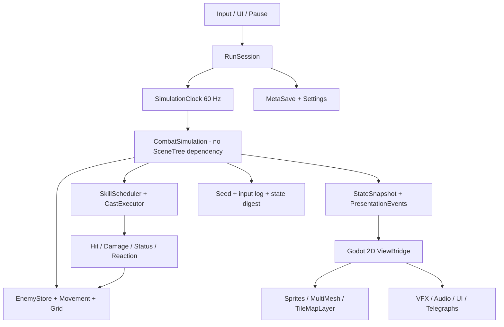

[Индекс](../../INDEX.md) · [Исходник v6](../../archive/architecture-v6-original.md) · [Манифест](../../MANIFEST.json)

> Исторический контекст, не отдельное новое решение. См. актуальные ADR и v7.

<a id="s04"></a>
## 04. Runtime-система и явная модель времени

### Правильный разрез приложения



**Предлагаемая ownership-модель:** `RunSession` владеет текущим `CombatSimulation`; внутри него `EntityStore`, `SkillStore`, `StatusStore`, `RngStreams`, `EventQueue`. `ViewBridge` только читает согласованный snapshot и события презентации. Запрещены прямые вызовы `EnemySprite.take_damage()`, `Particle2D.apply_poison()` и другая зависимость simulation от сцен.

**Clock:** один фиксированный основной timestep 60 Hz для движения героя, логики кастов и попаданий; отдельная частота пересчёта решений AI (`next_ai_tick`, например каждые 3–6 тиков), периодических эффектов и директора волн. Не плодить разные `Timer` для 1000 объектов. Реальная длительность тиковой очереди не должна зависеть от частоты рендеринга.

**Freeze:** при выборе улучшения `RunSession` переводится в состояние `UPGRADE_PAUSED`: combat-tick останавливается, не вызывается `randomize()`, UI и animations меню продолжают работать. Не менять произвольно `Engine.time_scale`, поскольку это затрагивает таймеры/частицы и создаёт нежелательные зависимости; hit-stop на важных ударах делается отдельной presentation-политикой либо строго согласованным замедлением.

**Phase list** (это договор команды, а не claim о Soulstone):

```text
0 Read input (stored with integer tick)
1 Apply prior queue of spawn/despawn and upgrade selection
2 Hero movement + enemy movement; rebuild/advance spatial grid
3 Skill readiness + target selection + windup/commit
4 Spawn/step logical projectiles, persistent areas and orbit hit shapes
5 Gather hit candidates, deduplicate and resolve damage
6 Apply/refresh statuses and schedule due ticks
7 Process due status ticks + authorized reactions in stable order
8 Resolve death, XP, drops, level-up requests
9 Commit state: snapshots, replay digest, presentation events
```

**Не смешивать 0/1 с Godot input callbacks:** callbacks только формируют команду `InputCommand`, привязанную к `tick` и порядковому номеру. Это единственный путь влияния кнопок и UI на симуляцию.

**Интерполяция:** Godot поддерживает physics interpolation, включая 2D, но packed-array enemies со своим renderer могут потребовать ручного `previous/current position` + alpha interpolation. Отдельно проверять телепортацию/respawn: без сброса interpolation появляются streak artifacts. GPU particles не обязаны интерполироваться тем же способом. [R06](https://docs.godotengine.org/en/4.7/tutorials/physics/interpolation/2d_and_3d_physics_interpolation.html)

**Контракт snapshot:** `SimulationFrame{tick,run_id,player_state,enemy_visuals[],projectile_visuals[],presentation_events[]}`; список объектов может быть только интересующей камеру подвыборкой. `Snapshot` не содержит ссылок на `Node`; rendering не меняет simulation state.
