[Индекс](../../INDEX.md) · [Исходник v6](../../archive/architecture-v6-original.md) · [Манифест](../../MANIFEST.json)

> Исторический контекст, не отдельное новое решение. См. актуальные ADR и v7.

<a id="s06"></a>
## 06. Auto-cast scheduler: полный контракт

**Используем две сущности:** `SkillDef` (immutable) и `SkillRuntime` (owner, rank, next_ready_tick, current_phase, cast_sequence, modifier-cache-key). На раннем этапе достаточно 4–8 умений игрока, но враги/суммоны также могут выполнять свои skills. Единый scheduler обслуживает собственные таймеры всех владельцев.

### Состояния каста

```mermaid
stateDiagram-v2
  [*] --> Ready
  Ready --> Acquiring: next_ready_tick <= tick
  Acquiring --> Windup: valid target & action allowed
  Acquiring --> Ready: no target; retry policy
  Windup --> Commit: windup elapsed
  Windup --> Cancelled: interrupted/owner dead
  Commit --> Echoes: primary cast succeeded
  Echoes --> Recovery: multicast complete
  Recovery --> Ready: cooldown elapsed
  Cancelled --> Recovery: cancel policy
```



**Нужны отдельные правила**, которые в v3 оставались подразумеваемыми:

- `No target`: не тратить cooldown до успешного commit (или строго заданная политика для field skills); повторная попытка через `retry_ticks`, но не каждый тик тысячами существ.
- `Target lost in windup`: `REACQUIRE | FIRE_AT_LAST_KNOWN | CANCEL`; не оставлять `target_id` без проверки `generation`.
- `Interrupted/Owner died`: отменить ещё не закоммиченный skill; выпущенные projectile/DoT могут продолжаться по `on_owner_death` policy.
- `Pause`: `ready_tick` не продвигается; `cast_sequence` не изменяется.
- `Cooldown changed by upgrade`: `NEXT_CAST_ONLY` для M0; альтернативы только по ADR. Нельзя пересчитывать прошедшую часть таймера без явной логики.
- `Cast animation`: презентация не блокирует игровую логику, кроме explicitly authored windup.
- `Multicast`: это *дополнительные Cast events* с собственными флагами источника; `allow_echo_multicast=false` для M0, предотвращая экспоненциальный рост.

### Набросок API без привязки к Godot Node

```gdscript
# Interface sketch, не утверждение о прошедшей компиляции.
class_name SkillScheduler
extends RefCounted

func advance(tick: int, skill_store: SkillStore, state: CombatState, out_events: Array[CombatEvent]) -> void:
    # 1. only due skill runtimes
    # 2. validate owner handle generation
    # 3. target policy with stable tie-break
    # 4. commit cast and optional echoes
    # 5. set next_ready_tick; no scene-tree callbacks
    pass
```

**Cooldown:** для прототипа `effective_ticks = max(min_ticks, ceil(base_ticks / (1 + haste)))`, `haste≥0`. При слишком высоком haste cooldown остаётся положительным; минимум является *балансным параметром конкретного skill*, а не искусственным скрытым ограничением. Проверить infinity/NaN и отрицательные значения при расчёте modifiers.

**Multicast:** модель v3 с `p_i = p0 · decay^(i−1)` остаётся **нашим предположением**, не восстановленной формулой Soulstone. Важно определить `max_echoes`, время между echo, snapshot stat policy, `proc_source_kind`, приоритет цели и суммарную стоимость каждого каста в goldens. Для CI строить распределение количества echo на `10^5` фиксированных seeded trials и проверять expected count `1 + Σp_i` в заданном допуске. Нельзя делать распределение зависимым от VFX RNG.
