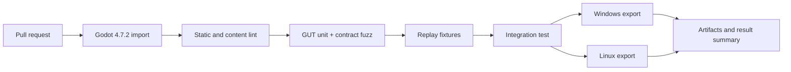

[Индекс](../../INDEX.md) · [Исходник v6](../../archive/architecture-v6-original.md) · [Манифест](../../MANIFEST.json)

> Исторический контекст, не отдельное новое решение. См. актуальные ADR и v7.

<a id="s25"></a>
## 25. Тесты, GitHub Actions, CI и реальные метрики

**CI-first:** разработка не должна зависеть от включённого компьютера пользователя. Для Windows-2022 и Linux GitHub-hosted runners нужен воспроизводимый script, pin engine и export templates, рабочее окружение с дисплеем только для задач, которым оно действительно требуется. Слепо использовать `--headless` для оценки кадров 2D render нельзя: headless path не доказывает GPU performance. [R05](https://docs.godotengine.org/en/stable/tutorials/editor/command_line_tutorial.html)

### 25.1. Обязательные test layers

| Gate | Примеры | Ошибка, которую предотвращает |
|---|---|---|
| Static parse | Godot `--headless --editor --import`, import UID audit | broken scene, missing class, syntactic mismatch |
| Unit GUT | status stack policy, damage math, auto-cast phase, target handles | логические регрессии |
| Deterministic replay | digest at ticks 500/1000/2500, same build/content | nondeterministic iteration/order/RNG |
| Contract fuzz | random modifiers/procs, termination, finite damage, cap invariants | взрывы events, NaN и loops |
| Content admission | manifest refs, atlas frame dims, projectile hit policies | invalid skill/editor assets |
| Godot integration | actual `PackedScene` -> spawn -> skill -> kill/XP -> upgrade | отдельные подсистемы не соединяются |
| Visual snapshots | committed screenshots от выбранного reference environment | тайлы/anchors/telegraphs теряют читаемость |
| CPU perf (self-hosted optional later) | fixture p95, event counts | деградация sim |
| GPU perf (manual target machine) | exported build on NVIDIA GPU 12GB | overdraw и rendering regression |
| Export smoke | Windows and Linux packaged build launches, asset lookups | editor passes but shipped build fails |

**Честная граница:** GitHub-hosted виртуальные машины не эквивалентны видеокарте пользователя, поэтому на них нельзя подтвердить производительность GPU 12 GB VRAM. Графическую приёмку можно выполнять позже на целевом ПК и записывать в `bench/results/`, а основной PR CI остаётся полностью cloud-hosted.

### 25.2. Условная реализация команд

```bash
# 1. clean import (после подготовки Godot binary и зависимостей)
godot --headless --editor --path game --import
# 2. GUT 9.7.1: проверить для закреплённой ветки точный CLI syntax
godot --headless --path game -s res://addons/gut/gut_cmdln.gd -gdir=res://tests/unit -gexit
# 3. validation and CLI-specific integration tests
godot --headless --path game --script res://tests/integration/run_suite.gd
# 4. controlled package export (если templates доступны)
godot --headless --path game --export-release "Windows Desktop" out/game.exe
```

Команды представлены как **план пайплайна**, а не как проверенный скрипт этого проекта. У GUT есть свой набор CLI option flags; после установки версии pin обязателен один smoke с намеренно падающим тестом, чтобы подтвердить, что CI действительно видит non-zero exit. [R35](https://gut.readthedocs.io/en/latest/Command-Line.html)

### 25.3. Матрица CI jobs



Параллелить independent export jobs **после** валидного import/test; исключения допускаются при отдельном cache key и неизменной исходной версии. В GitHub Actions ограничивать scope `permissions` для PR, cache делать по engine/plugin/dependency hashes, а большие тестовые generated assets не коммитить в базовый CI. Ограничение общего времени CI согласовать с пользователем после первых прогонов.

### 25.4. Acceptance checklist для каждого кода от агента

- **MUST:** версионированные входы/выходы, не нарушены core invariants, тесты реально запускались, в PR указаны commit hash и CI run;
- **MUST:** прежние тесты не отключены/не ослаблены, новые features имеют хотя бы один отрицательный и один положительный test;
- **MUST:** добавленный skill/status проходит content validator и replay fixture;
- **MUST:** описаны CPU/event-cost последствия; если модификатор вызывает 20x больше events, тестирует worst case;
- **MUST:** нет runtime зависимости от editor MCP или AI image service;
- **MAY:** обновление screenshot baseline только после человеческой приёмки.
