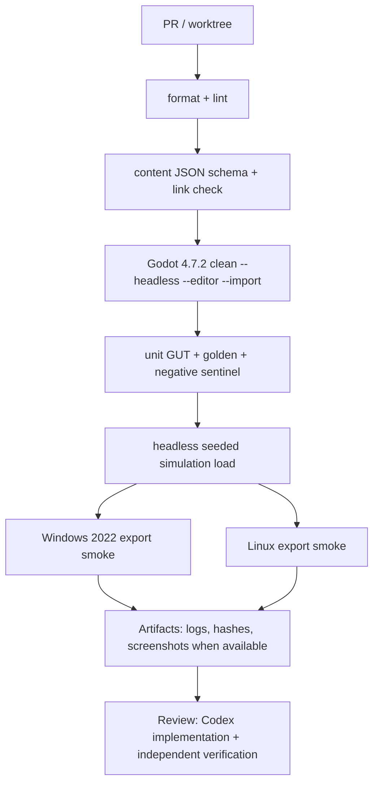

[Индекс](../../INDEX.md) · [Исходник v6](../../archive/architecture-v6-original.md) · [Манифест](../../MANIFEST.json)

> Исторический контекст, не отдельное новое решение. См. актуальные ADR и v7.

## Дополнение M. CI, сохранения, диагностика и GitHub-hosted workflow

### 32M.1. PR pipeline

Гейты следует запускать на GitHub-hosted Windows-2022 и Linux, не требуя включённого локального компьютера пользователя. Для графических screenshot tests можно применять виртуальный дисплей, но **не** заявлять реальные GPU timings без аппаратного стенда. При отсутствии экспортного шаблона job должен падать с понятным сообщением, а не условно ставить галочку `skipped` как `success`. Если используются Actions для скачивания Godot, pin engine artifact checksum, чтобы запуск после изменения релиза оставался воспроизводимым.

### 32M.2. Save и сессия

`ProfileSave` и `RunSuspendSave` — разные типы данных. M0 требует профиль/настройки и по возможности фиксированный seed-based run recreation; M1 — полноценную приостановку. `RunSuspendSave` сохраняет `tick`, `RngStreams`, `player state`, stores, pending status queue, projectiles, director state, global run modifiers, selected upgrades, `content_hash` — **не** только список врагов и HP. Снимок допускается лишь после `commit phase`, чтобы не сохранить половину атаки. Сериализация `NodePath`/SceneTree-графа запрещена для combat state. `user://` и `ConfigFile` годятся для профиля/настроек. [R16](https://docs.godotengine.org/en/4.7/tutorials/io/saving_games.html)

На каждую миграцию формата — `fixture_N.json` и тест `N→N+1`. Отдельно проверить `power loss during write`, corrupted JSON, unknown content ID, missing old DLC-like content, full disk, user edit, восстановление backup. Размер/формат снимка и частота автоматического сохранения оцениваются после реального 20-минутного забега, не по догадке.

### 32M.3. Crash repro bundle

`run_id`, `git_build`, `Godot_version`, `content_hash`, `seed`, последние `N` input events, `state_digest` каждые 60 тиков, `last_100_combat_trace_events`, frame/CPU metrics (если есть), последняя ошибка. Повторяющийся trace sampling отключается для production или ограничивается размером. Если пользователь присылает bug report без воспроизводимой трассы, агент может повторить тест по seed/командам и сравнить первое расхождение, вместо того чтобы гадать по скриншоту.
