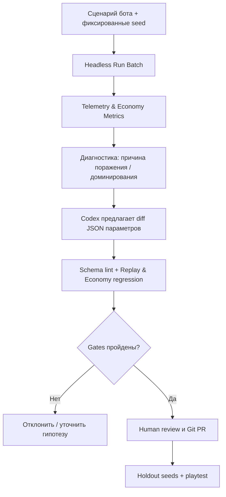

[Индекс](../../INDEX.md) · [Исходник v6](../../archive/architecture-v6-original.md) · [Манифест](../../MANIFEST.json)

> **Правила частично переопределены:** [v7 — поздняя прогрессия](../v7/late-game-progression.md) и [ADR-003](../../decisions/ADR-003-late-game.md).

## X. Набор ботов для автономного тестирования уровней, сложности, экономики и переводов

### X.1. Два слоя исполнения, один боевой код

`PlayerCommand` — `movement:Vector2`, `dodge_pressed:bool`, `selected_upgrade_id:StringName`, `breakthrough_requested:bool`; без поля `cast` для обычных автоатак (ими занимается scheduler). `BotPolicy.observe(snapshot)` получает ограниченную проекцию состояния, `BotPolicy.decide()` возвращает команду. Человек использует тот же интерфейс через `PlayerInputAdapter`.

- **Headless `SimulationRunner`**: `RunFactory → CombatWorld → MetaProgressionService` без узлов рендеринга; тысячи прогонов, бенчмарки экономических кривых. Важное требование: **не** отдельная упрощённая модель урона; используется то же ядро.
- **Godot integration runner**: запускает настоящие сцены, экраны и контроллер; выявляет ошибки связки UI/loadout/levels/results; в CI без GPU не делает заявления о FPS.
- **Visual QA runner**: скриншоты всех языков, классов, режимов, ряда VFX и телеграфов; real GPU измерения отдельно в локальном профиле (12 ГБ VRAM — объём, модель NVIDIA ещё не указана).

### X.2. Поведенческие политики — утверждённый набор

| Бот | Решение | Зачем |
|---|---|---|
| `idle` | без движения и выбора сильных билдов | проверить baseline survival/автоатаки |
| `random` | фиксированный RNG, случайное движение/драфт | найти редкие ошибки состояний |
| `beginner` | собирает ближайший XP, избегает только явных угроз | доступность низкого порога |
| `survival` | избегает угроз, выбирает защиту | проверить defensive builds |
| `aggressive` | входит в зоны риска ради большего DPS | сравнить risk/reward |
| `synergy` | максимизирует прогноз эффекта-комбинации | найти OP-связки и proc explosion |
| `class_master` | политика под класс | проверить классовую идентичность |
| `adversarial` | пытается сломать границы состояний | инварианты, эксплойты, softlocks |
| `progression` | делает десятки последовательных runs и покупки | метапрогрессия и экономика |
| `stress` | допустимые экстремальные нагрузки | CPU/runtime/perf |
| `farmer` | намеренно заканчивает ранние забеги, выбирает простые режимы | anti-farm reward checks |
| `challenge` | переигрывает high-tier maps & mutators | достижимость hard/tribulation |
| `localization_ui` | обходит экранные состояния на `ru/en/zz` | строки/ошибки верстки/доступность UI |
| `migration` | загружает профили всех версий | конфликт/утрата валюты/открытий |

**Не создавать все 14 как независимые сложные AI-системы в M0.** Первые 4 политики + `progression` с M1; остальные наследуют небольшой набор общих movement/choice behaviors. Нейросетевая RL/Gymnasium интеграция не нужна до появления устойчивого baseline и задачи, где эвристики явно не справляются. Изученные готовые библиотеки/агенты — кандидаты для smoke evaluation, не зависимость по умолчанию.

### X.3. Исследовательский протокол (защита от cherry-picking)

Каждая экспериментальная ячейка имеет `suite_id`, `scenario_id`, `policy_id`, `policy_version`, `git_commit`, `content_hash`, `rules_hash`, `seed`, `profile_snapshot`, `class_id`, `difficulty_id`, `mutators`, `locale`. **Парные seed** — для сравнения двух экономик или двух баланс-патчей; **не** подбирать индивидуально выигрышный seed для каждой политики. Отдельный holdout-набор seed не использовать для подгонки чисел.

**Ключевые метрики:** `win_rate`, `time_to_death`, `time_to_first_skill`, `first_boss_reached`, `damage_taken_by_source`, `dps_by_skill/status`, `spawn_event_rate`, `active_status_count`, `p95_sim_ms`, `queue_high_water_mark`, `stones_per_real_min`, `mastery_xp_per_run`, `talent_distribution`, `respec_frequency`, `mode_pick_rate`, `difficulty_clear_rate`, `early-exit-profit`, `dominance_index` и `profile_migration_errors`. Для локализации отдельно `missing_translation_keys`, `placeholder_mismatch`, `font_coverage`, `cropped_labels`, `rtl_issues` (когда появится язык RTL).

### X.4. Матрица проверок без комбинаторного взрыва

Полный декартов продукт `4 класса × 5 сложностей × 7 режимов × 3 стадии метапрофиля × 14 ботов × 100 seed` очень дорог. Используем три последовательные ступени:

1. **PR smoke (5–30 сценариев, быстрые)**: критические golden tests, 1–2 класса, standard/easy/hard, no-meta/full-meta, normal/hurry, fixed seed, settlement, сохранения, первые локали.
2. **Ночной batch (сотни симуляций)**: все реализованные классы и unlocked difficulty, большинство режимов, progression/farmer/challenge/stress, seeded replay, статистика. Ночные задания планируются отдельно, когда будет настоящая CI-потребность.
3. **Перед выпуском контента (тысячи симуляций)**: профильные крайние случаи, pairwise combinations + запрограммированные тройки риска (`endless+hard+synergy`, `hurry+thunder+status proc`, `training+reward`, `ascetic+class_master+boss`) и holdout seed.

Для покрытия взаимодействий использовать **pairwise/covering-array** только в сочетании с обязательными высокорисковыми комбинациями. Покрытие пар не заменяет семантических тестов мультикаста, цепочек DoT или сериализации. Не заявлять численные p95 до реальных CI runs.

### X.5. Автоматическая оценка готовности не равна «бот говорит fun=0.9»

Матрица release readiness:

- `Correctness`: все инварианты CombatEngine/Save/Reward/Mode композиции и negative tests зелёные;
- `Coverage`: нет забытой комбинации класс + difficulty + режим из утверждённой support matrix;
- `Economy`: нет удвоения наград, грубого фарма раннего выхода и незавершимых talent trees;
- `Balance`: нет очевидно доминирующего класса/таланта на всех стадиях; диапазоны win-rate и экономики — статистические гипотезы;
- `Performance`: профилированные пределы CPU/GPU проверены на целевом стенде, CI проверяет только headless sim;
- `UX/i18n`: translated screens и preview под контролем; broken glyph/перекрытия — блокер релиза соответствующей локали;
- `Human`: реальный игрок должен подтвердить интерес, ощущение силы и читаемость боевых атак. Боты не доказывают субъективную увлекательность.

### X.6. Автоматическая правка сложности агентами: да, но с обратимой историей

Рекомендуемая петля:

**Не разрешать автономному оптимизатору «облегчать игру, пока все боты не выиграют».** В противном случае он откалибрует режимы под слабую политику или читерскую стратегию. Агенту запрещено менять значения и критерии тестов одним PR без указания причины и независимого review.
